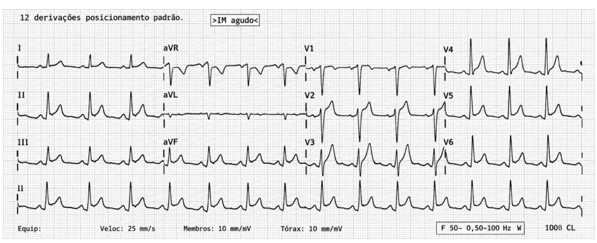
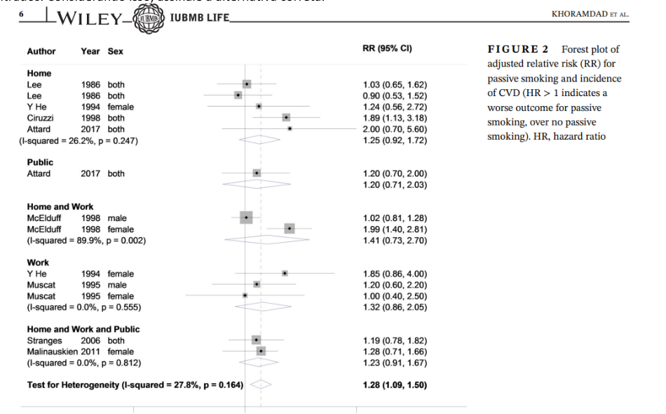

# Santa Casa/UFCSPA 2027 — Acesso Direto

**Questões comentadas e flashcards — resolução própria (Claude), RASCUNHO**

Material formativo oculto ao estudante. Gabarito preliminar de 04/11/2026; o definitivo ainda não foi publicado. Resolução não cega (as letras do gabarito já eram conhecidas). Ver `AUDITORIA.md`.

# Bloco 1 — Cirurgia geral (Q01–Q20)

## Questão 01 — Oncologia da tireoide

**Gabarito preliminar:** A · **Resposta da resolução:** A · **Confiança:** alta · **Status:** draft

**Justificativa:** Só a afirmativa I é verdadeira. O aumento da incidência do câncer de tireoide nas últimas décadas se deve sobretudo à detecção de microcarcinomas papilíferos por ultrassonografia e PAAF, com mortalidade específica estável. É o fenômeno do sobrediagnóstico. O carcinoma papilífero dissemina-se preferencialmente por via linfática, para linfonodos dos compartimentos central e lateral; a via hematogênica é típica do folicular. No carcinoma medular, que deriva das células C parafoliculares, os marcadores de seguimento são calcitonina e CEA. A tireoglobulina é marcador dos carcinomas de origem folicular (papilífero e folicular) após tireoidectomia total.
- A: Correta. I é verdadeira; II e III são falsas.
- B: Incorreta. II troca a via linfática pela hematogênica.
- C: Incorreta. II e III são falsas.
- D: Incorreta. II e III são falsas.
**Flashcard:** Quais são os marcadores séricos de seguimento do carcinoma medular de tireoide? :: Calcitonina e CEA. A tireoglobulina serve aos carcinomas de origem folicular.
**Ressalva:** —

## Questão 02 — Risco pulmonar perioperatório

**Gabarito preliminar:** B · **Resposta da resolução:** B · **Confiança:** alta · **Status:** draft

**Justificativa:** Em cirurgia não torácica, os principais preditores de complicação pulmonar pós-operatória são o sítio cirúrgico (abdome superior, aorta, tórax), a duração da cirurgia, a anestesia geral, a idade acima de 60 anos, a DPOC, a ASA ≥ II e a dependência funcional. Gastrectomia é cirurgia de abdome superior: a disfunção diafragmática e a dor reduzem CRF e CV, o que favorece atelectasia e pneumonia. A capacidade de subir dois lances de escada (≥ 4 METs) indica reserva funcional razoável.
- A: Incorreta. Espirometria pré-operatória rotineira não é recomendada só pelo tabagismo. Fica reservada a dispneia inexplicada ou à suspeita de DPOC não otimizada.
- B: Correta. O sítio cirúrgico é um dos preditores mais fortes.
- C: Incorreta. Não há ponto de corte de VEF1 que proíba cirurgia extratorácica. Valores de VEF1 importam na ressecção pulmonar.
- D: Incorreta. A TC de tórax não é ferramenta de estratificação de risco; a avaliação clínica e funcional (ARISCAT, METs) supera exames de imagem.
**Flashcard:** Qual fator ligado ao procedimento mais aumenta o risco de complicação pulmonar pós-operatória em cirurgia não torácica? :: O sítio cirúrgico: abdome superior, aorta e tórax. Quanto mais próximo do diafragma, maior o risco.
**Ressalva:** —

## Questão 03 — Úlcera duodenal perfurada

**Gabarito preliminar:** C · **Resposta da resolução:** C · **Confiança:** alta · **Status:** draft_com_nota

**Justificativa:** Na perfuração pequena (< 2 cm) de úlcera duodenal em paciente estável, o tratamento padrão é a rafia primária com epiploplastia (patch de Graham ou rafia com omentopexia), por via laparoscópica ou aberta, seguida de erradicação do *H. pylori*, IBP e suspensão do AINE. Ressecções gástricas e duodenais não têm lugar em perfuração pequena sem obstrução, sangramento ou suspeita de neoplasia.
- A: Incorreta. Gastrectomia distal é excessiva para perfuração pequena sem complicação associada.
- B: Incorreta. Úlcera duodenal raramente é maligna, e a TC não sugere neoplasia; a duodenopancreatectomia é desproporcional.
- C: Correta. Rafia com reforço omental.
- D: Incorreta. Ressecção das bordas com anastomose duodenojejunal não é técnica indicada.
**Flashcard:** Qual é o tratamento operatório de uma perfuração pequena de úlcera duodenal em paciente estável? :: Rafia primária com epiploplastia (patch de Graham), seguida de erradicação do *H. pylori*, IBP e suspensão do AINE.
**Ressalva:** A biópsia de bordas é obrigatória na úlcera gástrica perfurada, não na duodenal. Ela aparece na alternativa correta, mas não é exigência universal.

## Questão 04 — Abstinência precipitada por naloxona

**Gabarito preliminar:** D · **Resposta da resolução:** D · **Confiança:** alta · **Status:** draft

**Justificativa:** A naloxona é antagonista competitivo dos receptores opioides μ. Em paciente com dependência física, ela desloca o agonista e precipita a síndrome de abstinência em minutos: ansiedade, bocejos, lacrimejamento, rinorreia, piloereção, midríase, cólicas, vômitos e diarreia, com nível de consciência preservado. O quadro é desconfortável, mas raramente ameaça a vida. O manejo é sintomático; se houver nova depressão respiratória, titular a naloxona em doses baixas.
- A: Incorreta. A naloxona não causa "intoxicação" e o quadro não exige benzodiazepínico como prioridade.
- B: Incorreta. A síndrome serotoninérgica tem clônus, hiper-reflexia e hipertermia, e não há fármaco serotoninérgico no caso.
- C: Incorreta. A hipertermia maligna ocorre no intraoperatório com halogenados ou succinilcolina, com hipercapnia, rigidez e hipertermia progressiva. Não surge após naloxona.
- D: Correta.
**Flashcard:** Que síndrome surge minutos após a naloxona em usuário crônico de opioide? :: Abstinência opioide precipitada: midríase, bocejos, lacrimejamento, rinorreia, piloereção, cólicas, vômitos e diarreia, com consciência preservada.
**Ressalva:** —

## Questão 05 — Delirium pós-operatório

**Gabarito preliminar:** B · **Resposta da resolução:** B · **Confiança:** alta · **Status:** draft

**Justificativa:** O quadro tem início agudo, curso flutuante, desatenção (não consegue dizer os meses em ordem inversa) e alucinações visuais. Isso fecha delirium pelos critérios do CAM. Há múltiplos precipitantes: hipoxemia (SpO₂ 91%), retenção urinária (bexiga palpável), febre e fármacos deliriogênicos (difenidramina anticolinérgica, diazepam, tramadol), em idoso com comprometimento cognitivo prévio. O tratamento é identificar e corrigir as causas, com medidas não farmacológicas (reorientação, óculos e aparelhos auditivos, sono, mobilização). Antipsicótico fica reservado ao risco à segurança.
- A: Incorreta. Alucinações fazem parte do delirium e não indicam psicose primária. Antipsicótico não trata a causa.
- B: Correta.
- C: Incorreta. Corrigir a hipóxia é necessário, mas neuroimagem não é rotina sem déficit focal ou rebaixamento sem causa.
- D: Incorreta. Suspender fármacos isoladamente e "observar" ignora hipóxia, retenção urinária e possível infecção.
**Flashcard:** Quais são as quatro características do delirium no CAM? :: (1) Início agudo e curso flutuante e (2) desatenção, com (3) pensamento desorganizado ou (4) alteração do nível de consciência.
**Ressalva:** —

## Questão 06 — Diverticulite complicada (Hinchey Ib/II)

**Gabarito preliminar:** A · **Resposta da resolução:** A · **Confiança:** alta · **Status:** draft

**Justificativa:** Diverticulite com abscesso pericólico ou pélvico de 5,5 cm em paciente estável e sem peritonite difusa corresponde a Hinchey Ib/II. Abscessos acima de 3–4 cm devem ser drenados por via percutânea guiada por imagem, junto com antibioticoterapia. Cirurgia eletiva pode ser discutida depois.
- A: Correta.
- B: Incorreta. Cirurgia de urgência fica para peritonite generalizada (Hinchey III/IV), falha da drenagem ou instabilidade.
- C: Incorreta. Abscesso volumoso e febre exigem internação, antibiótico e drenagem.
- D: Incorreta. Colonoscopia na fase aguda é contraindicada pelo risco de perfuração. Faz-se 6–8 semanas depois, para excluir neoplasia.
**Flashcard:** Qual é a conduta na diverticulite com abscesso maior que 3–4 cm em paciente estável? :: Antibioticoterapia mais drenagem percutânea guiada por imagem.
**Ressalva:** —

## Questão 07 — Derrame parapneumônico complicado/empiema

**Gabarito preliminar:** D · **Resposta da resolução:** D · **Confiança:** alta · **Status:** draft_com_nota

**Justificativa:** Líquido turvo, pH < 7,2, glicose < 60 mg/dL e Gram positivo definem derrame parapneumônico complicado ou empiema. Há indicação de drenagem pleural fechada além do antibiótico. Se houver loculação e falha da drenagem, considerar fibrinolítico intrapleural (alteplase com dornase) ou VATS.
- A: Incorreta. Antibiótico isolado é insuficiente.
- B: Incorreta. Toracocentese única não resolve coleção loculada e infectada.
- C: Incorreta. Pleurodese é para derrame recorrente, sobretudo neoplásico, e não para empiema.
- D: Correta.
**Flashcard:** Que critérios do líquido pleural indicam drenagem no derrame parapneumônico? :: pH < 7,2, glicose < 60 mg/dL, Gram ou cultura positivos, pus franco ou loculação.
**Ressalva:** O fato de o derrame ser loculado sugere que a drenagem isolada pode falhar; o seguimento deve prever fibrinolítico ou VATS.

## Questão 08 — Pneumotórax hipertensivo iatrogênico

**Gabarito preliminar:** B · **Resposta da resolução:** B · **Confiança:** alta · **Status:** draft

**Justificativa:** Após punção de subclávia, o paciente tem dispneia súbita, hipoxemia, hipotensão, turgência jugular e murmúrio abolido do mesmo lado. É pneumotórax hipertensivo, um diagnóstico clínico. A conduta é descompressão imediata (agulha no 4º–5º EIC na linha axilar média, ou toracostomia digital) seguida de drenagem em selo d'água, sem esperar imagem.
- A: Incorreta. Esperar radiografia atrasa uma conduta salvadora.
- B: Correta.
- C: Incorreta. Ventilação com pressão positiva agrava o pneumotórax hipertensivo e pode precipitar PCR.
- D: Incorreta. TC em paciente instável é contraindicada.
**Flashcard:** O pneumotórax hipertensivo exige imagem antes da descompressão? :: Não. O diagnóstico é clínico e a descompressão é imediata.
**Ressalva:** —

## Questão 09 — Massa cervical cística no adulto

**Gabarito preliminar:** C · **Resposta da resolução:** C · **Confiança:** alta · **Status:** draft

**Justificativa:** Massa cervical lateral persistente em adulto acima de 40 anos deve ser considerada neoplasia até prova em contrário. Linfonodo cístico no nível II é apresentação clássica de metástase de carcinoma espinocelular de orofaringe HPV-positivo (amígdala, base de língua), muitas vezes com primário oculto. A investigação inclui imagem contrastada (TC ou RM), PAAF guiada por US (com p16/HPV) e exame endoscópico do trato aerodigestivo superior.
- A: Incorreta. Sem sinais infecciosos, o antibiótico empírico só atrasa o diagnóstico.
- B: Incorreta. Biópsia excisional como primeiro passo pode violar planos e comprometer o tratamento oncológico. É feita após PAAF inconclusiva.
- C: Correta.
- D: Incorreta. Cisto branquial é diagnóstico de exclusão nessa faixa etária.
**Flashcard:** Em adulto acima de 40 anos com linfonodo cervical cístico, que diagnóstico deve ser excluído primeiro? :: Metástase de carcinoma espinocelular de orofaringe, frequentemente HPV-positivo.
**Ressalva:** —

## Questão 10 — Colangite aguda grave

**Gabarito preliminar:** C · **Resposta da resolução:** C · **Confiança:** alta · **Status:** draft

**Justificativa:** Febre, icterícia e dor em hipocôndrio direito (tríade de Charcot), somadas a confusão e hipotensão, formam a pêntade de Reynolds. Com disfunção neurológica e cardiovascular, é colangite grau III (grave) pelos critérios de Tóquio. A conduta é ressuscitação, hemoculturas, antibiótico IV e drenagem biliar urgente, preferencialmente por CPRE com papilotomia e extração do cálculo ou prótese.
- A: Incorreta. O quadro é de obstrução da via biliar principal, não de colecistite.
- B: Incorreta. Com a ultrassonografia mostrando dilatação e cálculo no colédoco em paciente chocado, não se deve atrasar a descompressão por colangiorressonância.
- C: Correta.
- D: Incorreta. Diagnóstico e drenagem estão errados.
**Flashcard:** Qual é a conduta na colangite aguda grave (Tóquio III)? :: Ressuscitação, culturas, antibiótico IV e drenagem biliar urgente, preferencialmente por CPRE.
**Ressalva:** —

## Questão 11 — Pseudocisto pancreático

**Gabarito preliminar:** D · **Resposta da resolução:** D · **Confiança:** moderada-alta · **Status:** draft_com_nota

**Justificativa:** Coleção líquida homogênea, sem septos, debris ou gás, cerca de quatro semanas após pancreatite aguda, corresponde a pseudocisto pela classificação de Atlanta revisada (≥ 4 semanas, com parede definida). A maioria regride. Drenagem, preferencialmente endoscópica transmural, é indicada se houver sintomas persistentes (dor, saciedade precoce, obstrução), crescimento, infecção ou complicação.
- A: Incorreta. Necrose produz coleção heterogênea; a necrose encapsulada (WON) também pode exigir intervenção.
- B: Incorreta. Abscesso pancreático é termo abandonado e não há gás nem sinais sistêmicos de infecção. A abordagem atual é escalonada, sem cirurgia imediata.
- C: Incorreta. O tratamento não é "sempre cirúrgico". O tamanho isolado não indica drenagem.
- D: Correta.
**Flashcard:** Qual é a diferença temporal entre coleção líquida peripancreática aguda e pseudocisto (Atlanta revisada)? :: Abaixo de 4 semanas é coleção aguda. A partir de 4 semanas, com parede definida e conteúdo sem necrose, é pseudocisto.
**Ressalva:** O enunciado não descreve parede encapsulante; a classificação definitiva exige confirmá-la.

## Questão 12 — AMPLE

**Gabarito preliminar:** A · **Resposta da resolução:** A · **Confiança:** alta · **Status:** draft

**Justificativa:** No ATLS, AMPLE significa **A**lergias, **M**edicamentos em uso, **P**assado médico/gestação (*Past illnesses/Pregnancy*), **L**íquidos e última refeição (*Last meal*) e **E**ventos/ambiente relacionados ao trauma (*Events/Environment*).
- A: Correta.
- B: Incorreta. M é medicamentos.
- C: Incorreta. P é passado médico/gestação.
- D: Incorreta. E é eventos/ambiente.
**Flashcard:** Sem flashcard: item de memorização pura do mnemônico. Reaplicar a questão.
**Ressalva:** —

## Questão 13 — Acalásia

**Gabarito preliminar:** C · **Resposta da resolução:** C · **Confiança:** moderada · **Status:** draft_com_nota

**Justificativa:** Disfagia progressiva para sólidos e líquidos, regurgitação, dor retroesternal, esôfago dilatado sem lesão mucosa, aperistalse e hipertonia do EEI apontam para acalásia, que é a melhor hipótese entre as alternativas. Os tratamentos de primeira linha nos tipos I e II são a miotomia de Heller laparoscópica com fundoplicatura parcial (Dor ou Toupet), a POEM e a dilatação pneumática. A fundoplicatura acompanha a Heller; a POEM convencional não inclui fundoplicatura e tem maior incidência de refluxo.
- A: Incorreta. A EDA não mostra lesão; esofagectomia "imediata" sem diagnóstico é inaceitável.
- B: Incorreta. Esclerose sistêmica causa aperistalse com hipotonia do EEI e refluxo grave, o contrário do caso.
- C: Correta, com ressalvas.
- D: Incorreta. Esofagite eosinofílica tem anéis e sulcos na EDA, eosinofilia ≥ 15/campo na biópsia e não produz aperistalse com hipertonia.
**Flashcard:** O que define acalásia na manometria de alta resolução? :: Relaxamento inadequado da JEG (IRP elevado) com aperistalse. A classificação de Chicago separa os tipos I, II e III pelo padrão de pressurização ou espasmo.
**Ressalva:** Hipertonia do EEI isolada não é o critério diagnóstico (o critério é IRP elevado), e o subtipo não é definível com os dados fornecidos. Perda de 5 kg aos 55 anos e a "brida" obrigam a excluir pseudoacalásia (neoplasia da cárdia) antes da miotomia. A alternativa é a melhor, mas a vinheta é imprecisa.

## Questão 14 — Drenos de sucção fechada

**Gabarito preliminar:** A · **Resposta da resolução:** A · **Confiança:** alta · **Status:** draft

**Justificativa:** Drenos fechados de sucção (Jackson-Pratt, Blake, Portovac) evacuam espaço morto e previnem seroma e hematoma sob grandes retalhos: mastectomia, abdominoplastia, esvaziamentos linfonodais.
- A: Correta.
- B: Incorreta. Esses drenos não são próteses biliares.
- C: Incorreta. Metanálises não mostram benefício da drenagem peritoneal profilática rotineira após anastomose colônica, nem prevenção de deiscência.
- D: Incorreta. O manejo de fístula de alto débito exige antes controlar a sepse (SOWATS); dreno não é tratamento curativo.
**Flashcard:** Qual é a indicação clássica de dreno de sucção fechada? :: Evacuar espaço morto e prevenir seroma ou hematoma sob grandes retalhos, como em mastectomia e abdominoplastia.
**Ressalva:** —

## Questão 15 — Hérnia incisional

**Gabarito preliminar:** B · **Resposta da resolução:** B · **Confiança:** alta · **Status:** draft

**Justificativa:** A infecção do sítio cirúrgico é o principal fator de risco isolado para hérnia incisional. Ela prolonga a fase inflamatória, prejudica a deposição e a maturação do colágeno e enfraquece a cicatriz aponeurótica, aumentando o risco em cerca de 2 a 4 vezes. Outros fatores são obesidade, tabagismo, diabetes, desnutrição, corticoide, aneurisma de aorta e técnica de fechamento inadequada.
- A: Incorreta. As incisões medianas, e não as transversas, têm maior risco de hérnia.
- B: Correta.
- C: Incorreta. Sutura contínua com fio de absorção lenta e relação fio/ferida ≥ 4:1 (técnica de *small bites*) é o padrão. Categute está em desuso.
- D: Incorreta. Repouso no leito não é fator causal estabelecido.
**Flashcard:** Qual é o principal fator de risco para hérnia incisional após laparotomia? :: Infecção do sítio cirúrgico.
**Ressalva:** —

## Questão 16 — Tumor de células gigantes

**Gabarito preliminar:** D · **Resposta da resolução:** D · **Confiança:** alta · **Status:** draft

**Justificativa:** Lesão lítica, excêntrica e epifisária que se estende ao osso subcondral, em adulto jovem (20–40 anos, com fise fechada), ao redor do joelho, é o tumor de células gigantes. É benigno, localmente agressivo, com recidiva de 20–50% após curetagem simples e metástases pulmonares "benignas" em 2–5% dos casos.
- A: Incorreta. Encondroma é metafisário/diafisário, central, com calcificações condroides, frequente na mão.
- B: Incorreta. Osteossarcoma é maligno, metafisário, com reação periosteal.
- C: Incorreta. Displasia fibrosa tem aspecto em "vidro fosco" e é diafisária/metafisária.
- D: Correta.
**Flashcard:** Que tumor ósseo é lítico, excêntrico, epifisário, ocorre em adulto jovem com fise fechada e pode dar metástase pulmonar "benigna"? :: Tumor de células gigantes.
**Ressalva:** —

## Questão 17 — Divertículo de Meckel

**Gabarito preliminar:** A · **Resposta da resolução:** A · **Confiança:** alta · **Status:** draft

**Justificativa:** O divertículo de Meckel é a anomalia congênita mais comum do trato gastrointestinal (cerca de 2% da população). O sangramento, volumoso e indolor, decorre da ulceração da mucosa ileal adjacente pelo ácido secretado por mucosa gástrica ectópica. A cintilografia com ⁹⁹ᵐTc-pertecnetato detecta essa mucosa gástrica.
- A: Correta.
- B: Incorreta. Má rotação causa volvo e isquemia, com vômitos biliosos, e não hematoquezia indolor recorrente.
- C: Incorreta. Hirschsprung causa constipação e enterocolite, sem captação no pertecnetato.
- D: Incorreta. Cisto de duplicação é raro, e sua captação, quando ocorre, também decorre de mucosa gástrica. Não é a anomalia mais prevalente.
**Flashcard:** Por que o divertículo de Meckel sangra e como é detectado? :: Mucosa gástrica ectópica secreta ácido e ulcera o íleo adjacente. É detectado por cintilografia com ⁹⁹ᵐTc-pertecnetato.
**Ressalva:** —

## Questão 18 — Câncer de reto e excisão mesorretal total

**Gabarito preliminar:** D · **Resposta da resolução:** D · **Confiança:** alta · **Status:** draft

**Justificativa:** A excisão total do mesorreto (Heald) remove o reto com seu envelope fascial íntegro (fáscia própria do reto), contendo linfonodos e depósitos tumorais. É a intervenção que mais reduziu a recidiva local, de 20–30% para menos de 10%.
- A: Incorreta. A amputação abdominoperineal é reservada a tumores muito baixos ou com invasão esfincteriana, não a "todos".
- B: Incorreta. A neoadjuvância reduz recidiva no reto médio/baixo localmente avançado, mas não dispensa cirurgia de rotina. *Watch-and-wait* exige resposta clínica completa e protocolo próprio.
- C: Incorreta. Excisão local preservando o mesorreto deixa os linfonodos e não é curativa para adenocarcinoma invasivo de reto médio, exceto T1 de baixo risco selecionado.
- D: Correta.
**Flashcard:** Qual princípio cirúrgico mais reduz a recidiva local no câncer de reto? :: A excisão total do mesorreto, com a fáscia própria do reto íntegra.
**Ressalva:** —

## Questão 19 — Trauma abdominal fechado e lesão intestinal

**Gabarito preliminar:** B · **Resposta da resolução:** B · **Confiança:** alta · **Status:** draft_com_nota

**Justificativa:** A fratura de Chance (por flexão-distração da coluna toracolombar, típica do cinto subabdominal) associa-se a lesão de víscera oca e de mesentério em até 30–50% dos casos. Esse é o padrão "sinal do cinto" com fratura de Chance.
- A: Incorreta. A TC tem sensibilidade limitada para lesão de delgado e de mesentério; achados como líquido livre sem lesão de órgão sólido devem levantar suspeita.
- B: Correta.
- C: Incorreta. A proporção não tem sustentação.
- D: Incorreta. Lesões mesentéricas podem causar sangramento volumoso e isquemia.
**Flashcard:** Que lesão abdominal deve ser pesquisada em paciente com fratura de Chance? :: Lesão de víscera oca (delgado) e de mesentério.
**Ressalva:** O caso clínico (paciente instável com FAST positivo) não se relaciona com a pergunta, que é conceitual.

## Questão 20 — Lesão elétrica

**Gabarito preliminar:** C · **Resposta da resolução:** C · **Confiança:** moderada · **Status:** draft_com_nota

**Justificativa:** A lesão elétrica é um "iceberg": a pele pode estar pouco lesada e haver necrose extensa de músculos, vasos e nervos ao longo do trajeto da corrente, com risco de rabdomiólise, lesão renal aguda e síndrome compartimental. Nos tratados de cirurgia, o músculo é descrito como o principal tecido pelo qual a corrente flui, por seu volume e baixa resistência, e o que sofre maior dano. A pele, de alta resistência, tende a ser relativamente poupada.
- A: Incorreta. A necrose visível subestima a lesão profunda.
- B: Incorreta. A corrente segue os tecidos de menor resistência (nervos, vasos, músculos), não os de maior.
- C: Correta, conforme a formulação dos tratados.
- D: Incorreta. A resistência da pele faz com que ela seja relativamente poupada, e não "bastante afetada".
**Flashcard:** Pequenas lesões cutâneas excluem dano profundo após choque elétrico? :: Não. Pode haver necrose muscular extensa, rabdomiólise e síndrome compartimental com pele pouco lesada.
**Ressalva:** C simplifica um fenômeno que depende de voltagem, tipo de corrente, trajeto e tempo de contato, e a pele seca pode sofrer queimadura importante no ponto de entrada. A resposta segue o texto clássico.

# Bloco 2 — Clínica médica (Q21–Q40)

## Questão 21 — Diagnóstico de diabetes (SBD 2025)

**Gabarito preliminar:** C · **Resposta da resolução:** C · **Confiança:** alta · **Status:** draft

**Justificativa:** O diagnóstico de DM em paciente assintomático exige dois resultados alterados, na mesma amostra ou em amostras diferentes. Aqui há glicemia de jejum de 132 mg/dL (≥ 126, faixa de DM) e HbA1c de 6,3% (5,7–6,4%, faixa de pré-diabetes). Os testes são discordantes, e repete-se o exame alterado (ou se faz outro). Até lá, o diagnóstico não está confirmado. A paciente tem alto risco (obesidade, HAS, DMG prévio, TG alto, HDL baixo) e deve receber mudança intensiva de estilo de vida já.
- A: Incorreta. O diagnóstico não está confirmado com um único valor alterado em paciente assintomática.
- B: Incorreta. A glicemia de 132 mg/dL não é compatível com pré-diabetes e exige confirmação breve, não em um ano.
- C: Correta.
- D: Incorreta. O ponto de corte do TOTG em 2 h é ≥ 200 mg/dL, não 195.
**Flashcard:** Quantos exames alterados são necessários para diagnosticar DM em paciente assintomático? :: Dois, na mesma amostra ou em amostras diferentes. Se forem discordantes, repete-se o exame alterado.
**Ressalva:** —

## Questão 22 — Estratificação de risco em dislipidemia (SBC 2025)

**Gabarito preliminar:** B · **Resposta da resolução:** B · **Confiança:** moderada-alta · **Status:** draft_com_nota

**Justificativa:** Na diretriz brasileira, a presença de aterosclerose subclínica documentada, como placa carotídea mesmo sem repercussão hemodinâmica, classifica o paciente em prevenção primária como de alto risco, independentemente dos escores. A meta é LDL-c < 70 mg/dL com estatina de alta intensidade. O LDL de 158 mg/dL está muito acima da meta.
- A: Incorreta. A placa reclassifica o paciente para alto risco.
- B: Correta.
- C: Incorreta. O nível de risco e a meta (< 115) não correspondem; essa meta é de baixo risco.
- D: Incorreta. Muito alto risco exige doença aterosclerótica clínica ou obstrução significativa (≥ 50%), e não placa < 20%.
**Flashcard:** Em prevenção primária, como a placa carotídea não obstrutiva altera a classificação de risco na diretriz brasileira? :: Reclassifica para alto risco: meta de LDL-c < 70 mg/dL com estatina de alta intensidade.
**Ressalva:** As metas numéricas e as categorias mudaram entre as diretrizes de 2017 e 2025. Ao adaptar, conferir o texto vigente.

## Questão 23 — Diagnóstico de hipertensão (SBC/SBH/SBN 2025)

**Gabarito preliminar:** D · **Resposta da resolução:** D · **Confiança:** alta · **Status:** draft

**Justificativa:** PA de consultório de 140–159/90–99 mmHg em paciente sem lesão de órgão-alvo, DCV ou DRC exige confirmação por medidas em consultas subsequentes e/ou MAPA ou MRPA, para excluir hipertensão do avental branco. O diagnóstico numa única consulta só é aceitável com PA ≥ 180/110 mmHg ou lesão de órgão-alvo evidente.
- A: Incorreta. O diagnóstico ainda não está confirmado.
- B: Incorreta. O diagnóstico ainda não está confirmado.
- C: Incorreta. Terapia combinada inicial é para estágios 2 e 3 ou alto risco, e o diagnóstico ainda não foi confirmado.
- D: Correta.
**Flashcard:** Quando a hipertensão pode ser diagnosticada numa única consulta? :: Com PA ≥ 180/110 mmHg ou lesão de órgão-alvo evidente. Nos demais casos, confirma-se com medidas repetidas, MAPA ou MRPA.
**Ressalva:** —

## Questão 24 — ITU recorrente — fatores comportamentais

**Gabarito preliminar:** C · **Resposta da resolução:** C · **Confiança:** alta · **Status:** draft

**Justificativa:** Em mulheres jovens, o fator de risco comportamental consistentemente comprovado para cistite recorrente é a frequência de relações sexuais. Outros fatores são o uso de espermicida ou diafragma, um novo parceiro e ITU antes dos 15 anos. Micção pós-coito, direção da higiene perineal, banho de imersão e roupas íntimas não demonstraram associação em estudos de caso-controle.
- A: Incorreta. Sem evidência.
- B: Incorreta. É recomendação popular, sem evidência de associação.
- C: Correta.
- D: Incorreta. Sem evidência.
**Flashcard:** Qual comportamento é fator de risco comprovado para cistite recorrente na mulher jovem? :: A frequência de relações sexuais, além do uso de espermicida.
**Ressalva:** —

## Questão 25 — Hipocalemia grave por abuso de laxantes

**Gabarito preliminar:** A · **Resposta da resolução:** A · **Confiança:** alta · **Status:** draft_com_nota

**Justificativa:** Hipocalemia crônica grave (K⁺ 2 mEq/L) reduz a expressão de aquaporina-2 e a resposta ao ADH no ducto coletor, causando diabetes insípido nefrogênico, com poliúria e polidipsia. O abuso de laxantes produz perda fecal de K⁺ e de bicarbonato, com acidose metabólica (CO₂ 18). Vômitos causariam alcalose.
- A: Correta.
- B: Incorreta. Uma queda de 3,5–4 para 2 mEq/L corresponde a déficit corporal de cerca de 300–600 mEq (aproximadamente 200–400 mEq por 1 mEq/L de queda abaixo de 3,5), muito acima de 100 mEq.
- C: Incorreta. Vômitos geram alcalose metabólica por perda de HCl. Acidose sugere diarreia, laxantes ou ATR.
- D: Incorreta. A glicemia de 85 mg/dL afasta diabetes.
**Flashcard:** Como a hipocalemia crônica causa poliúria? :: Por diabetes insípido nefrogênico: menos aquaporina-2 e resistência ao ADH no ducto coletor.
**Ressalva:** O K⁺ de 2 mEq/L exige ECG, reposição monitorizada e correção de magnésio. A questão não aborda isso.

## Questão 26 — Leptospirose — rim

**Gabarito preliminar:** D · **Resposta da resolução:** D · **Confiança:** alta · **Status:** draft

**Justificativa:** A lesão renal da leptospirose é uma nefrite intersticial aguda com disfunção tubular proximal. É caracteristicamente não oligúrica, com hipocalemia (por perda tubular de K⁺) e hiponatremia, mas pode ser oligúrica nas formas graves (síndrome de Weil). A diálise precoce reduz mortalidade, e a função renal costuma se recuperar nos sobreviventes.
- A: Incorreta. Omite III, que é verdadeira.
- B: Incorreta. Omite I.
- C: Incorreta. Omite II.
- D: Correta.
**Flashcard:** Qual é o padrão típico da lesão renal na leptospirose? :: IRA não oligúrica com hipocalemia, por disfunção tubular proximal e nefrite intersticial.
**Ressalva:** —

## Questão 27 — Suspeita de mieloma múltiplo

**Gabarito preliminar:** B · **Resposta da resolução:** B · **Confiança:** alta · **Status:** draft_com_nota

**Justificativa:** Anemia, insuficiência renal, hipercalcemia e dor óssea em idoso formam o CRAB e sugerem mieloma. Há uma pista importante: a fita urinária mostra proteína negativa, mas a relação proteína/creatinina é de 3 g/g. A fita detecta albumina e não detecta cadeias leves (proteinúria de Bence Jones). O exame inicial é a eletroforese de proteínas sérica e urinária com imunofixação, idealmente com cadeias leves livres séricas (κ/λ).
- A: Incorreta. A biópsia renal não é o primeiro passo.
- B: Correta.
- C: Incorreta. Com PTH de 40 pg/mL, o hiperparatireoidismo primário não pode ser descartado (PTH inapropriadamente normal), e o uso de tiazídico complica a análise. Ainda assim, o conjunto aponta para gamopatia.
- D: Incorreta. Não há suspeita prostática.
**Flashcard:** Por que a fita urinária pode ser negativa com proteinúria importante no mieloma? :: A fita detecta albumina, não cadeias leves (Bence Jones). Proteína/creatinina urinária alta com fita negativa sugere paraproteína.
**Ressalva:** PTH de 40 pg/mL com cálcio de 11,1 mg/dL não está suprimido. Convém repetir cálcio iônico e PTH e considerar o efeito do tiazídico.

## Questão 28 — Pneumonia — CURB-65

**Gabarito preliminar:** B · **Resposta da resolução:** NENHUMA (gabarito preliminar: B) · **Confiança:** alta · **Status:** blocked

**Justificativa:** Pelo CURB-65: confusão = 0 (orientado); ureia 50 mg/dL ≈ 8,3 mmol/L (> 7) = 1; FR 32 (≥ 30) = 1; PAS 88 (< 90) = 1; idade 52 anos = 0. Total de **3 pontos** (mortalidade de cerca de 14% na derivação original). O paciente precisa de internação e avaliação de UTI pela gravidade: PAS < 90 com hipoxemia e infiltrado multilobar já somam critérios menores ATS/IDSA (FR ≥ 30, multilobar, hipotensão com necessidade de volume). B acerta a conduta e erra o escore. A mortalidade de 22% corresponde ao agrupamento 3–5, e não ao escore 4.
- A: Incorreta. O escore não é 2, e amoxicilina-clavulanato isolada é inadequada para PAC grave.
- B: Incorreta no número (4 em vez de 3). A conduta é adequada.
- C: Incorreta. PSI e CURB-65 não decidem ventilação mecânica.
- D: Incorreta. Hipotensão e hipoxemia contraindicam tratamento domiciliar.
**Flashcard:** Quais são os componentes do CURB-65 e seus pontos de corte? :: Confusão; Ureia > 7 mmol/L (≈ 42 mg/dL); FR ≥ 30; PAS < 90 ou PAD ≤ 60; idade ≥ 65 anos. Um ponto cada.
**Ressalva:** QUESTÃO DEFEITUOSA. Nenhuma alternativa está integralmente correta. Forte candidata à anulação. Não liberar até o gabarito definitivo.

## Questão 29 — DPOC grupo E com eosinófilos ≥ 300

**Gabarito preliminar:** D · **Resposta da resolução:** D · **Confiança:** alta · **Status:** draft

**Justificativa:** No GOLD 2024/2025, o grupo E (≥ 2 exacerbações moderadas ou ≥ 1 com hospitalização) inicia LABA + LAMA. Se os eosinófilos forem ≥ 300 células/µL, considera-se LABA + LAMA + CI desde o início (terapia tripla em dispositivo único), com redução de exacerbações e de mortalidade.
- A: Incorreta. Monoterapia é para o grupo A ou B, a depender do perfil.
- B: Incorreta. É a escolha no grupo E com eosinófilos < 300.
- C: Incorreta. CI isolado não é recomendado na DPOC. Roflumilaste é adicional (VEF1 < 50% com bronquite crônica).
- D: Correta.
**Flashcard:** Qual é o tratamento inicial na DPOC grupo E com eosinófilos ≥ 300/µL? :: LABA + LAMA + CI (terapia tripla).
**Ressalva:** —

## Questão 30 — Pericardite aguda (ECG)

**Gabarito preliminar:** D · **Resposta da resolução:** D · **Confiança:** alta · **Status:** draft_com_nota

**Justificativa:** O ECG mostra supradesnivelamento de ST difuso e côncavo (I, II, III, aVF, V2–V6), sem imagem em espelho, com infradesnível de ST e supradesnível de PR em aVR e infradesnível de PR em II. Junto com dor pleurítica e troponina negativa, isso define pericardite aguda; o laudo automático "IM agudo" é uma armadilha. O tratamento de primeira linha é AINE (ibuprofeno ou AAS em altas doses) com colchicina por cerca de 3 meses, que reduz recorrência.
- A: Incorreta. A colchicina deve ser usada, não evitada. Corticoide é segunda linha e aumenta recorrência.
- B: Incorreta. Não há troponina positiva que sustente miopericardite.
- C: Incorreta. O padrão difuso, sem espelho e com alteração de PR não é de IAMCSST.
- D: Correta.
**Flashcard:** Quais achados do ECG diferenciam pericardite aguda de IAM com supra? :: Supra de ST difuso e côncavo, sem imagem em espelho, com infra de PR (e supra de PR em aVR).
**Ressalva:** Dor há 10 dias pode suscitar o termo "subaguda", mas a alternativa A está errada pela conduta.

## Questão 31 — Osteoporose pós-menopausa

**Gabarito preliminar:** B · **Resposta da resolução:** B · **Confiança:** alta · **Status:** draft

**Justificativa:** Em mulher pós-menopausa usa-se o T-score. T ≤ −2,5 (L1–L4 −3,2; colo −2,6) define osteoporose densitométrica, com indicação de tratamento farmacológico (bisfosfonato como primeira linha) independentemente de fratura prévia, especialmente com fatores de risco do FRAX. B lista corretamente fatores de risco: sexo feminino, idade, tabagismo e fratura de quadril materna.
- A: Incorreta. O Z-score serve a pré-menopausa, homens < 50 anos e crianças.
- B: Correta.
- C: Incorreta. Não existe "osteoporose leve" pelo T-score, e cálcio com vitamina D isolados não tratam osteoporose.
- D: Incorreta. O objetivo é prevenir a primeira fratura; esperar a fratura acontecer é inadequado.
**Flashcard:** Qual escore da densitometria se usa na mulher pós-menopausa e qual o corte de osteoporose? :: T-score; osteoporose se T ≤ −2,5.
**Ressalva:** —

## Questão 32 — AVC isquêmico agudo

**Gabarito preliminar:** B · **Resposta da resolução:** B · **Confiança:** alta · **Status:** draft_com_nota

**Justificativa:** O paciente tem AVC isquêmico de ACM esquerda com NIHSS 8, sintomas há cerca de 1 h (dentro da janela de 4,5 h) e TC sem hemorragia. Há indicação de trombólise IV (alteplase 0,9 mg/kg ou tenecteplase), após excluir contraindicações. A PA deve estar abaixo de 185/110 mmHg antes da infusão; com 185/95, reduz-se a PA (labetalol ou nicardipino) e depois se trombolisa. Avaliar trombectomia se houver oclusão de grande vaso.
- A: Incorreta. Dupla antiagregação é para AVC menor (NIHSS ≤ 3) ou AIT de alto risco.
- B: Correta.
- C: Incorreta. Déficit moderado incapacitante é justamente indicação de trombólise.
- D: Incorreta. Anticoagulação plena na fase aguda não é indicada.
**Flashcard:** Qual é o limite de PA para administrar trombolítico no AVC isquêmico? :: PA < 185/110 mmHg antes da infusão e < 180/105 mmHg nas 24 h seguintes.
**Ressalva:** PAS de 185 mmHg está no limite e exige redução antes da infusão.

## Questão 33 — Gota

**Gabarito preliminar:** C · **Resposta da resolução:** C · **Confiança:** moderada · **Status:** draft_com_nota

**Justificativa:** C é a melhor alternativa, mas com imprecisão. No ACR 2020 e no EULAR, colchicina (em baixa dose), AINE e glicocorticoide são todos de primeira linha para a crise, escolhidos pelas comorbidades. Neste paciente, os AINEs são relativamente contraindicados (diabético, hipertenso, em uso de IECA e tiazídico, com risco de lesão renal aguda), o que torna a colchicina a escolha contextual mais adequada. Com 3 crises por ano, há indicação de terapia uricorredutora (alopurinol) e de substituir a hidroclorotiazida, que eleva o urato, por losartana.
- A: Incorreta. Cerca de dois terços do urato são de produção endógena; a dieta tem efeito modesto.
- B: Incorreta. Hiperuricemia assintomática não é indicação rotineira de uricorredutor.
- C: Melhor alternativa, com ressalva.
- D: Incorreta. O uricorredutor não é para "todos" os pacientes com crise. Iniciá-lo durante a crise é aceitável quando indicado (ACR 2020), mas com dose baixa e titulação, e não para reduzir o urato "rapidamente".
**Flashcard:** Quando está indicada a terapia uricorredutora na gota? :: Com ≥ 2 crises por ano, tofos, artropatia gotosa radiográfica ou litíase úrica. Alvo de urato < 6 mg/dL.
**Ressalva:** A frase "preferencialmente com colchicina; AINE ou corticoide se falha ou contraindicação" contraria o ACR, em que os três são primeira linha. Liberar só com nota explicativa; não ensinar a hierarquia como regra geral.

## Questão 34 — Tireoidite de Hashimoto

**Gabarito preliminar:** C · **Resposta da resolução:** C · **Confiança:** alta · **Status:** draft

**Justificativa:** Hipotireoidismo primário (TSH alto, T4 livre baixo) com anti-TPO em títulos altos e bócio firme indica tireoidite de Hashimoto. À ultrassonografia, há ecotextura heterogênea e hipoecoica com micronódulos e pseudonódulos por infiltrado linfocitário, sem nódulos verdadeiros. PAAF só se indica em nódulo verdadeiro que preencha os critérios TI-RADS.
- A: Incorreta. O T3 é o último a cair e não serve para diagnosticar nem graduar o hipotireoidismo primário.
- B: Incorreta. TSH normal com T4 livre baixo é justamente o padrão do hipotireoidismo central; um TSH normal não o exclui.
- C: Correta.
- D: Incorreta. Áreas hipoecoicas mal definidas sem nódulo delimitado não indicam PAAF.
**Flashcard:** O que representam as áreas hipoecoicas mal definidas na ultrassonografia da tireoidite de Hashimoto? :: Pseudonódulos por infiltrado linfocitário. Não indicam PAAF sem nódulo verdadeiro.
**Ressalva:** —

## Questão 35 — SDRA — prognóstico

**Gabarito preliminar:** A · **Resposta da resolução:** A · **Confiança:** moderada · **Status:** draft_com_nota

**Justificativa:** A alternativa A reproduz a seção de prognóstico da SDRA no *Harrison's Principles of Internal Medicine*: pacientes com SDRA por lesão direta (pneumonia, aspiração) teriam mortalidade quase duas vezes maior que os de causas indiretas, e pacientes cirúrgicos ou de trauma sem lesão pulmonar direta teriam melhor sobrevida. O mesmo texto contradiz as outras alternativas. A maioria das mortes decorre de sepse e disfunção de múltiplos órgãos; a insuficiência respiratória refratária responde por pequena fração dos óbitos (cerca de 9–16%), o que contraria C. A idade avançada é fator de risco importante, o que contraria D. Na definição de Berlim, PEEP ≥ 10 e complacência ≤ 40 mL/cmH₂O foram testadas e removidas por não acrescentarem valor preditivo, o que contraria B.
- A: Correta segundo a fonte textual provável (Harrison).
- B: Incorreta. Essas variáveis não melhoraram a predição na definição de Berlim.
- C: Incorreta. A mortalidade decorre predominantemente de disfunção extrapulmonar.
- D: Incorreta. A idade é preditor independente de mortalidade.
**Flashcard:** Qual é a principal causa de morte na SDRA? :: Sepse e disfunção de múltiplos órgãos. A hipoxemia refratária responde por uma minoria dos óbitos.
**Ressalva:** A citação a "LUNG SAFE" no enunciado é imprecisa: a afirmação de A vem de texto-base de tratado, não desse estudo, e a duplicação da mortalidade por causa direta não é achado consistente em todas as coortes. Item liberável apenas com essa nota. Recomendo confirmar a página do Harrison antes da publicação.

## Questão 36 — Diagnóstico de HIV com dois testes rápidos

**Gabarito preliminar:** A · **Resposta da resolução:** A · **Confiança:** alta · **Status:** draft

**Justificativa:** No fluxograma do Ministério da Saúde com dois testes rápidos de fabricantes distintos: TR1 e TR2 reagentes são resultado reagente, e o paciente segue para carga viral e CD4 (2). TR1 não reagente é resultado não reagente, sem necessidade de TR2, ressalvada a janela (1). TR1 reagente com TR2 não reagente é discordante e exige repetir o fluxograma ou seguir via laboratorial (3). Suspeita de infecção aguda pede teste molecular e repetição (4). A sequência é 2-1-3-4.
- A: Correta.
- B: Incorreta. Inverte reagente e não reagente e troca discordante por janela.
- C: Incorreta. Atribui o resultado discordante ao TR1 não reagente.
- D: Incorreta. Atribui o resultado reagente ao par discordante.
**Flashcard:** No fluxograma com dois testes rápidos para HIV, qual é a conduta se o TR1 é reagente e o TR2 não reagente? :: Resultado discordante: repetir o fluxograma, de preferência com nova amostra, ou seguir para investigação laboratorial complementar.
**Ressalva:** —

## Questão 37 — Escala de Coma de Glasgow

**Gabarito preliminar:** A · **Resposta da resolução:** A · **Confiança:** alta · **Status:** draft

**Justificativa:** Abertura ocular à dor = 2; sons incompreensíveis = 2; retirada à dor = 4. Glasgow 8, que indica coma e via aérea definitiva ("Glasgow ≤ 8, intubar").
- A: Correta.
- B: Incorreta. Glasgow 10 exigiria, por exemplo, localizar a dor (M5) com palavras inapropriadas (V3).
- C: Incorreta. A soma não chega a 12.
- D: Incorreta. Glasgow 15 exige abertura ocular espontânea, orientação e obediência a comandos.
**Flashcard:** Quanto vale "retira o membro à dor" na resposta motora de Glasgow? :: 4 pontos. Flexão anormal (decorticação) = 3; extensão = 2.
**Ressalva:** —

## Questão 38 — Hepatite B após teste rápido reagente

**Gabarito preliminar:** D · **Resposta da resolução:** C (gabarito preliminar: D) · **Confiança:** moderada-alta · **Status:** blocked

**Justificativa:** O teste rápido de hepatite B detecta HBsAg. No *Manual Técnico para o Diagnóstico das Hepatites Virais* do Ministério da Saúde, o fluxograma que parte de TR-HBsAg reagente prevê, como teste complementar, a carga viral (HBV-DNA). HBV-DNA detectável confirma a infecção. Se indetectável, o fluxograma prossegue com anti-HBc total e outros marcadores. Pedir de novo o HBsAg (D) repete a triagem por outro método e não é o complemento previsto nesse fluxograma.
- A: Incorreta. Aminotransferases avaliam atividade inflamatória, não etiologia.
- B: Incorreta. Imagem não confirma infecção.
- C: Correta pelo fluxograma do Ministério da Saúde.
- D: É o gabarito preliminar. Pode ser defendida apenas por fluxogramas laboratoriais que iniciam com imunoensaio de HBsAg, o que não é o caso de quem já fez TR.
**Flashcard:** No fluxograma do MS, qual é o exame complementar após teste rápido de HBsAg reagente? :: Carga viral do HBV (HBV-DNA). Se indetectável, prosseguir com anti-HBc total.
**Ressalva:** DIVERGÊNCIA COM O GABARITO PRELIMINAR. Bloquear até o gabarito definitivo; é candidata a recurso ou alteração.

## Questão 39 — Intoxicação por lítio

**Gabarito preliminar:** C · **Resposta da resolução:** C · **Confiança:** alta · **Status:** draft

**Justificativa:** Tremor, hiper-reflexia, ataxia, disartria e sintomas gastrointestinais indicam intoxicação por lítio. Os tiazídicos aumentam a reabsorção proximal de Na⁺ e, com ela, a de lítio, elevando a litemia em cerca de 25–40% em 1–2 semanas. IECA, BRA e AINE têm o mesmo efeito.
- A: Incorreta. Betabloqueador não eleva a litemia (até reduz o tremor).
- B: Incorreta. A amilorida age no ducto coletor; é usada para tratar o DI nefrogênico do lítio e tem efeito mínimo na litemia.
- C: Correta.
- D: Incorreta. Bloqueadores de canal de cálcio diidropiridínicos não aumentam a litemia de forma relevante.
**Flashcard:** Quais classes de anti-hipertensivo elevam a litemia? :: Tiazídicos, IECA e BRA (e também AINE).
**Ressalva:** —

## Questão 40 — Clozapina

**Gabarito preliminar:** A · **Resposta da resolução:** A · **Confiança:** alta · **Status:** draft

**Justificativa:** A clozapina é o único antipsicótico com eficácia superior na esquizofrenia resistente (falha de ≥ 2 antipsicóticos em dose e tempo adequados) e o único que reduz o comportamento suicida (estudo InterSePT). Seus efeitos metabólicos são os mais intensos da classe: ganho de peso, dislipidemia, hiperglicemia e síndrome metabólica. Exige monitorização de neutrófilos pelo risco de agranulocitose.
- A: Correta.
- B: Incorreta. Haloperidol tem baixo efeito metabólico e não tem ação diferenciada na resistência.
- C: Incorreta. Aripiprazol tem perfil metabólico favorável.
- D: Incorreta. Risperidona não é indicada após resistência e não reduz suicídio de forma específica.
**Flashcard:** Qual antipsicótico é indicado na esquizofrenia resistente e reduz o comportamento suicida? :: Clozapina. Monitorizar neutrófilos (agranulocitose) e parâmetros metabólicos.
**Ressalva:** —

# Bloco 3 — Medicina preventiva, saúde coletiva e MFC (Q41–Q60)

## Questão 41 — APS — intersetorialidade e participação social

**Gabarito preliminar:** B · **Resposta da resolução:** B · **Confiança:** alta · **Status:** draft

**Justificativa:** Obesidade infantil e insegurança alimentar têm determinação social (renda, território, oferta de alimentos, ambiente escolar). A demanda veio do conselho local de saúde, uma instância de participação social. A resposta coerente com a PNAB e os princípios do SUS (integralidade, participação, territorialização) é uma ação intersetorial com comunidade, escola (PSE), ACS e assistência social.
- A: Incorreta. Reduz o problema a escolhas individuais, numa abordagem prescritiva e culpabilizante.
- B: Correta.
- C: Incorreta. Medicaliza um problema coletivo e inverte a lógica de território.
- D: Incorreta. A vigilância antropométrica é necessária, mas não basta para agir.
**Flashcard:** Sem flashcard: competência atitudinal de MFC, melhor treinada reaplicando a vinheta.
**Ressalva:** —

## Questão 42 — Regionalização e coordenação do cuidado

**Gabarito preliminar:** C · **Resposta da resolução:** C · **Confiança:** alta · **Status:** draft_com_nota

**Justificativa:** A regionalização organiza serviços de diferentes complexidades numa região de saúde, com referência e contrarreferência pactuadas entre municípios (CIR, consórcios, PPI). A APS mantém a coordenação do cuidado e a longitudinalidade: aciona a referência conforme a necessidade clínica e segue o paciente no território.
- A: Incorreta. O encaminhamento indiscriminado quebra a coordenação e a lógica de necessidade.
- B: Incorreta. Descentralização não significa autossuficiência de cada município.
- C: Correta.
- D: Incorreta. Distrator sem relação com o caso (parece repetido da Q41).
**Flashcard:** Na regionalização do SUS, quem coordena o cuidado do usuário referenciado a serviço de outro município? :: A APS do município de residência, que mantém o vínculo, aciona a referência e recebe a contrarreferência.
**Ressalva:** A alternativa D é idêntica à D da Q41, provável erro de diagramação. O consórcio é uma forma de pactuação, não a única.

## Questão 43 — Violência doméstica na APS

**Gabarito preliminar:** A · **Resposta da resolução:** A · **Confiança:** alta · **Status:** draft_com_nota

**Justificativa:** A integralidade exige acolher a demanda oculta: sofrimento psíquico e violência psicológica, além da renovação de receita. Avalia-se o risco, maneja-se o conjunto (HAS, saúde mental, violência) e articula-se a rede (CRAS/CREAS, rede de enfrentamento) conforme o desejo e o risco, respeitando a autonomia. Violência contra a mulher é de notificação compulsória ao SINAN, sem exigir boletim de ocorrência.
- A: Correta.
- B: Incorreta. Fragmenta o cuidado e perde a oportunidade.
- C: Incorreta. Silenciar sobre a violência perpetua o risco.
- D: Incorreta. O encaminhamento policial compulsório desrespeita a autonomia de mulher adulta, salvo situações específicas. A unidade de saúde é porta de entrada legítima.
**Flashcard:** Violência contra a mulher atendida na UBS é de notificação compulsória? :: Sim, ao SINAN. A notificação é epidemiológica e não equivale a denúncia policial, que depende da vontade da mulher adulta, salvo exceções legais.
**Ressalva:** "Conforme desejo e risco" não dispensa a notificação compulsória.

## Questão 44 — Método clínico centrado na pessoa

**Gabarito preliminar:** A · **Resposta da resolução:** A · **Confiança:** alta · **Status:** draft

**Justificativa:** O MCCP explora a doença e a experiência de adoecimento, entende a pessoa no contexto (cuidadora do neto, medo de julgamento), busca um plano comum com metas adaptadas e fortalece a relação. A conduta deve validar, explorar preferências, oferecer alternativas e evitar culpabilizar.
- A: Correta.
- B: Incorreta. É impositiva.
- C: Incorreta. É hierarquização arbitrária que ignora as preferências.
- D: Incorreta. A APS é justamente quem coordena a multimorbidade.
**Flashcard:** Quais são os componentes do método clínico centrado na pessoa? :: Explorar saúde, doença e experiência de adoecimento; entender a pessoa como um todo; elaborar um plano conjunto; fortalecer a relação médico-pessoa.
**Ressalva:** —

## Questão 45 — Hipotireoidismo subclínico e comunicação

**Gabarito preliminar:** B · **Resposta da resolução:** B · **Confiança:** alta · **Status:** draft

**Justificativa:** TSH levemente elevado com T4 livre normal é hipotireoidismo subclínico. O primeiro passo é repetir o TSH em 6–12 semanas (pode ser transitório) e dosar anti-TPO. Levotiroxina raramente se justifica com TSH < 10 mUI/L sem gestação ou plano de gestar, e os sintomas inespecíficos frequentemente não melhoram com tratamento. A conduta comunicacional adequada é linguagem clara, exploração de medos (o mito de que "vira câncer") e diagnóstico diferencial do cansaço, com decisão compartilhada.
- A: Incorreta. É tratamento precipitado, com promessas indevidas.
- B: Correta.
- C: Incorreta. É tranquilização prematura, que nega o achado e não propõe seguimento.
- D: Incorreta. O hipotireoidismo subclínico é manejável na APS.
**Flashcard:** Qual é a conduta inicial diante de TSH levemente elevado com T4 livre normal? :: Repetir TSH em 6–12 semanas com anti-TPO. Tratar só em situações específicas (TSH ≥ 10, gestação ou desejo de gestar).
**Ressalva:** —

## Questão 46 — Comunicação: validação e agenda

**Gabarito preliminar:** D · **Resposta da resolução:** D · **Confiança:** alta · **Status:** draft

**Justificativa:** Diante de vergonha e sofrimento, a habilidade central é validar a experiência, usar linguagem não julgadora, convidar à narrativa (perguntas abertas), explorar medos e verificar expectativas (a agenda do paciente).
- A: Incorreta. Tranquiliza e orienta antes de ouvir; "não precisa ter vergonha" invalida o sentimento.
- B: Incorreta. É explicação técnica que adia a escuta.
- C: Incorreta. Desestimula o relato.
- D: Correta.
**Flashcard:** Sem flashcard: habilidade comunicacional melhor treinada reaplicando a vinheta.
**Ressalva:** —

## Questão 47 — Idosa, autonomia e dinâmica familiar

**Gabarito preliminar:** C · **Resposta da resolução:** C · **Confiança:** alta · **Status:** draft_com_nota

**Justificativa:** Interrupções, desqualificação das queixas, evitação do olhar e respostas curtas são sinais de alerta para violência psicológica contra a pessoa idosa. Sem urgência, a conduta é garantir espaço de fala respeitoso, validar sintomas, observar a dinâmica, avaliar a segurança e pactuar seguimento pela equipe, idealmente com um momento a sós.
- A: Incorreta. Conivente; normaliza as queixas como "coisa da idade".
- B: Incorreta. Ignora os sinais de risco.
- C: Correta.
- D: Incorreta. O confronto pode aumentar o risco para a paciente e romper o vínculo.
**Flashcard:** Que sinais na visita domiciliar sugerem violência psicológica contra a pessoa idosa? :: Familiar que interrompe e desqualifica as queixas, idosa que evita contato visual e responde com frases curtas.
**Ressalva:** Na suspeita de violência contra a pessoa idosa, a notificação é compulsória (Estatuto da Pessoa Idosa).

## Questão 48 — DM2, família e decisão compartilhada

**Gabarito preliminar:** C · **Resposta da resolução:** C · **Confiança:** alta · **Status:** draft

**Justificativa:** A cobrança familiar ("dê uma bronca") gera desmotivação ("eu desisto"). A abordagem centrada na pessoa reconhece a tensão, devolve a palavra ao paciente, pergunta como ele deseja envolver a esposa, explora barreiras e pacta metas, incluindo o grupo se fizer sentido para ele. É coerente com a entrevista motivacional.
- A: Incorreta. Reforçar a culpabilização piora a adesão.
- B: Incorreta. Excluir a esposa sem consultar o paciente é unilateral.
- C: Correta.
- D: Incorreta. Encaminhar adia o cuidado e rotula o paciente como "resistente".
**Flashcard:** Sem flashcard: competência atitudinal melhor treinada reaplicando a vinheta.
**Ressalva:** —

## Questão 49 — Insônia crônica

**Gabarito preliminar:** B · **Resposta da resolução:** B · **Confiança:** alta · **Status:** draft_com_nota

**Justificativa:** Dificuldade de iniciar e manter o sono há ≥ 3 meses, com prejuízo diurno, caracteriza insônia crônica. A TCC-I é o tratamento de primeira linha (ESRS 2023, AASM, ACP), com eficácia sustentada. Higiene do sono isolada é insuficiente. Hipnóticos são de curto prazo e adjuvantes quando a TCC-I não está disponível ou falha. Benzodiazepínicos de meia-vida longa são desaconselhados.
- A: Incorreta. Higiene do sono isolada é pouco eficaz.
- B: Correta.
- C: Incorreta. É alternativa defensável em decisão compartilhada, mas não é a primeira linha geral.
- D: Incorreta. Clonazepam tem meia-vida longa e causa sedação diurna e dependência.
**Flashcard:** Qual é o tratamento de primeira linha da insônia crônica no adulto? :: Terapia cognitivo-comportamental para insônia (TCC-I).
**Ressalva:** O enunciado não explicita a frequência (≥ 3 noites por semana).

## Questão 50 — Pré-diabetes e decisão compartilhada

**Gabarito preliminar:** D · **Resposta da resolução:** D · **Confiança:** alta · **Status:** draft

**Justificativa:** Decisão compartilhada não é atender à preferência sem discussão, nem impor a conduta. É explorar expectativas e informações, identificar barreiras e recursos (caminhar com a esposa), apresentar opções com benefícios e limites (no DPP, a mudança de estilo de vida reduziu a incidência de DM em 58%, contra 31% da metformina) e negociar metas realistas, incluindo farmacoterapia se indicada.
- A: Incorreta. Confunde decisão compartilhada com consumismo.
- B: Incorreta. É paternalista ("exclusivamente").
- C: Incorreta. Adia as preferências e condiciona o diálogo.
- D: Correta.
**Flashcard:** Na prevenção do DM2 (Diabetes Prevention Program), qual intervenção reduziu mais a incidência de diabetes? :: Mudança intensiva de estilo de vida (−58%), superior à metformina (−31%).
**Ressalva:** —

## Questão 51 — Estudo caso-controle

**Gabarito preliminar:** A · **Resposta da resolução:** A · **Confiança:** alta · **Status:** draft_com_nota

**Justificativa:** Os participantes são selecionados pelo desfecho (casos com infertilidade e controles puérperas) e investiga-se a exposição passada por questionário. É um estudo caso-controle: eficiente para desfechos raros ou de latência longa e sujeito a viés de memória (recordação diferencial entre casos e controles).
- A: Correta.
- B: Incorreta. Descreve uma coorte (parte da exposição e mede incidência).
- C: Incorreta. Caso-controle não estima prevalência.
- D: Incorreta. Fatores de risco não podem ser randomizados por razões éticas.
**Flashcard:** Qual viés é típico do estudo caso-controle com exposição obtida por entrevista? :: Viés de memória (recordação diferencial entre casos e controles).
**Ressalva:** Puérperas são controles questionáveis: por definição são férteis e podem não representar a população-fonte dos casos.

## Questão 52 — Vieses do rastreamento

**Gabarito preliminar:** A · **Resposta da resolução:** NENHUMA (gabarito preliminar: A) · **Confiança:** moderada-alta · **Status:** blocked

**Justificativa:** A afirmativa I descreve corretamente o viés de duração (*length-time bias*): o rastreamento detecta preferencialmente lesões de evolução lenta, com melhor prognóstico intrínseco. A II parte de fato verdadeiro (a vacina reduz a infecção persistente por HPV16), mas conclui indevidamente que a prevenção primária "é mais eficaz" e "elimina completamente" o tempo ganho e os vieses. Vacinação e rastreamento são complementares, e o rastreamento continua indicado em vacinadas. A III é falsa: detectar antes dos sintomas não prova aumento real de sobrevida (exatamente o viés de tempo ganho, *lead-time*), e o viés de duração ocorre já na primeira rodada (rastreamento de prevalência). A resposta correta seria "apenas I", que não existe.
- A: Gabarito preliminar. Aceita a II, que contém extrapolação.
- B: Incorreta. Inclui a III.
- C: Incorreta. Inclui a III.
- D: Incorreta. Inclui a III.
**Flashcard:** O viés de duração (*length bias*) pode ocorrer na primeira rodada de rastreamento? :: Sim. É máximo no rastreamento de prevalência, que seleciona lesões de evolução lenta.
**Ressalva:** QUESTÃO DEFEITUOSA. Não há alternativa "apenas I". Bloquear até o gabarito definitivo.

## Questão 53 — Estudo ecológico e falácia ecológica

**Gabarito preliminar:** D · **Resposta da resolução:** D · **Confiança:** alta · **Status:** draft_com_nota

**Justificativa:** Durkheim comparou taxas agregadas (regiões, países), o que caracteriza um estudo ecológico. Inferir que os indivíduos que se suicidaram eram socialmente isolados a partir de dados de grupo é a falácia ecológica: associações em nível agregado não se transferem necessariamente ao nível individual.
- A: Incorreta. Não houve seguimento individual.
- B: Incorreta. Não há medida individual simultânea.
- C: Incorreta. Não há seleção de indivíduos por desfecho.
- D: Correta.
**Flashcard:** O que é falácia ecológica? :: Atribuir aos indivíduos uma associação observada apenas em dados agregados de grupos.
**Ressalva:** Encontrar suicidas integrados em comunidades de baixa integração mostra o risco da inferência individual, mas não invalida, por si só, a associação no nível coletivo.

## Questão 54 — Controle de confundimento

**Gabarito preliminar:** B · **Resposta da resolução:** B · **Confiança:** alta · **Status:** draft_com_nota

**Justificativa:** O tabagismo associa-se ao café (exposição) e ao câncer de pâncreas (desfecho) e não está na cadeia causal: é um confundidor. No desenho, controla-se por restrição, pareamento ou randomização; na análise, por estratificação e ajuste multivariável.
- A: Incorreta. Aumentar a amostra reduz erro aleatório, não confundimento.
- B: Correta.
- C: Incorreta. Trata de erro de aferição.
- D: Incorreta. É incoerente: estudo ecológico não randomiza e é mais sujeito a confundimento.
**Flashcard:** Quais estratégias controlam o confundimento no desenho e na análise? :: No desenho: randomização, restrição e pareamento. Na análise: estratificação e ajuste multivariável.
**Ressalva:** O texto-base atribui ao estudo de MacMahon um desfecho didático. Historicamente, a associação café–câncer de pâncreas não se confirmou em estudos posteriores. Não ensinar a narrativa como fato histórico exato.

## Questão 55 — Confundimento na estratificação

**Gabarito preliminar:** D · **Resposta da resolução:** D · **Confiança:** alta · **Status:** draft_com_nota

**Justificativa:** Se a associação desaparece ou se reduz em ambos os estratos de tabagismo, a associação bruta era explicada pelo confundidor. Se os estratos fossem diferentes entre si, seria modificação de efeito (interação).
- A: Incorreta. Não há evidência de seleção diferencial.
- B: Incorreta. O acaso não explica a mudança com a estratificação.
- C: Incorreta. Não há evidência de aferição diferencial.
- D: Correta.
**Flashcard:** Qual é a diferença entre confundimento e modificação de efeito na análise estratificada? :: No confundimento, as medidas dos estratos são semelhantes entre si e diferentes da bruta. Na modificação de efeito, as medidas dos estratos diferem entre si.
**Ressalva:** O desaparecimento da associação após estratificação é dado didático do enunciado, não resultado conferido do estudo original de MacMahon (1981).

## Questão 56 — Pesquisa em serviços de saúde

**Gabarito preliminar:** A · **Resposta da resolução:** A · **Confiança:** moderada-alta · **Status:** draft

**Justificativa:** A pesquisa em serviços de saúde (*health services research*) estuda como fatores organizacionais, de acesso, financiamento, volume e processos (não biológicos) afetam qualidade, custo e desfechos, e como aplicar na prática o conhecimento existente. A relação volume–desfecho em cirurgia oncológica de ovário é exemplo clássico.
- A: Correta.
- B: Incorreta. Limita a investigação a fatores biológicos.
- C: Incorreta. Um ensaio de droga nova não explica uma diferença entre hospitais.
- D: Incorreta. Exclui desfechos clínicos.
**Flashcard:** Sem flashcard: conceito definicional, melhor treinado reaplicando a questão.
**Ressalva:** —

## Questão 57 — Níveis de prevenção

**Gabarito preliminar:** C · **Resposta da resolução:** C · **Confiança:** alta · **Status:** draft

**Justificativa:** A vacina contra HPV previne a infecção antes da doença: é prevenção primária, segura, eficaz e custo-efetiva, e está no PNI.
- A: Incorreta. As probabilidades pré-teste e pós-teste diferem muito entre rastreamento (assintomáticos, baixa prevalência) e diagnóstico (sintomáticos).
- B: Incorreta. Colonoscopia no seguimento pós-tratamento é prevenção terciária (detectar recidiva); continua sendo prevenção.
- C: Correta.
- D: Incorreta. Polivitamínicos não reduzem câncer (USPSTF) e, se fossem preventivos, seriam prevenção primária.
**Flashcard:** Em que nível de prevenção está a vacinação contra HPV? :: Prevenção primária.
**Ressalva:** —

## Questão 58 — Forest plot

**Gabarito preliminar:** B · **Resposta da resolução:** B (com ressalva) · **Confiança:** moderada · **Status:** draft_com_nota

**Justificativa:** Na figura, o RR combinado é 1,28 (IC95% 1,09–1,50). O diamante não cruza a unidade, portanto a associação é estatisticamente significativa. B é a única leitura estatística correta. Porém a legenda da figura refere-se à incidência de doença cardiovascular, não à HAS, de modo que a conclusão específica para HAS é uma extrapolação do enunciado.
- A: Incorreta. p = 0,164 refere-se ao teste de heterogeneidade (I² = 27,8%), não à significância do efeito.
- B: Correta quanto à leitura do gráfico.
- C: Incorreta. A premissa é verdadeira (só dois estudos não cruzam 1: Ciruzzi 1998 e McElduff 1998, sexo feminino), mas a conclusão é falsa: a estimativa combinada é significativa mesmo com estudos individuais imprecisos.
- D: Incorreta. A maioria dos IC individuais cruza 1. "Contar votos" não substitui a síntese.
**Flashcard:** No forest plot de risco relativo, quando a estimativa combinada é estatisticamente significativa? :: Quando o IC95% do diamante não inclui 1.
**Ressalva:** O desfecho da figura (doença cardiovascular) difere do desfecho das alternativas (HAS). Liberar apenas como treino de leitura de forest plot, com nota explícita.

## Questão 59 — Medidas de associação

**Gabarito preliminar:** D · **Resposta da resolução:** D · **Confiança:** alta · **Status:** draft

**Justificativa:** O risco atribuível (diferença de riscos) é a incidência nos expostos menos a incidência nos não expostos: o excesso absoluto de risco atribuído à exposição.
- A: Incorreta. O RR é uma razão (medida relativa), não excesso absoluto.
- B: Incorreta. A OR é a razão de chances (odds), não de prevalências.
- C: Incorreta. A RP é uma razão de prevalências.
- D: Correta.
**Flashcard:** Qual é a fórmula do risco atribuível nos expostos? :: Incidência nos expostos − incidência nos não expostos.
**Ressalva:** —

## Questão 60 — Transtorno de sintomas somáticos

**Gabarito preliminar:** C · **Resposta da resolução:** C · **Confiança:** alta · **Status:** draft

**Justificativa:** O critério B do DSM-5-TR para transtorno de sintomas somáticos exige pensamentos, sentimentos ou comportamentos excessivos relacionados ao sintoma: pensamentos desproporcionais e persistentes sobre a gravidade, ansiedade elevada ou tempo e energia excessivos dedicados ao sintoma. A desproporção entre a dor e os exames não é critério; o diagnóstico não exige ausência de explicação médica.
- A: Incorreta. A desproporção em relação à imagem não define o transtorno (critério do DSM-IV, abandonado).
- B: Incorreta. Cinesiofobia ocorre em dor crônica em geral.
- C: Correta.
- D: Incorreta. É inespecífica.
**Flashcard:** Qual é o núcleo diagnóstico do transtorno de sintomas somáticos no DSM-5? :: Pensamentos, sentimentos ou comportamentos excessivos e desproporcionais relacionados ao sintoma, persistentes (> 6 meses), independentemente de haver explicação médica.
**Ressalva:** —

# Bloco 4 — Ginecologia e obstetrícia (Q61–Q80)

## Questão 61 — Rastreamento com DNA-HPV

**Gabarito preliminar:** C · **Resposta da resolução:** C · **Confiança:** alta · **Status:** draft

**Justificativa:** Nas diretrizes brasileiras de rastreamento com teste molecular (INCA/MS 2024), um teste DNA-HPV positivo para HPV16 ou 18 leva a encaminhamento direto para colposcopia, pelo alto risco de NIC 3+. Positivo para outros tipos oncogênicos leva a citologia reflexa (colposcopia se houver alteração; se normal, repetir o teste em 1 ano). Teste negativo: repetir em 5 anos.
- A: Incorreta. É a conduta para teste negativo.
- B: Incorreta. É a conduta para HPV não 16/18.
- C: Correta.
- D: Incorreta. Seria a conduta para outros tipos de HPV com citologia normal.
**Flashcard:** Qual é a conduta diante de teste DNA-HPV positivo para HPV16 ou 18? :: Encaminhar diretamente à colposcopia.
**Ressalva:** —

## Questão 62 — Benzodiazepínicos na gestação

**Gabarito preliminar:** A · **Resposta da resolução:** A · **Confiança:** moderada · **Status:** draft_com_nota

**Justificativa:** Estudos de coorte grandes e mais recentes não confirmaram a associação inicialmente descrita entre benzodiazepínicos no 1º trimestre e fenda labiopalatina, nem aumento expressivo de malformações maiores. A classe parece mais segura do que se supunha, embora alguns estudos sugiram pequeno aumento com doses altas. Os riscos reais concentram-se perto do parto: síndrome do bebê hipotônico (hipotermia, hipotonia, apneia, sucção débil, Apgar baixo), abstinência neonatal e mais internações em UTI neonatal.
- A: Correta, com ressalva.
- B: Incorreta. Esses riscos são reais no 3º trimestre.
- C: Incorreta. O uso crônico aumenta as admissões em UTI neonatal.
- D: Incorreta. Não há essa "contraindicação absoluta". Clonazepam tem meia-vida longa, ao contrário de alprazolam e lorazepam, então a frase também é factualmente errada.
**Flashcard:** Qual é o principal risco neonatal do uso de benzodiazepínico próximo ao parto? :: Síndrome do bebê hipotônico (floppy infant): hipotonia, hipotermia, apneia e sucção débil, além de abstinência neonatal.
**Ressalva:** "Mais seguros" refere-se a malformações e não a todos os desfechos. Há dados recentes de pequeno aumento de risco dependente de dose.

## Questão 63 — Dor pélvica crônica e cuidado informado pelo trauma

**Gabarito preliminar:** D · **Resposta da resolução:** D · **Confiança:** alta · **Status:** draft

**Justificativa:** A história de abuso sexual não pode levar a atribuir automaticamente a dor ao trauma (fechamento diagnóstico prematuro, *overshadowing*). Dismenorreia e dispareunia profunda persistentes após melhora dos sintomas psíquicos exigem investigação ginecológica de causas orgânicas, como endometriose, adenomiose e doença inflamatória pélvica, com abordagem informada pelo trauma (exame consentido, controle pela paciente).
- A: Incorreta. Os sintomas psíquicos já melhoraram; a dor persiste.
- B: Incorreta. É o erro de ofuscamento diagnóstico.
- C: Incorreta. Adia a investigação.
- D: Correta.
**Flashcard:** Que erro de raciocínio ocorre ao atribuir dor pélvica ao histórico de abuso sem investigar? :: Ofuscamento diagnóstico (*diagnostic overshadowing*): fechar o diagnóstico precocemente sem excluir causas orgânicas.
**Ressalva:** —

## Questão 64 — Início de contraceptivo combinado

**Gabarito preliminar:** A · **Resposta da resolução:** A · **Confiança:** alta · **Status:** draft

**Justificativa:** Pelos critérios da OMS e do CDC, o COC iniciado até o 5º dia do ciclo menstrual não exige método de *backup*. Após o 5º dia (início "rápido", *quick start*), recomendam-se 7 dias de *backup*. Mulher saudável com anamnese e PA normais não precisa de exames laboratoriais (categoria 1 da OMS).
- A: Correta.
- B: Incorreta. Exames são desnecessários e criam barreira de acesso.
- C: Incorreta. *Backup* não é necessário até o 5º dia.
- D: Incorreta. O método pode ser iniciado em qualquer momento, desde que a gravidez seja razoavelmente excluída.
**Flashcard:** Até que dia do ciclo o COC pode ser iniciado sem método de *backup*? :: Até o 5º dia do ciclo. Depois disso, *backup* por 7 dias.
**Ressalva:** —

## Questão 65 — Síndrome geniturinária da menopausa

**Gabarito preliminar:** C · **Resposta da resolução:** C · **Confiança:** alta · **Status:** draft

**Justificativa:** I é verdadeira: o hipoestrogenismo afina o epitélio, reduz o glicogênio e os lactobacilos e eleva o pH vaginal acima de 4,5, favorecendo inflamação e infecção. II é falsa: ao contrário dos sintomas vasomotores, a síndrome geniturinária é crônica e progressiva, sem melhora espontânea. III é verdadeira: urgência, disúria e ITU recorrente integram o quadro, e a disfunção sexual é multifatorial.
- A: Incorreta. Omite III.
- B: Incorreta. II é falsa.
- C: Correta.
- D: Incorreta. II é falsa.
**Flashcard:** A síndrome geniturinária da menopausa melhora espontaneamente com o tempo? :: Não. É crônica e progressiva, ao contrário dos sintomas vasomotores. Tratamento de escolha: estrogênio vaginal em baixa dose.
**Ressalva:** —

## Questão 66 — Fisiologia endometrial — fase secretora

**Gabarito preliminar:** B · **Resposta da resolução:** B · **Confiança:** alta · **Status:** draft

**Justificativa:** Sete dias após a ovulação (D21, fase secretora média), a progesterona do corpo lúteo atua sobre um endométrio previamente preparado pelo estradiol, que induziu os receptores de progesterona. O resultado são glândulas tortuosas com secreção de glicogênio e glicoproteínas, edema estromal e arteríolas espiraladas mais enoveladas, preparando a janela de implantação.
- A: Incorreta. Não há gestação; a hCG atua sobre o corpo lúteo, não diretamente no endométrio.
- B: Correta.
- C: Incorreta. O estradiol domina a fase proliferativa.
- D: Incorreta. O FSH atua no ovário, não no endométrio.
**Flashcard:** Que hormônio produz as alterações secretoras do endométrio após a ovulação? :: A progesterona, sobre endométrio previamente sensibilizado pelo estradiol.
**Ressalva:** —

## Questão 67 — Herpes genital recorrente

**Gabarito preliminar:** B · **Resposta da resolução:** B · **Confiança:** alta · **Status:** draft

**Justificativa:** Pródromo de ardor e formigamento, seguido de vesículas agrupadas que se rompem em úlceras dolorosas, com episódio prévio semelhante, é herpes genital (HSV-2 ou HSV-1) recorrente.
- A: Incorreta. O cancro duro da sífilis primária é úlcera única, indolor e endurecida.
- B: Correta.
- C: Incorreta. O cancro mole (*H. ducreyi*) produz úlceras múltiplas, dolorosas, de fundo purulento, sem vesículas.
- D: Incorreta. A donovanose produz úlcera indolor, vermelho-carne e sangrante.
**Flashcard:** Qual úlcera genital é precedida de pródromo e vesículas agrupadas dolorosas? :: Herpes genital.
**Ressalva:** —

## Questão 68 — Sangramento uterino anormal

**Gabarito preliminar:** D · **Resposta da resolução:** D · **Confiança:** moderada-alta · **Status:** draft_com_nota

**Justificativa:** (V) O SUA é frequente, e a idade orienta as hipóteses: anovulação na adolescência, gravidez e lesões estruturais na menacme, neoplasia na pós-menopausa. (F) A imaturidade do eixo hipotálamo-hipófise-ovário pode causar ciclos anovulatórios por vários anos após a menarca, não apenas no primeiro ano. (V) Os componentes PALM (pólipo, adenomiose, leiomioma, malignidade e hiperplasia) são estruturais, avaliáveis por imagem e/ou histologia. (V) Obesidade, diabetes e hipertensão são fatores de risco do carcinoma de endométrio tipo 1 (estrogênio-dependente).
- A: Incorreta. II e IV estão trocadas.
- B: Incorreta. IV é verdadeira.
- C: Incorreta. I e III são verdadeiras.
- D: Correta.
**Flashcard:** Quais componentes da classificação PALM-COEIN são estruturais? :: PALM: pólipo, adenomiose, leiomioma e malignidade/hiperplasia.
**Ressalva:** Malignidade e hiperplasia exigem histologia; imagem apenas sugere.

## Questão 69 — Endometriose com imagem normal

**Gabarito preliminar:** B · **Resposta da resolução:** B · **Confiança:** alta · **Status:** draft

**Justificativa:** Dismenorreia progressiva desde a adolescência que melhorou com COC e recidivou com dor incapacitante ao suspendê-lo para engravidar é quadro típico de endometriose. A RM normal não exclui endometriose peritoneal superficial, que pode ser diagnosticada clinicamente e confirmada por laparoscopia quando indicado.
- A: Incorreta. Há sintomatologia típica, e 7 meses de tentativas ainda não definem infertilidade (são necessários 12 meses abaixo de 35 anos).
- B: Correta.
- C: Incorreta. A adenomiose costuma ser visível à RM (zona juncional espessada) e predomina em multíparas mais velhas.
- D: Incorreta. Distrator sem quadro compatível.
**Flashcard:** Exame de imagem normal exclui endometriose? :: Não. A doença peritoneal superficial frequentemente não é vista à RM ou à US. O diagnóstico pode ser clínico.
**Ressalva:** —

## Questão 70 — Câncer de ovário

**Gabarito preliminar:** A · **Resposta da resolução:** A · **Confiança:** alta · **Status:** draft

**Justificativa:** O uso de anticoncepcional oral combinado reduz o risco de câncer epitelial de ovário (cerca de 30–50%, proporcional ao tempo de uso, com efeito persistente após a suspensão), por supressão da ovulação.
- A: Correta.
- B: Incorreta. Rastreamento com US transvaginal e CA-125 na população geral não reduziu mortalidade (PLCO, UKCTOCS).
- C: Incorreta. Salpingectomia oportunista reduz o risco também na população geral, porque muitos carcinomas serosos de alto grau se originam na tuba.
- D: Incorreta. A letalidade é alta, porque não há rastreamento eficaz e o diagnóstico costuma ser tardio.
**Flashcard:** O rastreamento populacional com CA-125 e US transvaginal reduz a mortalidade por câncer de ovário? :: Não (PLCO, UKCTOCS). O ACO é fator de proteção.
**Ressalva:** —

## Questão 71 — Vaginose bacteriana

**Gabarito preliminar:** D · **Resposta da resolução:** D · **Confiança:** alta · **Status:** draft_com_nota

**Justificativa:** Corrimento branco-acinzentado, homogêneo, com odor fétido e teste das aminas (*whiff*) positivo indica vaginose bacteriana. Pelos critérios de Amsel, são necessários 3 de 4: corrimento característico, pH > 4,5, *whiff* positivo e *clue cells*. O tratamento é metronidazol oral (500 mg de 12/12 h por 7 dias) ou gel vaginal 0,75% por 5 noites.
- A: Incorreta. A vaginose citolítica tem *whiff* negativo e pH baixo, com excesso de lactobacilos.
- B: Incorreta. A candidíase dá corrimento grumoso, prurido e pH normal.
- C: Incorreta. A vaginite inflamatória descamativa é purulenta, com pH alto e *whiff* geralmente negativo.
- D: Correta.
**Flashcard:** Quais são os critérios de Amsel para vaginose bacteriana? :: São necessários 3 de 4: corrimento homogêneo branco-acinzentado, pH > 4,5, teste das aminas (*whiff*) positivo e *clue cells*.
**Ressalva:** O enunciado diz "No microscópio, teste de whiff", mas o teste de aminas é feito com KOH, não por microscopia.

## Questão 72 — Pré-eclâmpsia

**Gabarito preliminar:** C · **Resposta da resolução:** C · **Confiança:** alta · **Status:** draft

**Justificativa:** Pelos critérios ISSHP, ACOG e da FEBRASGO, pré-eclâmpsia é hipertensão após 20 semanas com proteinúria ou, na ausência dela, disfunção de órgão-alvo: plaquetopenia, disfunção hepática ou renal, edema pulmonar, sintomas cerebrais ou visuais, ou disfunção uteroplacentária.
- A: Incorreta. A proteinúria não é obrigatória.
- B: Incorreta. A hipertensão gestacional exige ausência de proteinúria e de lesão de órgão-alvo.
- C: Correta.
- D: Incorreta. Hipertensão persistente após 12 semanas pós-parto reclassifica o quadro como hipertensão crônica.
**Flashcard:** A proteinúria é obrigatória para diagnosticar pré-eclâmpsia? :: Não. Hipertensão após 20 semanas com disfunção de órgão-alvo basta.
**Ressalva:** —

## Questão 73 — Diabetes gestacional — insulinoterapia

**Gabarito preliminar:** B · **Resposta da resolução:** B · **Confiança:** alta · **Status:** draft

**Justificativa:** As metas no DMG (SBD/FEBRASGO/ADA) são jejum < 95 mg/dL, 1 h pós-prandial < 140 mg/dL e 2 h < 120 mg/dL. Jejum de 98–105 e 1 h pós-café de 145–154 estão acima da meta após terapia nutricional e atividade física. Indica-se insulina, mantendo dieta e exercício. A metformina pode ser considerada como alternativa.
- A: Incorreta. O alvo pós-prandial de 1 h é < 140 mg/dL, não 160.
- B: Correta.
- C: Incorreta. A HbA1c não é o parâmetro de decisão no DMG; usa-se o perfil glicêmico capilar.
- D: Incorreta. A terapia nutricional é mantida junto com a insulina.
**Flashcard:** Quais são as metas de glicemia capilar no diabetes gestacional? :: Jejum < 95 mg/dL; 1 h pós-prandial < 140 mg/dL; 2 h pós-prandial < 120 mg/dL.
**Ressalva:** —

## Questão 74 — Cardiotocografia intraparto

**Gabarito preliminar:** B · **Resposta da resolução:** B · **Confiança:** alta · **Status:** draft

**Justificativa:** I é verdadeira: variabilidade moderada (6–25 bpm) prediz com alta confiabilidade a ausência de acidemia metabólica no momento. II é falsa: variabilidade mínima ou ausente isolada (sono fetal, fármacos, prematuridade) não é preditor confiável. Pesa quando associada a desacelerações tardias ou recorrentes, ou a bradicardia. III é verdadeira: desacelerações variáveis têm queda abrupta, formato e relação variável com a contração e decorrem de compressão do cordão. IV é verdadeira: taquissistolia é mais de 5 contrações em 10 minutos, em média numa janela de 30 minutos, especificando a presença ou não de desacelerações.
- A: Incorreta. Inclui II.
- B: Correta.
- C: Incorreta. Inclui II e omite I.
- D: Incorreta. Inclui II.
**Flashcard:** Qual achado da cardiotocografia prediz com alta confiabilidade ausência de acidemia fetal? :: Variabilidade moderada (6–25 bpm), ou presença de acelerações.
**Ressalva:** —

## Questão 75 — Anemia ferropriva na gestação

**Gabarito preliminar:** A · **Resposta da resolução:** A · **Confiança:** alta · **Status:** draft_com_nota

**Justificativa:** Hb 9,8 g/dL no 2º trimestre (anemia se < 10,5–11), microcitose, hipocromia e ferritina de 10 µg/L (< 30) confirmam anemia ferropriva. O tratamento é ferro oral, 40–80 mg de ferro elementar ao dia ou em dias alternados. O ferro IV fica para intolerância, má absorção, ausência de resposta ou anemia grave no 3º trimestre.
- A: Correta.
- B: Incorreta. A Hb isolada não define a etiologia, e há anemia dilucional fisiológica.
- C: Incorreta. Microcitose e hipocromia indicam ferropenia ou talassemia; B12 e folato causam macrocitose.
- D: Incorreta. Transfusão é reservada a instabilidade ou Hb muito baixa perto do parto.
**Flashcard:** Que valor de ferritina confirma ferropenia na gestação? :: Ferritina < 30 µg/L (com < 15 é altamente específica).
**Ressalva:** O ponto de corte de Hb no 2º trimestre varia entre as fontes (10,5 ou 11 g/dL).

## Questão 76 — Transmissão vertical do HIV

**Gabarito preliminar:** D · **Resposta da resolução:** D · **Confiança:** alta · **Status:** draft

**Justificativa:** A carga viral materna, sobretudo perto do parto, é o principal determinante da transmissão vertical. Com carga viral indetectável sob TARV, o risco cai abaixo de 1%. Na infecção aguda durante a gestação ou a amamentação, a viremia é muito alta, com risco particularmente elevado. Por isso se repete a testagem no 3º trimestre e se orienta o uso de preservativo.
- A: Incorreta. A carga viral é o principal determinante.
- B: Incorreta. O risco é maior na fase aguda e com carga viral alta.
- C: Incorreta. A reexposição e a reinfecção aumentam a viremia e o risco.
- D: Correta.
**Flashcard:** Em que fase da infecção materna o risco de transmissão vertical do HIV é maior? :: Na infecção aguda, durante a gestação ou a amamentação, pela viremia muito alta.
**Ressalva:** —

## Questão 77 — Sífilis secundária e efeito prozona

**Gabarito preliminar:** D · **Resposta da resolução:** D · **Confiança:** alta · **Status:** draft

**Justificativa:** Cancro prévio que regrediu, seguido de exantema maculopapular disseminado e poliadenopatia, indica sífilis secundária, a fase com títulos não treponêmicos mais altos. Teste treponêmico reagente com VDRL não reagente nessa fase sugere efeito prozona: excesso de anticorpos que impede a floculação. A diluição do soro revela títulos elevados. Na gestante, tratar com penicilina benzatina 2,4 milhões UI em dose única (sífilis recente) e notificar.
- A: Incorreta. O VDRL não reagente não exclui sífilis ativa.
- B: Incorreta. O exantema é da fase secundária; a latente não tem manifestações e o teste treponêmico permanece reagente.
- C: Incorreta. A microscopia de campo escuro exige lesão úmida adequada e não é obrigatória.
- D: Correta.
**Flashcard:** O que é o efeito prozona no VDRL? :: Falso-negativo por excesso de anticorpos na sífilis secundária. Diluir o soro revela títulos altos.
**Ressalva:** —

## Questão 78 — Formas clínicas de abortamento

**Gabarito preliminar:** C · **Resposta da resolução:** C · **Confiança:** alta · **Status:** draft

**Justificativa:** I é verdadeira: na ameaça de abortamento, o sangramento é leve, há cólicas leves e o colo está impérvio. II é verdadeira: o abortamento incompleto é diagnóstico clínico (sangramento, cólicas, colo pérvio), e abaixo de 14 semanas as opções incluem misoprostol, AMIU e conduta expectante. III é falsa: no abortamento retido do 1º trimestre, a conduta expectante é opção válida em paciente estável e bem informada, ao lado da medicamentosa e da aspiração. IV é verdadeira: no abortamento completo, sangramento e cólicas diminuem e a US confirma cavidade vazia (eco endometrial fino).
- A: Incorreta. Inclui III.
- B: Incorreta. Omite I.
- C: Correta.
- D: Incorreta. Inclui III.
**Flashcard:** A conduta expectante é aceitável no abortamento retido do 1º trimestre? :: Sim, em paciente estável e informada, ao lado das opções medicamentosa (misoprostol, com ou sem mifepristona) e de aspiração.
**Ressalva:** —

## Questão 79 — Gestação ectópica — cirurgia

**Gabarito preliminar:** A · **Resposta da resolução:** A · **Confiança:** moderada-alta · **Status:** draft

**Justificativa:** Recorrência na mesma tuba, dano tubário irreparável, sangramento incontrolável e prole completa indicam salpingectomia. O ensaio ESEP mostrou que, com a tuba contralateral saudável, a salpingostomia não aumenta a taxa de gravidez espontânea em relação à salpingectomia. Portanto, o desejo reprodutivo isolado não determina a cirurgia conservadora.
- A: Correta.
- B: Incorreta. A ressecção cornual em cunha não é recomendada; aumenta o risco de rotura uterina em gestação futura.
- C: Incorreta. Contradiz o ESEP.
- D: Incorreta. Após salpingostomia, o seguimento seriado de β-hCG é obrigatório para todas as pacientes, pelo risco de trofoblasto persistente (cerca de 5–8%).
**Flashcard:** Após salpingostomia por gestação ectópica, o seguimento com β-hCG é obrigatório? :: Sim, até negativar, pelo risco de tecido trofoblástico persistente.
**Ressalva:** —

## Questão 80 — Rotura prematura pré-termo de membranas

**Gabarito preliminar:** C · **Resposta da resolução:** C · **Confiança:** alta · **Status:** draft

**Justificativa:** Líquido saindo pelo orifício externo ao exame especular confirma a RPMO, mesmo com maior bolsão de 3,2 cm. Com 31 semanas, a conduta é expectante hospitalar: antibiótico de latência, corticoide, sulfato de magnésio para neuroproteção se houver trabalho de parto abaixo de 32 semanas, e vigilância infecciosa e fetal. A leucocitose 36 h após betametasona é esperada (o corticoide eleva os leucócitos por demarginação por 3–5 dias). Sem febre, taquicardia materna ou fetal, dor uterina ou secreção purulenta, não caracteriza corioamnionite.
- A: Incorreta. O exame especular confirma o diagnóstico, e o toque vaginal deve ser evitado na RPMO pelo risco de infecção.
- B: Incorreta. A leucocitose isolada após corticoide não define infecção intrauterina.
- C: Correta.
- D: Incorreta. Tocólise de manutenção na RPMO não é recomendada: não melhora o desfecho e pode mascarar infecção.
**Flashcard:** Leucocitose após betametasona na RPMO indica corioamnionite? :: Não isoladamente. O corticoide eleva os leucócitos por 3–5 dias; o diagnóstico exige febre e outros sinais clínicos.
**Ressalva:** —

# Bloco 5 — Pediatria (Q81–Q100)

## Questão 81 — CIV com insuficiência cardíaca

**Gabarito preliminar:** C · **Resposta da resolução:** C · **Confiança:** alta · **Status:** draft

**Justificativa:** Lactente de 3 meses com sopro holossistólico rude 4/6 na borda esternal esquerda baixa, irradiado "em roda de carroça", tem CIV. A B2 hiperfonética sugere hipertensão pulmonar por hiperfluxo. Sudorese às mamadas, taquipneia, baixo ganho ponderal e hepatomegalia indicam insuficiência cardíaca. O quadro surge por volta de 1–3 meses, quando a resistência vascular pulmonar cai e o *shunt* esquerda→direita aumenta. A estabilização é feita com diurético (furosemida, com ou sem espironolactona), IECA (redução da pós-carga sistêmica) e otimização calórica, com programação cirúrgica.
- A: Incorreta. CIA raramente causa insuficiência cardíaca no lactente e produz sopro sistólico ejetivo suave com B2 desdobrada fixa.
- B: Incorreta. Tetralogia de Fallot é cianótica, com hipofluxo pulmonar.
- C: Correta.
- D: Incorreta. Estenose pulmonar crítica causa cianose neonatal e sobrecarga do VD, não do VE.
**Flashcard:** Por que a CIV grande costuma descompensar entre 1 e 3 meses de vida? :: A resistência vascular pulmonar cai, o *shunt* esquerda→direita aumenta e surge insuficiência cardíaca por hiperfluxo.
**Ressalva:** —

## Questão 82 — Síncope vasovagal

**Gabarito preliminar:** A · **Resposta da resolução:** A · **Confiança:** moderada-alta · **Status:** draft_com_nota

**Justificativa:** Gatilho (calor, ortostatismo), pródromo (mal-estar, tontura, palidez), perda de consciência breve com recuperação rápida em decúbito e exame normal caracterizam síncope reflexa (vasovagal). O reflexo de Bezold-Jarisch produz vasodilatação periférica e/ou bradicardia, com queda do débito e hipoperfusão cerebral global transitória.
- A: Correta.
- B: Incorreta. Sem crise epiléptica (sem movimentos tônico-clônicos nem estado pós-ictal).
- C: Incorreta. Sem sinais de síncope arrítmica (esforço, palpitações, ausência de pródromo, cardiopatia).
- D: Incorreta. Hipoglicemia não se recupera espontaneamente em segundos.
**Flashcard:** Quais elementos da história sugerem síncope vasovagal? :: Gatilho (calor, ortostatismo, dor, emoção), pródromo autonômico (palidez, sudorese, náusea) e recuperação rápida em decúbito.
**Ressalva:** A alternativa coloca a perda do tônus postural na posição de causa, mas ela é consequência da hipoperfusão. Mesmo assim, é a única compatível com o mecanismo.

## Questão 83 — Mononucleose com obstrução de via aérea

**Gabarito preliminar:** D · **Resposta da resolução:** D · **Confiança:** alta · **Status:** draft

**Justificativa:** Hipertrofia tonsilar grau IV com apneias na mononucleose indica obstrução de via aérea superior, a principal indicação de corticoide (prednisona ou dexametasona) na infecção por EBV. Monitorização é obrigatória; via aérea avançada fica para falha.
- A: Incorreta. O aciclovir não altera o curso clínico da mononucleose.
- B: Incorreta. Imunoglobulina não tem papel.
- C: Incorreta. A hipertrofia é reversível; amigdalectomia de urgência é excepcional.
- D: Correta.
**Flashcard:** Qual é a principal indicação de corticoide na mononucleose infecciosa? :: Obstrução iminente de via aérea por hipertrofia linfoide (também anemia hemolítica e plaquetopenia graves).
**Ressalva:** —

## Questão 84 — Neuroblastoma

**Gabarito preliminar:** C · **Resposta da resolução:** C · **Confiança:** alta · **Status:** draft

**Justificativa:** Lactente com massa suprarrenal, equimoses periorbitárias ("olhos de guaxinim", por metástase orbitária), hepatomegalia e catecolaminas urinárias elevadas (VMA, HVA) tem neuroblastoma metastático, o tumor sólido extracraniano mais comum da infância.
- A: Incorreta. O linfoma de Burkitt é abdominal, ileocecal, sem catecolaminas.
- B: Incorreta. O tumor de Wilms é renal, não suprarrenal, e não eleva catecolaminas.
- C: Correta.
- D: Incorreta. O hepatoblastoma eleva alfafetoproteína.
**Flashcard:** Que tumor infantil causa equimose periorbitária e eleva VMA e HVA urinários? :: Neuroblastoma.
**Ressalva:** —

## Questão 85 — Icterícia neonatal no aleitamento materno

**Gabarito preliminar:** C · **Resposta da resolução:** C · **Confiança:** alta · **Status:** draft

**Justificativa:** RN a termo, com 6 dias de vida, em bom estado, com hiperbilirrubinemia indireta (BT 15, direta 0,3) e perda de 6,5% do peso de nascimento (aceitável, < 10%) está abaixo do limiar de fototerapia para a idade. Nas curvas AAP 2022 para ≥ 40 semanas sem fatores de neurotoxicidade, o limiar após 96 h fica em torno de 21 mg/dL. Conduta: manter o aleitamento, otimizar a pega e reavaliar seriadamente.
- A: Incorreta. Está abaixo do limiar de fototerapia para a idade em horas.
- B: Incorreta. Suspender o aleitamento não é necessário e prejudica a amamentação.
- C: Correta.
- D: Incorreta. Biópsia hepática não tem lugar: não há colestase (direta normal).
**Flashcard:** Como se decide fototerapia no RN ≥ 35 semanas? :: Pela BT plotada na curva por idade em horas (AAP 2022), considerando IG e fatores de risco de neurotoxicidade.
**Ressalva:** —

## Questão 86 — Mecônio na sala de parto

**Gabarito preliminar:** D · **Resposta da resolução:** D · **Confiança:** alta · **Status:** draft_com_nota

**Justificativa:** A questão pede a alternativa INCORRETA. Na diretriz da SBP (RN ≥ 34 semanas) e nas recomendações AHA/ILCOR, o RN com mecônio que permanece com apneia, respiração irregular ou FC < 100 bpm após os passos iniciais deve receber VPP com máscara até 60 segundos de vida (o "minuto de ouro"). A laringoscopia com aspiração traqueal de rotina foi abandonada por atrasar a ventilação sem benefício. A aspiração traqueal só se justifica se houver obstrução que impeça a ventilação.
- A: Verdadeira. A aspiração intraparto ao desprendimento do polo cefálico não é recomendada.
- B: Verdadeira. O RN com boa vitalidade permanece com a mãe.
- C: Verdadeira pela diretriz da SBP, que menciona "aspiração de boca e narinas" nos passos iniciais do RN sem boa vitalidade.
- D: Falsa (resposta). Laringoscopia com aspiração traqueal imediata e sistemática não é recomendada.
**Flashcard:** No RN com mecônio que segue em apneia ou com FC < 100 após os passos iniciais, qual é a prioridade? :: Ventilação com pressão positiva até 60 segundos de vida, sem aspiração traqueal de rotina.
**Ressalva:** A alternativa C segue o texto da SBP, mas o ILCOR/AHA 2020–2025 não recomenda aspiração de rotina, só se as secreções obstruírem a via aérea. Liberar com nota sobre a diferença entre as fontes.

## Questão 87 — Aumento transitório da demanda (estirão)

**Gabarito preliminar:** D · **Resposta da resolução:** D · **Confiança:** alta · **Status:** draft

**Justificativa:** Aumento súbito da demanda por 48–72 h em lactente com cerca de 3 meses é típico dos "picos de crescimento". A sucção mais frequente estimula a produção de leite (controle autócrino da lactação). Conduta: tranquilizar, manter o aleitamento exclusivo em livre demanda e acompanhar o peso e as eliminações.
- A: Incorreta. Galactagogo não é indicado nessa situação, e a hidratação não aumenta a produção além do necessário.
- B: Incorreta. A introdução alimentar é a partir dos 6 meses.
- C: Incorreta. O complemento desnecessário reduz o estímulo e a produção.
- D: Correta.
**Flashcard:** Qual é a conduta diante de aumento súbito da demanda de mamadas aos 3 meses com bom ganho de peso? :: Tranquilizar e manter o aleitamento exclusivo em livre demanda: é provável pico de crescimento.
**Ressalva:** —

## Questão 88 — Hematoquezia aos 2 anos

**Gabarito preliminar:** C · **Resposta da resolução:** AMBÍGUA, A ou C (gabarito preliminar: C) · **Confiança:** baixa · **Status:** blocked

**Justificativa:** Os dados se dividem. A favor de divertículo de Meckel: sangue vivo (vermelho, volumoso), dor leve, abdome pouco doloroso, palidez e taquicardia por perda sanguínea, idade de 2 anos (regra dos "2"). Na prova, sangramento indolor ou pouco doloroso com repercussão hemodinâmica é o padrão de Meckel. A favor de invaginação: idade típica (6 meses–3 anos), dor em cólica, prostração (letargia é apresentação frequente e às vezes isolada), distensão abdominal. As fezes em "geleia de framboesa" são sinal tardio e nem sempre presentes. Na prática clínica, a conduta imediata é a mesma linha: ultrassonografia abdominal urgente para invaginação (alvo/pseudorrim) e, se negativa, cintilografia com pertecnetato.
- A: Defensável: cólica, prostração e distensão são compatíveis.
- B: Incorreta. A DII tem curso crônico e é rara nessa idade com início súbito.
- C: Gabarito preliminar, defensável pelo sangue vivo com dor leve e palidez.
- D: Incorreta. Hematoquezia não é manifestação típica de apendicite.
**Flashcard:** Que exame se faz primeiro em criança de 2 anos com hematoquezia e cólica? :: Ultrassonografia abdominal para invaginação (sinal do alvo); se negativa e o sangramento for persistente, cintilografia com pertecnetato para Meckel.
**Ressalva:** QUESTÃO AMBÍGUA. A vinheta não diferencia com segurança invaginação de Meckel. Manter retida ou liberar com nota explícita sobre o discriminador pretendido (sangue vivo com dor leve indica Meckel; cólica com fezes em "geleia" indica invaginação).

## Questão 89 — Diagnóstico de asma em pré-escolar (GINA)

**Gabarito preliminar:** A · **Resposta da resolução:** A · **Confiança:** alta · **Status:** draft_com_nota

**Justificativa:** Em crianças ≤ 5 anos, o GINA aumenta a probabilidade de asma diante de sibilância recorrente, sintomas inter-crises (tosse ao esforço, despertar noturno), atopia ou história familiar e, sobretudo, resposta clínica a um teste terapêutico com CI de 2–3 meses com piora após a suspensão. Esse teste é o elemento que mais sustenta o diagnóstico.
- A: Correta.
- B: Incorreta. A sibilância só com viroses é frequente e muitas vezes transitória.
- C: Incorreta. O número de episódios isolado é menos específico.
- D: Incorreta. O diagnóstico clínico é possível nessa faixa etária.
**Flashcard:** No pré-escolar, qual dado mais aumenta a confiança no diagnóstico de asma (GINA)? :: Melhora com teste terapêutico de corticoide inalado e piora após sua suspensão.
**Ressalva:** O enunciado cita "GINA 2026"; conferir a edição vigente ao publicar.

## Questão 90 — Bronquiolite — oxigênio

**Gabarito preliminar:** B · **Resposta da resolução:** NENHUMA (gabarito preliminar: B) · **Confiança:** alta · **Status:** blocked

**Justificativa:** As diretrizes atuais (AAP 2014, NICE, Australásia 2025, SBP) indicam oxigênio suplementar apenas com SpO₂ persistentemente < 90–92%. SpO₂ de 94–95% em ar ambiente não justifica oxigênio de baixo fluxo, que não reduz o trabalho respiratório em lactente normoxêmico. Este lactente (6 semanas, prematuro de 34 semanas, FR 68, retração moderada, dificuldade para mamar) é de risco. Ele precisa de monitorização contínua, suporte de hidratação e nutrição (sonda nasogástrica ou hidratação IV) e, se o esforço progredir, avaliação de cateter nasal de alto fluxo ou CPAP, que são suporte ventilatório e não "oxigênio para reduzir trabalho".
- A: Incorreta. Alvos de 98–99% não são recomendados.
- B: É o gabarito pretendido, mas sem sustentação nas diretrizes para O₂ de baixo fluxo em normoxemia.
- C: Incorreta. O oxigênio não reduz edema bronquiolar.
- D: Incorreta. Não se dá O₂ universal, e o alvo não é > 95%.
**Flashcard:** A partir de qual SpO₂ se indica oxigênio suplementar na bronquiolite? :: SpO₂ persistentemente < 90–92%, conforme a diretriz. Oxigênio não trata o esforço respiratório em normoxemia.
**Ressalva:** QUESTÃO DEFEITUOSA. Nenhuma alternativa traz justificativa válida. Não ensinar B como conduta. Bloquear até o gabarito definitivo.

## Questão 91 — Atresia de vias biliares

**Gabarito preliminar:** A · **Resposta da resolução:** A · **Confiança:** alta · **Status:** draft

**Justificativa:** Colestase (bilirrubina direta alta) persistente além de 2–3 semanas, acolia fecal, colúria e GGT muito elevada em lactente sugerem atresia de vias biliares. O sinal do cordão triangular (cone fibroso hiperecoico no hilo hepático, espessura ≥ 3–4 mm) é altamente específico. A vesícula ausente ou atrófica também apoia. O diagnóstico é confirmado por colangiografia intraoperatória, seguida de portoenterostomia de Kasai, idealmente antes de 45–60 dias.
- A: Correta.
- B: Incorreta. A deficiência de alfa-1-antitripsina se diagnostica por dosagem e fenotipagem.
- C: Incorreta. Não há nutrição parenteral no caso.
- D: Incorreta. A síndrome de Alagille tem fácies e alterações cardíacas, vertebrais e oculares, e o sinal do cordão triangular não a sugere.
**Flashcard:** Qual achado ultrassonográfico é muito sugestivo de atresia de vias biliares? :: Sinal do cordão triangular no hilo hepático (vesícula ausente ou atrófica também sugere).
**Ressalva:** —

## Questão 92 — APLV com comprometimento gastrointestinal

**Gabarito preliminar:** A · **Resposta da resolução:** A · **Confiança:** moderada-alta · **Status:** draft_com_nota

**Justificativa:** Na APLV em lactente sem aleitamento materno, a primeira escolha é a fórmula extensamente hidrolisada (proteína do soro ou caseína), tolerada por cerca de 90% dos pacientes. A fórmula de aminoácidos fica para falha da extensamente hidrolisada, anafilaxia, enteropatia grave com desnutrição, esofagite eosinofílica ou alergia múltipla.
- A: Correta, como melhor opção entre as oferecidas.
- B: Incorreta. A soja não é indicada abaixo de 6 meses, nem na enteropatia, pela reatividade cruzada (10–14% ou mais).
- C: Incorreta. A fórmula parcialmente hidrolisada não é tratamento de APLV.
- D: Incorreta. Composto lácteo contém proteína do leite de vaca e não é fórmula infantil.
**Flashcard:** Qual é a fórmula de primeira escolha na APLV do lactente não amamentado? :: Fórmula extensamente hidrolisada. A de aminoácidos fica para falha ou formas graves.
**Ressalva:** "Comprometimento importante do trato gastrointestinal" com baixo ganho ponderal pode justificar fórmula de aminoácidos segundo alguns consensos (enteropatia grave com déficit de crescimento). Como a fórmula de aminoácidos não está entre as opções, A permanece a melhor.

## Questão 93 — Procalcitonina na PAC pediátrica

**Gabarito preliminar:** A · **Resposta da resolução:** A · **Confiança:** moderada-alta · **Status:** draft_com_nota

**Justificativa:** Em crianças com PAC, a procalcitonina < 0,1 ng/mL tem alto valor preditivo negativo para etiologia bacteriana típica (estudo EPIC pediátrico), reduzindo significativamente a probabilidade de pneumonia bacteriana. É um apoio à decisão, e não um teste isolado.
- A: Correta.
- B: Incorreta. O alto VPN não implica, por si, baixo VPP, nem estabelece etiologia viral: há confusão conceitual entre medidas.
- C: Incorreta. A PCT não substitui avaliação clínica e radiológica.
- D: Incorreta. Não há base para o raciocínio de "exclui grave mas não leve".
**Flashcard:** Qual é o significado de procalcitonina < 0,1 ng/mL na PAC pediátrica? :: Baixa probabilidade de pneumonia bacteriana típica (alto VPN). Não define etiologia viral isoladamente.
**Ressalva:** A validação refere-se a bactérias típicas em crianças hospitalizadas. Não generalizar para exclusão de toda bactéria (por exemplo, atípicas).

## Questão 94 — Maus-tratos infantis

**Gabarito preliminar:** D · **Resposta da resolução:** D · **Confiança:** alta · **Status:** draft

**Justificativa:** Lactente de 11 meses (fase pré-deambulação) com hematomas em várias regiões, fraturas múltiplas em diferentes fases de consolidação e história incompatível com o mecanismo relatado ("rolou e bateu a cabeça") configura alta suspeita de violência física. Conduta: internar para proteção, investigar de forma completa (inventário esquelético, fundo de olho, coagulograma, triagem de outros irmãos) e notificar compulsoriamente ao Conselho Tutelar (ECA, art. 13).
- A: Incorreta como conduta prioritária. A coagulopatia deve ser investigada, mas não explica fraturas em diferentes fases.
- B: Incorreta. A alta mantém a exposição ao risco.
- C: Incorreta. A alta mantém a exposição ao risco.
- D: Correta.
**Flashcard:** Que achados radiológicos sugerem fortemente maus-tratos em lactente? :: Fraturas múltiplas em diferentes fases de consolidação, fraturas metafisárias e de arcos costais posteriores, sem trauma compatível.
**Ressalva:** —

## Questão 95 — TDAH — fatores de risco

**Gabarito preliminar:** B · **Resposta da resolução:** B · **Confiança:** alta · **Status:** draft

**Justificativa:** O TDAH tem herdabilidade alta (cerca de 70–80%). Fatores ambientais associados incluem prematuridade, baixo peso ao nascer, exposição pré-natal a tabaco e álcool, e exposição a chumbo.
- A: Incorreta. A herdabilidade é alta.
- B: Correta.
- C: Incorreta. O tabagismo materno é fator de risco, não de proteção.
- D: Incorreta. A hiperatividade tende a diminuir com o desenvolvimento, enquanto a desatenção persiste com mais frequência.
**Flashcard:** Qual é a herdabilidade estimada do TDAH? :: Cerca de 70–80%, entre as mais altas dos transtornos psiquiátricos.
**Ressalva:** —

## Questão 96 — Reanimação neonatal e Apgar

**Gabarito preliminar:** B · **Resposta da resolução:** B · **Confiança:** alta · **Status:** draft

**Justificativa:** A decisão de reanimar baseia-se na avaliação imediata (respiração ou choro, tônus) e, depois dos passos iniciais, em respiração e FC. Apneia com FC < 100 bpm indica VPP no minuto de ouro. O Apgar descreve a resposta à reanimação e a vitalidade; não é usado para indicar nem guiar manobras.
- A: Incorreta. Esperar o Apgar atrasa a reanimação.
- B: Correta.
- C: Incorreta. Estimulação tátil isolada é insuficiente com FC de 70 bpm.
- D: Incorreta. O Apgar não define as manobras.
**Flashcard:** O Apgar é usado para indicar a reanimação neonatal? :: Não. Usa-se respiração, tônus e FC. O Apgar avalia a resposta.
**Ressalva:** —

## Questão 97 — Nirsevimabe — estratégia MS 2026

**Gabarito preliminar:** D · **Resposta da resolução:** D · **Confiança:** moderada-alta · **Status:** draft_com_nota

**Justificativa:** A estratégia do Ministério da Saúde de 2026 para prematuros contempla os nascidos com IG ≤ 36 semanas e 6 dias e idade inferior a 6 meses, independentemente de comorbidade. O lactente (35s2d, 4 meses) é elegível. Elegibilidade é diferente do momento operacional da aplicação, que segue a sazonalidade do VSR e as regras de resgate.
- A: Incorreta. O critério ≤ 28s6d corresponde ao antigo critério do palivizumabe.
- B: Incorreta como restrição universal: confunde elegibilidade com calendário.
- C: Incorreta. Não exige doença pulmonar crônica.
- D: Correta.
**Flashcard:** Que prematuros são elegíveis ao nirsevimabe na estratégia do MS 2026? :: IG ≤ 36 semanas e 6 dias, com menos de 6 meses de idade.
**Ressalva:** O enunciado não informa a época do ano. Elegibilidade não equivale a aplicação imediata fora da sazonalidade. Conferir a nota técnica vigente.

## Questão 98 — Antropometria na amputação

**Gabarito preliminar:** B · **Resposta da resolução:** B · **Confiança:** alta · **Status:** draft_com_nota

**Justificativa:** Após amputação, o peso aferido é menor que o peso "de referência" do corpo íntegro. Usado diretamente no IMC, subestima o estado nutricional e pode mascarar sobrepeso ou obesidade. Corrige-se estimando o peso sem amputação pela proporção do segmento perdido (membro inferior inteiro ≈ 16% no adulto; coxa ≈ 10%). Em crianças, as proporções diferem e devem ser usadas com cautela.
- A: Incorreta. O sentido do viés está invertido.
- B: Correta.
- C: Incorreta. O IMC pode ser usado após correção.
- D: Incorreta. O peso continua clinicamente útil.
**Flashcard:** O peso aferido após amputação superestima ou subestima o estado nutricional? :: Subestima. É preciso estimar o peso sem a amputação antes de calcular o IMC.
**Ressalva:** As tabelas de proporção segmentar são de adultos; em crianças, interpretar com cautela.

## Questão 99 — PCR pediátrica em AESP

**Gabarito preliminar:** B · **Resposta da resolução:** B · **Confiança:** alta · **Status:** draft

**Justificativa:** Em ritmo não chocável (AESP ou assistolia), o PALS (AHA/AAP 2025) recomenda RCP de alta qualidade e epinefrina 0,01 mg/kg IV/IO o mais precocemente possível (idealmente nos primeiros 5 minutos), repetida a cada 3–5 minutos, com busca das causas reversíveis (Hs e Ts).
- A: Incorreta. Atrasar a epinefrina piora o desfecho.
- B: Correta.
- C: Incorreta. Bicarbonato não é rotina; fica para hipercalemia, intoxicação por tricíclicos e situações específicas.
- D: Incorreta. Amiodarona é para FV ou TV sem pulso refratárias, não para AESP.
**Flashcard:** Qual é a primeira droga na PCR pediátrica em ritmo não chocável? :: Epinefrina 0,01 mg/kg IV/IO o mais cedo possível, repetida a cada 3–5 minutos.
**Ressalva:** —

## Questão 100 — História natural do DM1

**Gabarito preliminar:** C · **Resposta da resolução:** C · **Confiança:** moderada · **Status:** draft_com_nota

**Justificativa:** Na fase pré-clínica do DM1 (estágios 1–2), descrevem-se perda da primeira fase de secreção de insulina, queda da resposta de peptídeo C a estímulos (A) e disglicemia ou instabilidade glicêmica (B). Coortes de risco (DAISY, TEDDY) associam maior velocidade de crescimento linear (D) e de ganho de peso na infância ao risco de autoimunidade e progressão. Isso é o oposto do que acontece perto do diagnóstico clínico: nos meses que antecedem o diagnóstico, a insulinopenia progressiva causa perda de peso, com poliúria e polidipsia. "Ganho de peso alguns meses antes do diagnóstico clínico" é, portanto, a exceção.
- A: Alteração precoce (redução da secreção de insulina e do peptídeo C).
- B: Alteração precoce (disglicemia).
- C: Resposta: não é alteração precoce; perto do diagnóstico há perda de peso.
- D: Alteração descrita (crescimento linear acelerado na fase pré-clínica).
**Flashcard:** O que acontece com o peso nos meses que antecedem o diagnóstico clínico de DM1? :: Há perda de peso por insulinopenia e catabolismo, junto com poliúria e polidipsia.
**Ressalva:** A redação é ambígua: "ganho de peso" maior na infância também foi associado ao risco de DM1 (hipótese do acelerador). A interpretação depende do intervalo "meses antes do diagnóstico". Recomendo conferência documental (DAISY, TEDDY) antes da publicação.
