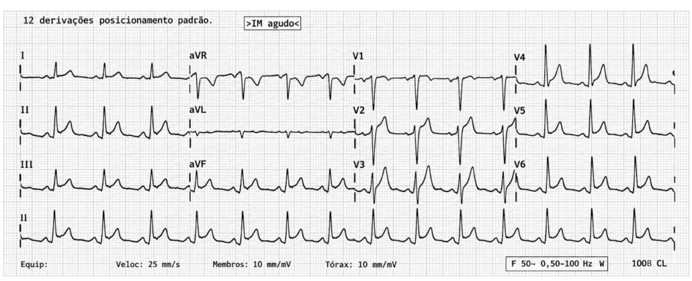
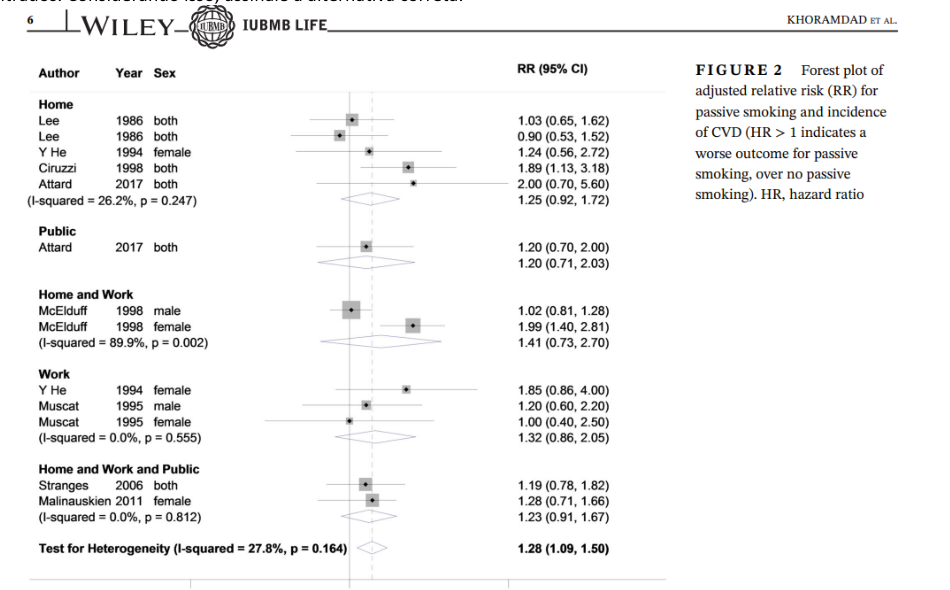

MEDUNIDAVI | MATERIAL EDITORIAL — RASCUNHO

Santa Casa / UFCSPA 2027

Acesso direto • 100 questões comentadas • Flashcards conceituais

Preparado em 08/11/2026. Gabarito preliminar de 04/11/2026. Reutilização autorizada pelo usuário nesta conversa. Material formativo em rascunho, sem revisão humana e sem liberação ao estudante. A resolução cega foi realizada em contextos separados, antes do confronto com a chave oficial. Concordância de letras não equivale a validação clínica integral. As referências indicam a cobertura documental de cada item.

Padrão editorial recuperado do trabalho AMRIGS: justificativa principal, comentário das alternativas e cartão autônomo quando útil. Não se acrescenta uma segunda mensagem redundante ao estudante. Questões oficiais são preservadas, inclusive quando apresentam defeitos; ressalvas ficam explícitas.

Fonte da prova: https://drive.google.com/file/d/184wAibaUuAJcpkbtZ278HfPk7dmhIqAf/view

Fonte do gabarito: https://drive.google.com/file/d/1hklOLHgSxr0MH69i16Q9qJzhX6MihSFO/view

  

# Questão 01 — Oncologia da tireoide

Gabarito oficial preliminar: A | Resolução independente: A | Estado: draft | PDF: página 2

Sobre câncer de tireoide, analise as afirmativas e assinale a alternativa correta. I. O aumento da incidência de câncer de tireoide nas últimas décadas ocorreu principalmente à custa do diagnóstico de pequenos carcinomas papilíferos, sem aumento proporcional da mortalidade específica. II. O carcinoma papilífero da tireoide é o tipo mais comum de câncer diferenciado da tireoide e apresenta disseminação preferencial pela via hemática. III. A tireoglobulina é o principal marcador sérico utilizado no seguimento do carcinoma medular da tireoide.

A) Apenas a afirmativa I está correta.

B) Apenas as afirmativas I e II estão corretas.

C) Apenas as afirmativas II e III estão corretas.

D) Todas as afirmativas estão corretas.

## Justificativa

Apenas a afirmativa I é correta: a maior detecção de pequenos carcinomas papilíferos contribuiu substancialmente para o aumento da incidência, sem elevação proporcional da mortalidade. O carcinoma papilífero é o tipo mais comum, mas sua disseminação preferencial é linfática, tornando II falsa. No carcinoma medular, originado nas células C, os principais marcadores são calcitonina e CEA; tireoglobulina é utilizada no seguimento dos carcinomas diferenciados de origem folicular, tornando III falsa.

A — Correta: reconhece I como verdadeira e II e III como falsas.

B — Incorreta: II erra a via predominante de disseminação do carcinoma papilífero.

C — Incorreta: tanto II quanto III contêm erros.

D — Incorreta: apenas I é verdadeira.

## Ressalvas editoriais

Fonte acessada sustenta a afirmação epidemiológica; marcador do carcinoma medular e via linfática requerem fonte específica antes da publicação.

## Flashcard

Frente: Qual é o principal marcador sérico do carcinoma medular da tireoide?

Verso: Calcitonina, acompanhada de CEA no seguimento.

## Referências e cobertura

Increasing incidence of thyroid cancer in the United States, 1973–2002 \[accessed\_search\_excerpt\]. Aumento da incidência predominantemente por pequenos carcinomas papilíferos, com mortalidade global estável. https://pubmed.ncbi.nlm.nih.gov/16684987/?dopt=Abstract

  

# Questão 02 — Avaliação pulmonar pré-operatória

Gabarito oficial preliminar: B | Resolução independente: B | Estado: draft | PDF: página 2

Paciente do sexo masculino, 68 anos, tabagista (40 maços-ano), em uso de broncodilatador de longa ação, será submetido a uma gastrectomia subtotal por adenocarcinoma gástrico. Ao exame físico, apresenta-se eupneico em repouso, com murmúrio vesicular diminuído globalmente e sem ruídos adventícios. SpO2 é de 94% em ar ambiente. O paciente relata que consegue subir dois lances de escada sem precisar parar por falta de ar. Baseando-se nesse caso, assinale a alternativa correta.

A) Ser tabagista já torna a espirometria mandatória para prever complicações pós-operatórias para esse paciente e para todos os demais, independentemente do tipo de cirurgia.

B) A localização da cirurgia é um dos fatores de risco mais importantes para complicações pulmonares pós-operatórias nesse caso.

C) A cirurgia deve ser contraindicada se o volume expiratório forçado no primeiro segundo (VEF1) for inferior a 80% do previsto.

D) Atualmente, a TC de tórax é o melhor preditor de complicações pulmonares pós-operatórias, superando a avaliação clínica e a capacidade funcional.

## Justificativa

A gastrectomia é uma cirurgia do abdome superior e sua localização aumenta o risco de complicações pulmonares por dor, disfunção diafragmática e redução dos volumes pulmonares. Idade, tabagismo e provável DPOC também contribuem, mas o paciente mantém capacidade funcional razoável e não apresenta exacerbação. A avaliação deve orientar otimização clínica; não existe indicação universal de espirometria pelo tabagismo, nem um VEF1 menor que 80% que contraindique, isoladamente, uma operação abdominal.

A — Incorreta: tabagismo não torna espirometria obrigatória para qualquer cirurgia.

B — Correta: operações abdominais superiores são fatores importantes de risco pulmonar.

C — Incorreta: esse ponto de corte não constitui contraindicação universal para cirurgia extratorácica.

D — Incorreta: TC de tórax não substitui avaliação clínica e funcional na predição rotineira.

## Flashcard

Frente: A localização de qual cirurgia abdominal aumenta especialmente o risco de complicações pulmonares pós-operatórias?

Verso: Cirurgia do abdome superior, pela maior repercussão sobre o diafragma e os volumes pulmonares.

## Referências e cobertura

Perioperative Evaluation of Patients with Pulmonary Conditions Undergoing Non-Cardiothoracic Surgery \[accessed\_search\_excerpt\]. Avaliação clínica e funcional é central; não há evidência suficiente para espirometria rotineira na estratificação de cirurgia não torácica. https://pmc.ncbi.nlm.nih.gov/articles/PMC5104294/

UCSF Hospital Handbook: Perioperative Pulmonary Evaluation \[accessed\_search\_excerpt\]. Cirurgia abdominal, tabagismo, DPOC e idade avançada aumentam o risco. https://hospitalhandbook.ucsf.edu/05-perioperative-pulmonary-evaluation/05-perioperative-pulmonary-evaluation

  

# Questão 03 — Úlcera duodenal perfurada

Gabarito oficial preliminar: C | Resolução independente: C | Estado: draft | PDF: página 2

Homem de 56 anos, tabagista e usuário frequente de anti-inflamatórios, apresenta dor epigástrica súbita, seguida de dor abdominal difusa. Após reposição volêmica inicial, permanece hemodinamicamente estável. A tomografia demonstra perfuração de 8mm na parede anterior da primeira porção do duodeno, sem evidência de neoplasia ou de obstrução da saída gástrica. Durante a laparoscopia, confirma-se pequena perfuração duodenal, com bordas viáveis. Qual é o tratamento operatório mais apropriado?

A) Gastrectomia distal com reconstrução à Billroth II.

B) Duodenopancreatectomia, devido ao risco de lesão neoplásica subjacente.

C) Biópsia de bordas, fechamento primário da perfuração, reforçado com retalho de omento.

D) Ressecção das bordas da úlcera com anastomose duodenojejunal.

## Justificativa

Em uma perfuração duodenal pequena, de 8 mm, com bordas viáveis e paciente estável, o fechamento primário, podendo ser reforçado por retalho de omento, é a opção operatória proporcional. Ressecções extensas não se justificam sem defeito grande, obstrução ou suspeita de neoplasia. A biópsia não é obrigatória de rotina nas úlceras duodenais típicas, mas a alternativa C contém o reparo adequado. Após o controle da perfuração, são pertinentes supressão ácida, pesquisa e erradicação de H. pylori quando indicado e suspensão de anti-inflamatórios.

A — Incorreta: gastrectomia é excessiva para a pequena perfuração duodenal descrita.

B — Incorreta: não há dados que justifiquem duodenopancreatectomia.

C — Correta entre as opções: fechamento primário com reforço omental é apropriado.

D — Incorreta: ressecção e derivação duodenojejunal não são necessárias para esse pequeno defeito.

## Ressalvas editoriais

Biópsia de bordas de úlcera duodenal não é exigência universal; omental patch também não é obrigatório em todo pequeno defeito.

## Flashcard

Frente: Qual é o reparo habitual de uma pequena perfuração de úlcera duodenal com bordas viáveis?

Verso: Fechamento primário, com reforço omental conforme os achados e a técnica utilizada.

## Referências e cobertura

Perforated and bleeding peptic ulcer: WSES guidelines \[accessed\_search\_excerpt\]. Perfurações menores que 2 cm podem ser tratadas por reparo primário. https://doi.org/10.1186/S13017-019-0283-9

  

# Questão 04 — Abstinência de opioides

Gabarito oficial preliminar: D | Resolução independente: D | Estado: draft | PDF: página 2

Uma mulher de 37 anos é internada com abdome agudo. Antes da cirurgia, omite que utiliza diariamente oxicodona sem prescrição. Após o procedimento, recebe naloxona por depressão respiratória. Poucos minutos depois, desenvolve ansiedade intensa, temperatura corporal de 37,9°C, bocejos repetidos, lacrimejamento, rinorreia, piloereção, midríase, cólicas abdominais, vômitos e diarreia. Mantém-se consciente e orientada. Sobre esse quadro, assinale a alternativa correta.

A) Trata-se de intoxicação causada pela naloxona, que deve ser tratada prioritariamente com benzodiazepínico.

B) Trata-se de síndrome serotoninérgica, indicada pela presença de midríase e sintomas gastrintestinais.

C) Trata-se de hipertermia maligna desencadeada pelo procedimento anestésico, cuja apresentação inicial pode incluir instabilidade autonômica e elevação da temperatura corporal.

D) Trata-se de abstinência por opioides precipitada pela naloxona, decorrente de antagonismo competitivo de receptores opioides.

## Justificativa

O início abrupto de bocejos, lacrimejamento, rinorreia, midríase, piloereção, vômitos e diarreia logo após naloxona, em usuária diária de oxicodona, caracteriza abstinência opioide precipitada. A naloxona antagoniza competitivamente receptores opioides e retira rapidamente o efeito agonista em quem desenvolveu dependência física. O conjunto não corresponde a intoxicação inespecífica por naloxona, síndrome serotoninérgica ou hipertermia maligna.

A — Incorreta: os sintomas formam uma síndrome de abstinência reconhecível; benzodiazepínico não é o tratamento prioritário automático.

B — Incorreta: faltam exposição serotoninérgica e sinais neuromusculares típicos, como clônus e hiperreflexia.

C — Incorreta: faltam hipercapnia e rigidez; a relação temporal com o antagonista e os sintomas secretórios apontam para abstinência.

D — Correta: antagonismo opioide em pessoa dependente pode precipitar abstinência.

## Flashcard

Frente: Qual síndrome pode surgir após naloxona em pessoa com dependência física de opioides?

Verso: Abstinência opioide precipitada, com midríase, bocejos, lacrimejamento, piloereção e sintomas gastrointestinais.

## Referências e cobertura

Operational definition of precipitated opioid withdrawal \[accessed\_search\_excerpt\]. Naloxona pode precipitar abstinência; lacrimejamento, bocejos, rinorreia e dilatação pupilar são sinais associados. https://pmc.ncbi.nlm.nih.gov/articles/PMC10162012/

  

# Questão 05 — Delirium pós-operatório

Gabarito oficial preliminar: B | Resolução independente: B | Estado: draft | PDF: página 2

Um homem de 74 anos, com hipertensão arterial e comprometimento cognitivo leve, é submetido à artroplastia de quadril. No segundo dia pós-operatório, passa a alternar entre sonolência e agitação, tenta retirar o acesso venoso e afirma que "há pessoas escondidas atrás da cortina". Durante a entrevista, perde repetidamente o fio da conversa e não consegue dizer os meses do ano em ordem inversa. Sua temperatura é de 37,8°C, a saturação de oxigênio é de 91%, e a bexiga encontra-se palpável. Recebeu tramadol, difenidramina e diazepam nas últimas 24 horas. Qual é a conduta inicial mais apropriada?

A) Administrar haloperidol intravenoso para controle da agitação, pois a presença de alucinações indica psicose aguda, e a melhora dos sintomas irá ajudar na investigação diagnóstica.

B) Investigar e corrigir fatores precipitantes, incluindo hipóxia, retenção urinária, infecção e medicamentos, associando medidas ambientais de reorientação e reservando antipsicóticos para casos de risco à segurança do paciente.

C) Corrigir imediatamente a hipóxia e solicitar avaliação neurológica com neuroimagem, considerando a possibilidade de evento cerebrovascular perioperatório, apesar da ausência de déficit neurológico focal.

D) Suspender os fármacos potencialmente causadores do quadro e observar a evolução antes de iniciar outras intervenções, pois medicamentos são causas frequentes de delirium pós-operatório.

## Justificativa

A instalação aguda, a flutuação entre sonolência e agitação e a desatenção caracterizam delirium, mesmo com alucinações. A conduta inicial é pesquisar e corrigir simultaneamente precipitantes, particularmente hipóxia, retenção urinária, possível infecção e fármacos deliriogênicos, além de oferecer reorientação e medidas ambientais. Antipsicóticos podem ser considerados por curto prazo quando há risco à segurança ou sofrimento importante apesar das medidas iniciais; não substituem a investigação da causa.

A — Incorreta: alucinações não transformam delirium em psicose primária e não indicam haloperidol intravenoso automático.

B — Correta: aborda causas reversíveis e cuidado não farmacológico de forma imediata.

C — Incorreta: corrigir hipóxia é necessário, mas neuroimagem não é obrigatória sem indicação clínica adicional e a opção omite outros precipitantes evidentes.

D — Incorreta: suspender fármacos é parte do cuidado, mas observar sem tratar hipóxia e retenção urinária é inadequado.

## Flashcard

Frente: Qual é a prioridade no manejo inicial do delirium pós-operatório?

Verso: Identificar e corrigir precipitantes reversíveis e associar medidas ambientais e de reorientação.

## Referências e cobertura

NICE CG103: Delirium — Recommendations \[accessed\_search\_excerpt\]. Avaliar hipóxia, revisar medicamentos, tratar causas e considerar haloperidol apenas em situações selecionadas. https://www.nice.org.uk/guidance/cg103/chapter/Recommendations

  

# Questão 06 — Diverticulite com abscesso

Gabarito oficial preliminar: A | Resolução independente: A | Estado: draft | PDF: página 3

Mulher de 63 anos apresenta dor em fossa ilíaca esquerda e febre há cinco dias. Está hemodinamicamente estável e apresenta dor localizada, sem sinais de peritonite difusa. A tomografia evidencia espessamento do sigmoide, inflamação da gordura pericólica e coleção pélvica de 5,5cm. Qual é a estratégia terapêutica inicial mais adequada?

A) Antibioticoterapia e avaliação para drenagem percutânea da coleção.

B) Sigmoidectomia de urgência com anastomose primária.

C) Tratamento ambulatorial com hidratação e analgesia.

D) Colonoscopia imediata para excluir neoplasia colorretal perfurada.

## Justificativa

O quadro representa diverticulite complicada por abscesso pélvico de 5,5 cm, em paciente estável e sem peritonite difusa. O tratamento inicial mais adequado combina antibióticos e avaliação da viabilidade de drenagem percutânea guiada por imagem. Abscessos maiores que cerca de 4–5 cm apresentam maior risco de falha com antibióticos isolados; cirurgia fica reservada para deterioração, impossibilidade ou insucesso do controle não operatório.

A — Correta: combina terapia antimicrobiana e controle focal da coleção.

B — Incorreta: cirurgia imediata não é a primeira opção no paciente estável com abscesso drenável.

C — Incorreta: coleção de 5,5 cm e febre não se manejam apenas com hidratação e analgesia ambulatoriais.

D — Incorreta: colonoscopia durante inflamação complicada aguda não é a prioridade e pode aumentar riscos.

## Flashcard

Frente: Qual é a abordagem inicial de um abscesso diverticular grande em paciente estável?

Verso: Antibióticos e drenagem percutânea se tecnicamente viável; cirurgia se houver falha ou deterioração.

## Referências e cobertura

WSES 2020: acute colonic diverticulitis \[verified\]. Abscessos maiores que 4–5 cm favorecem drenagem percutânea associada a antibióticos. https://pmc.ncbi.nlm.nih.gov/articles/PMC7206757/

  

# Questão 07 — Infecção pleural

Gabarito oficial preliminar: D | Resolução independente: D | Estado: draft | PDF: página 3

Homem de 54 anos está internado por pneumonia adquirida na comunidade. Apesar da antibioticoterapia, mantém febre e leucocitose. A tomografia de tórax evidencia derrame pleural moderado e loculado. A toracocentese revela líquido turvo, pH de 7,05, glicose de 35mg/dL e bacterioscopia positiva. Qual é a melhor conduta inicial?

A) Manter os antibióticos e repetir a tomografia após sete dias.

B) Realizar toracocentese evacuadora única.

C) Indicar pleurodese química após o esvaziamento do derrame.

D) Manter antibioticoterapia e realizar a drenagem pleural fechada.

## Justificativa

Líquido pleural loculado, turvo, com bacterioscopia positiva, pH de 7,05 e glicose baixa caracteriza infecção pleural e exige controle da coleção, além de antibióticos. A drenagem pleural fechada é a conduta inicial adequada. Na persistência de coleção após drenagem, devem ser reavaliados posicionamento do dreno, terapia intrapleural e necessidade de abordagem cirúrgica.

A — Incorreta: aguardar sete dias sem controlar o foco aumenta risco de persistência da infecção.

B — Incorreta: uma punção evacuadora isolada é insuficiente para a coleção infectada e loculada descrita.

C — Incorreta: pleurodese não é tratamento inicial de infecção pleural.

D — Correta: antibióticos e dreno pleural promovem tratamento da infecção e controle do foco.

## Flashcard

Frente: Qual valor de pH pleural favorece drenagem no derrame parapneumônico?

Verso: pH ≤7,2 indica alto risco de infecção pleural complicada e favorece drenagem, se houver líquido acessível com segurança.

## Referências e cobertura

British Thoracic Society Guideline for pleural disease \[accessed\_search\_excerpt\]. pH pleural ≤7,2 indica alto risco de infecção e necessidade de dreno quando acessível com segurança. https://thorax.bmj.com/content/early/2023/08/08/thorax-2023-220304

  

# Questão 08 — Pneumotórax hipertensivo

Gabarito oficial preliminar: B | Resolução independente: B | Estado: draft | PDF: página 3

Homem de 32 anos, internado após politraumatismo, apresenta dispneia súbita imediatamente após tentativa de punção venosa central da subclávia. Encontra-se agitado, com frequência respiratória de 36irpm, saturação de 82%, pressão arterial de 75/45mmHg e ausência de murmúrio vesicular no hemitórax direito. Há distensão das veias do pescoço. Qual deve ser a próxima conduta?

A) Solicitar radiografia portátil de tórax antes de realizar qualquer intervenção.

B) Realizar descompressão imediata do hemitórax direito, seguida de drenagem pleural.

C) Realizar intubação orotraqueal com pressão positiva e observar a resposta clínica.

D) Solicitar tomografia de tórax para diferenciar pneumotórax de hemotórax.

## Justificativa

Hipotensão grave, hipoxemia, ausência unilateral de murmúrio vesicular e turgência jugular imediatamente após punção subclávia indicam pneumotórax hipertensivo com choque obstrutivo. O diagnóstico é clínico nessa situação e a descompressão imediata do hemitórax direito deve preceder exames de imagem, com drenagem pleural definitiva em seguida. Ventilação com pressão positiva antes do alívio pode agravar a instabilidade.

A — Incorreta: radiografia não deve retardar descompressão no paciente instável.

B — Correta: trata imediatamente a causa obstrutiva do choque.

C — Incorreta: pressão positiva sem aliviar a tensão pode piorar o retorno venoso e precipitar parada.

D — Incorreta: transportar para TC retarda uma intervenção vital.

## Flashcard

Frente: Qual é a prioridade diante de suspeita clínica de pneumotórax hipertensivo com instabilidade?

Verso: Descompressão torácica imediata, seguida de drenagem pleural, sem aguardar imagem.

## Referências e cobertura

NICE NG39: Major trauma — Recommendations \[accessed\_search\_excerpt\]. Pneumotórax hipertensivo com instabilidade hemodinâmica ou comprometimento respiratório grave deve ser descomprimido antes da imagem. https://www.nice.org.uk/guidance/ng39/chapter/Recommendations

  

# Questão 09 — Massa cervical em adulto

Gabarito oficial preliminar: C | Resolução independente: C | Estado: draft | PDF: página 3

Homem de 48 anos apresenta massa cervical lateral direita, indolor e progressiva há três meses. Nega febre ou infecção recente. A ultrassonografia demonstra linfonodo predominantemente cístico, com 3,2cm, no nível II cervical. Ao exame da cavidade oral, não se identifica lesão evidente. Qual é a abordagem inicial mais apropriada?

A) Prescrever antibioticoterapia empírica e reavaliar em três semanas.

B) Realizar biópsia excisional do linfonodo como primeiro procedimento diagnóstico.

C) Solicitar imagem cervical contrastada, realizar punção aspirativa do linfonodo e examinar endoscopicamente o trato aerodigestivo superior.

D) Indicar cirurgia, pois a ultrassonografia sugere cisto branquial.

## Justificativa

Massa cervical progressiva há três meses em adulto, sem sinais infecciosos, deve ser investigada como potencial neoplasia. O aspecto cístico em nível II não exclui metástase de carcinoma escamoso da orofaringe, inclusive associado a HPV. A abordagem inicial envolve imagem contrastada do pescoço, punção aspirativa e avaliação dirigida das mucosas do trato aerodigestivo superior; não se deve presumir cisto branquial apenas pela ultrassonografia.

A — Incorreta: antibiótico empírico sem evidência de infecção retarda investigação de possível câncer.

B — Incorreta: punção aspirativa deve preceder biópsia aberta na abordagem inicial usual.

C — Correta: reúne imagem, amostragem minimamente invasiva e procura de sítio primário.

D — Incorreta: lesão cística cervical em adulto requer exclusão de malignidade.

## Flashcard

Frente: O aspecto cístico de um linfonodo cervical em adulto exclui metástase?

Verso: Não. Metástases de carcinoma orofaríngeo, inclusive associado a HPV, podem ser predominantemente císticas.

## Referências e cobertura

AAO-HNS: Clinical Practice Guideline — Evaluation of the Neck Mass in Adults \[accessed\_search\_excerpt\]. Massa suspeita requer imagem contrastada e punção aspirativa; massas císticas devem ser investigadas até diagnóstico. https://journals.sagepub.com/doi/full/10.1177/0194599817722550

  

# Questão 10 — Colangite aguda grave

Gabarito oficial preliminar: C | Resolução independente: C | Estado: draft | PDF: página 3

Homem de 71 anos, com história de colelitíase, apresenta dor no hipocôndrio direito, febre e icterícia há dois dias. Na admissão, encontra-se confuso, com pressão arterial de 85/55mmHg e frequência cardíaca de 118bpm. Os exames demonstram leucocitose e elevação da bilirrubina direta e das enzimas canaliculares. A ultrassonografia evidencia dilatação das vias biliares e provável cálculo no colédoco distal. Qual é o diagnóstico e a conduta mais apropriada?

A) Colecistite aguda complicada; colecistectomia laparoscópica imediata.

B) Colangite aguda; iniciar reposição volêmica e antibioticoterapia e realizar colangiorressonância antes de decidir pela descompressão biliar.

C) Colangite aguda grave; ressuscitação, coleta de culturas, antibioticoterapia intravenosa e CPRE.

D) Abscesso hepático piogênico; antibioticoterapia e drenagem percutânea da vesícula biliar.

## Justificativa

Dor em hipocôndrio direito, febre e icterícia, associadas a hipotensão e confusão, compõem apresentação clássica de colangite grave por obstrução biliar. É necessário iniciar ressuscitação e antibiótico intravenoso, colher culturas sem retardar o tratamento e promover descompressão biliar urgente, preferencialmente por CPRE. Colangiorressonância não deve atrasar o controle do foco em um quadro já clinicamente definido e instável.

A — Incorreta: colecistite isolada não explica tão bem obstrução do colédoco e sepse biliar; colecistectomia não é o controle inicial principal.

B — Incorreta: o diagnóstico é plausível, mas aguardar colangiorressonância retarda drenagem urgente.

C — Correta: reconhece gravidade e associa suporte, antimicrobianos e drenagem biliar.

D — Incorreta: os dados indicam colangite; drenar vesícula não equivale a descomprimir obstrução do colédoco.

## Flashcard

Frente: Qual é a medida de controle de foco na colangite grave obstrutiva?

Verso: Descompressão biliar urgente, preferencialmente por CPRE, associada a ressuscitação e antibióticos.

## Referências e cobertura

Tokyo Guidelines 2018: initial management of acute biliary infection \[accessed\_search\_excerpt\]. Colangite grave requer suporte respiratório/circulatório, antimicrobianos e drenagem biliar urgente. https://pubmed.ncbi.nlm.nih.gov/28941329/

  

# Questão 11 — Pseudocisto pancreático

Gabarito oficial preliminar: D | Resolução independente: D | Estado: draft | PDF: página 3

Um paciente de 52 anos, etilista crônico, procura o pronto-socorro com dor epigástrica de forte intensidade há 10 dias, irradiando para o dorso, associada a perda de apetite e emagrecimento. Refere que a dor começou após um episódio de pancreatite aguda, tratado clinicamente há cerca de um mês. Ao exame físico, apresenta massa palpável na região epigástrica. Uma tomografia computadorizada de abdome evidencia uma coleção arredondada, homogênea, com conteúdo líquido, sem septações ou presença de gás no seu interior. Com base nesse quadro clínico e nos conhecimentos sobre as doenças pancreáticas, assinale a alternativa correta.

A) O achado de imagem é compatível com necrose pancreática, complicação que raramente exige intervenção e regride espontaneamente na maioria dos casos.

B) A principal hipótese diagnóstica é abscesso pancreático, cuja abordagem inicial deve ser antibioticoterapia e cirurgia imediata.

C) O tratamento do pseudocisto pancreático é sempre cirúrgico, independentemente do tamanho ou dos sintomas associados.

D) Trata-se provavelmente de um pseudocisto pancreático, uma complicação tardia da pancreatite aguda, que pode exigir drenagem caso haja sintomas persistentes ou aumento progressivo.

## Justificativa

Uma coleção líquida homogênea aproximadamente um mês após pancreatite, sem debris ou gás, sugere pseudocisto quando já possui parede bem definida. Diferentemente da necrose delimitada, o conteúdo do pseudocisto é predominantemente líquido e sem necrose sólida relevante. Nem todo pseudocisto precisa de intervenção, mas dor persistente, perda ponderal, compressão, infecção ou crescimento podem indicar drenagem, frequentemente por via endoscópica quando apropriada.

A — Incorreta: necrose costuma apresentar componentes sólidos e não pode ser descrita como invariavelmente autolimitada.

B — Incorreta: não há evidência de infecção, e a expressão abscesso pancreático é inadequada à classificação atual.

C — Incorreta: tratamento não é sempre cirúrgico e depende de sintomas e complicações.

D — Correta: identifica provável pseudocisto e a indicação seletiva de drenagem.

## Ressalvas editoriais

Enunciado não descreve explicitamente parede encapsulante e usa intervalo aproximado de um mês; a classificação definitiva exige verificar maturação da parede.

## Flashcard

Frente: O que distingue pseudocisto de necrose pancreática delimitada?

Verso: O pseudocisto tem conteúdo líquido e parede definida, sem componentes necróticos sólidos relevantes.

## Referências e cobertura

Clinical Practice Guidelines for the Endoscopic Management of Peripancreatic Fluid Collections \[accessed\_search\_excerpt\]. Pseudocistos usualmente surgem após quatro semanas; sintomas ou infecção indicam drenagem. https://pmc.ncbi.nlm.nih.gov/articles/PMC8357592/

NICE NG104: Pancreatitis — Recommendations \[accessed\_search\_excerpt\]. Pseudocistos sintomáticos, inclusive com dor ou emagrecimento, são candidatos à drenagem. https://www.nice.org.uk/guidance/ng104/chapter/Recommendations

  

# Questão 12 — História no trauma — AMPLE

Gabarito oficial preliminar: A | Resolução independente: A | Estado: draft | PDF: página 3

A história AMPLE é uma ferramenta essencial na avaliação secundária do paciente traumatizado. Cada letra do mnemônico corresponde a um elemento da história clínica. Considerando o AMPLE, assinale a alternativa que relaciona CORRETAMENTE a letra do mnemônico à informação clínica.

A) A - Alergias.

B) M - Mecanismo do trauma.

C) P - Pressão sanguínea.

D) E - Exame neurológico.

## Justificativa

No mnemônico AMPLE, A corresponde a alergias; M, a medicamentos em uso; P, a antecedentes pessoais e possibilidade de gestação; L, à última refeição; e E, aos eventos e ambiente relacionados ao trauma. Essa história complementa a avaliação secundária, sem atrasar o reconhecimento e o tratamento de ameaças à vida.

A — Correta: A significa alergias.

B — Incorreta: M significa medicamentos; mecanismo está no contexto dos eventos.

C — Incorreta: P significa antecedentes pessoais e gestação, não pressão arterial.

D — Incorreta: E corresponde aos eventos e ambiente relacionados ao trauma.

## Ressalvas editoriais

Item predominantemente de memorização; baixo nível de decisão clínica.

## Flashcard

Frente: O que significa a letra M na história AMPLE do paciente traumatizado?

Verso: Medicamentos em uso.

## Referências e cobertura

AMPLE — GP Exams \[accessed\_search\_excerpt\]. Expansão do mnemônico AMPLE em alergias, medicamentos, antecedentes/gestação, última refeição e eventos. https://gpexams.com/ample/?cat=19

  

# Questão 13 — Acalásia

Gabarito oficial preliminar: C | Resolução independente: C | Estado: blocked | PDF: página 4

Uma paciente de 55 anos relata disfagia progressiva, inicialmente para sólidos e depois para líquidos, acompanhada de dor retroesternal intermitente, regurgitação e perda de peso de 5kg em 3 meses. Uma endoscopia digestiva alta (EDA) revela dilatação esofágica sem lesões mucosas visíveis e brida distal a 5cm da junção gastroesofágica. A manometria esofágica demonstra ausência de peristalse e hipertonia do esfíncter esofágico inferior. A pH-metria mostra refluxo esofágico leve. Considerando o caso, qual é o diagnóstico provável e o tratamento mais adequado?

A) Câncer esofágico; indicação de esofagectomia imediata para evitar progressão e perda de função.

B) Esclerose sistêmica com envolvimento esofágico; tratamento inicial com agonistas de motilidade (como metoclopramida) e inibidores de bomba de prótons (IBP).

C) Acalásia (tipo I ou II); tratamento de escolha é miotomia endoscópica peroral (POEM) ou miotomia cirúrgica de Heller, preferencialmente com fundoplicatura.

D) Esofagite eosinofílica; abordagem adequada seria dieta de eliminação e corticoterapia tópica (como budesonida ou fluticasona).

## Justificativa

Aperistalse esofágica e alteração do esfíncter inferior, associadas a disfagia e dilatação, tornam acalásia a melhor hipótese entre as alternativas. POEM e miotomia de Heller são opções efetivas; a Heller costuma ser associada à fundoplicatura parcial, enquanto POEM convencional não inclui fundoplicatura e apresenta maior risco de refluxo. Entretanto, a classificação em tipos I ou II requer manometria de alta resolução com dados de relaxamento e pressurização, ausentes na vinheta. A perda ponderal e a descrição de brida exigem excluir obstrução mecânica e pseudoacalásia antes do tratamento definitivo.

A — Incorreta: neoplasia precisa ser excluída, mas esofagectomia imediata sem comprovação não é apropriada.

B — Incorreta: esclerose sistêmica geralmente causa hipotonia do esfíncter inferior, não o padrão hipertônico descrito.

C — Melhor alternativa: compatível com acalásia e opções de miotomia, com ressalvas sobre subtipagem e fundoplicatura.

D — Incorreta: não há confirmação histológica e a motilidade descrita favorece acalásia.

## Ressalvas editoriais

Hipertonia isolada não documenta relaxamento inadequado do esfíncter inferior; faltam IRP e pressurização para definir subtipo.

Brida distal a 5 cm da junção é achado atípico e exige esclarecimento/exclusão de obstrução mecânica.

Redação da alternativa pode sugerir fundoplicatura também com POEM; necessita reparo técnico.

Dilatação pneumática também é opção efetiva para acalásia I/II em pacientes selecionados; não há tratamento universal de escolha apenas com estes dados.

## Flashcard

Frente: À qual miotomia para acalásia se associa habitualmente fundoplicatura parcial?

Verso: À miotomia cirúrgica de Heller; POEM convencional não inclui fundoplicatura.

## Referências e cobertura

ACG Clinical Guidelines: Diagnosis and Management of Achalasia \[verified\]. Diagnóstico requer avaliação do relaxamento da junção; Heller com fundoplicatura e POEM são opções, com mais refluxo após POEM. https://pmc.ncbi.nlm.nih.gov/articles/PMC9896940/

SAGES 2024 update: POEM for achalasia \[accessed\_search\_excerpt\]. Acalásia I/II pode ser tratada com POEM acompanhado de IBP conforme necessário ou Heller com fundoplicatura. https://www.sages.org/publications/guidelines/update-to-guidelines-for-the-use-of-poem-for-achalasia/

  

# Questão 14 — Drenos de sucção fechada

Gabarito oficial preliminar: A | Resolução independente: A | Estado: draft | PDF: página 4

A utilização de drenos de sucção fechada (como os modelos Jackson-Pratt ou Blake) possui indicações cirúrgicas estabelecidas. Qual das alternativas representa uma indicação clássica e amplamente aceita?

A) Evacuação de espaço morto e prevenção de acúmulo de seroma ou hematoma sob grandes descolamentos de retalhos cutâneos (mastectomias, abdominoplastias).

B) Posicionamento intrabiliar como stent primário durante uma derivação biliodigestiva paliativa.

C) Drenagem profilática rotineira da cavidade peritoneal após toda e qualquer ressecção colônica não complicada, para evitar deiscência de anastomose.

D) Tratamento curativo de fístulas enterocutâneas de alto débito sem a necessidade de controle da sepse subjacente.

## Justificativa

Drenos de sucção fechada são utilizados para remover sangue e líquido seroso de espaços mortos após descolamentos extensos, como em mastectomia e abdominoplastia. Sua indicação é individualizada e não representa garantia de ausência de seroma. Eles não funcionam como stents biliares e não substituem tratamento da sepse, suporte nutricional ou controle da causa de uma fístula.

A — Correta: drenagem de espaço morto após grandes retalhos é indicação tradicional.

B — Incorreta: dreno Jackson-Pratt ou Blake não é stent intrabiliar primário.

C — Incorreta: drenagem profilática não é recomendada indiscriminadamente após toda ressecção colônica nem previne deiscência por si.

D — Incorreta: dreno não cura isoladamente fístula de alto débito e não dispensa controle de sepse.

## Flashcard

Frente: Qual é a finalidade de um dreno de sucção fechada sob um grande retalho cutâneo?

Verso: Remover líquido seroso e sangue do espaço morto para reduzir seu acúmulo.

## Referências e cobertura

QUISERMAS trial protocol: Dead space closure versus drainage after mastectomy \[accessed\_search\_excerpt\]. Drenagem de sucção sob os retalhos é prática convencional para manejo do espaço morto após mastectomia. https://pmc.ncbi.nlm.nih.gov/articles/PMC4823448/

  

# Questão 15 — Hérnia incisional e cicatrização fascial

Gabarito oficial preliminar: B | Resolução independente: B | Estado: draft | PDF: página 4

Qual é o principal fator de risco técnico ou sistêmico diretamente associado à falha do fechamento fascial e ao desenvolvimento de uma hérnia incisional após uma laparotomia?

A) A realização de incisões transversas, que separam as fibras aponeuróticas com maior tensão do que as incisões medianas.

B) A presença de infecção do sítio cirúrgico (superficial ou profunda), que altera a fase proliferativa da cicatrização e enfraquece a matriz de colágeno.

C) O uso de sutura contínua com fios de absorção lenta, que é sabidamente inferior ao uso de fios de categute de absorção rápida para o fechamento da fáscia.

D) A manutenção do paciente em decúbito dorsal estrito por 48 horas no pós-operatório.

## Justificativa

A infecção do sítio cirúrgico prejudica cicatrização e resistência do fechamento fascial, aumentando fortemente o risco de hérnia incisional. A técnica de fechamento também importa: sutura contínua com pequenas passadas e fio de absorção lenta é estratégia recomendada, contrariando a alternativa C. Incisão mediana costuma apresentar maior risco que incisões não medianas, e imobilidade em decúbito por 48 horas não constitui o fator principal descrito.

A — Incorreta: a afirmação sobre maior tensão e risco universal das transversas está invertida.

B — Correta: infecção do sítio operatório é importante fator de risco para hérnia incisional.

C — Incorreta: fio de absorção lenta é preferível a material de absorção rápida no fechamento fascial.

D — Incorreta: decúbito dorsal por esse período não é o principal fator de falha fascial.

## Ressalvas editoriais

Abertura integral da fonte encontrou CAPTCHA; confirmação restrita ao trecho acessado na busca.

## Flashcard

Frente: Qual complicação pós-operatória aumenta fortemente o risco de hérnia incisional?

Verso: Infecção do sítio cirúrgico, por prejudicar a cicatrização e a resistência fascial.

## Referências e cobertura

European Hernia Society: Midline incisional hernia guidelines \[accessed\_search\_excerpt\]. Trecho indexado identifica infecção de sítio cirúrgico como fator de grande impacto e recomenda small bites com fio de absorção lenta. https://pmc.ncbi.nlm.nih.gov/articles/PMC10638550/

  

# Questão 16 — Tumor de células gigantes do osso

Gabarito oficial preliminar: D | Resolução independente: D | Estado: draft | PDF: página 4

Um homem de 30 anos apresenta-se com dor e inchaço no joelho após uma pequena queda. A radiografia mostra uma fratura patológica através de uma lesão lítica e excêntrica na epífise do fêmur distal, que se estende até o osso subcondral. A biópsia confirma o diagnóstico de um tumor ósseo benigno, mas que é conhecido por ser localmente agressivo, com altas taxas de recorrência, e por ter um raro potencial de causar metástases pulmonares de aparência benigna. Qual é o diagnóstico mais provável?

A) Encondroma.

B) Osteossarcoma.

C) Displasia fibrosa.

D) Tumor de células gigantes.

## Justificativa

A lesão lítica excêntrica que alcança a epífise e o osso subcondral ao redor do joelho, em adulto jovem, é característica de tumor de células gigantes. Apesar de histologicamente benigno na maioria dos casos, pode ser localmente agressivo, causar fratura patológica, recorrer e, raramente, apresentar implantes pulmonares de aspecto histológico benigno. Esse conjunto diferencia o tumor dos demais diagnósticos propostos.

A — Incorreta: encondroma é lesão cartilaginosa mais frequentemente medular/metafisária, sem esse padrão clínico-radiológico típico.

B — Incorreta: osteossarcoma é neoplasia maligna produtora de osteoide e não corresponde à biópsia descrita.

C — Incorreta: displasia fibrosa costuma ter padrão de matriz em vidro fosco e não é a hipótese típica de lesão epifisária subcondral.

D — Correta: reúne localização e comportamento clássicos de tumor de células gigantes.

## Flashcard

Frente: Qual tumor ósseo tipicamente produz lesão lítica epifisária subcondral no adulto jovem?

Verso: Tumor de células gigantes do osso.

## Referências e cobertura

POSNA: Giant Cell Tumor of Bone \[accessed\_search\_excerpt\]. Tumor benigno localmente agressivo, com extensão epifisária e possibilidade de metástases pulmonares. https://posna.org/physician-education/study-guide/giant-cell-tumor-of-bone

  

# Questão 17 — Divertículo de Meckel

Gabarito oficial preliminar: A | Resolução independente: A | Estado: draft | PDF: página 4

Homem de 25 anos apresenta-se com história de vários episódios de hematoquezia de grande volume e indolor. Os exames de endoscopia digestiva alta e colonoscopia são normais. Uma cintilografia com tecnécio-99m pertecnetato revela uma área de captação anômala no quadrante inferior direito do abdome. Considerando isso, qual é a anomalia congênita mais prevalente do trato gastrointestinal, e qual é a causa mais provável do sangramento nesse paciente?

A) Divertículo de Meckel; a causa do sangramento é a ulceração da mucosa ileal adjacente por ácido secretado por mucosa gástrica ectópica dentro do divertículo.

B) Má rotação intestinal; a causa do sangramento é a isquemia por volvo.

C) Doença de Hirschsprung; o sangramento é raro e geralmente causado por enterocolite.

D) Cisto de duplicação; o sangramento é causado por estase e ulceração.

## Justificativa

Hematoquezia volumosa e indolor em adulto jovem, com endoscopias habituais negativas e captação de pertecnetato no quadrante inferior direito, sugere divertículo de Meckel com mucosa gástrica ectópica. O ácido secretado pela mucosa ectópica ulcera sobretudo o íleo adjacente e provoca sangramento. A cintilografia detecta tecido gástrico funcionante, e não o divertículo por sua anatomia isoladamente.

A — Correta: associa a anomalia congênita ao mecanismo ácido-péptico do sangramento.

B — Incorreta: volvo costuma provocar dor e obstrução/isquemia, e não captação típica por mucosa gástrica ectópica.

C — Incorreta: Hirschsprung se manifesta principalmente por obstrução/constipação desde a infância.

D — Incorreta: duplicações podem conter mucosa gástrica, mas a alternativa apresenta mecanismo e prevalência menos compatíveis com o comando.

## Flashcard

Frente: Como a mucosa gástrica ectópica no divertículo de Meckel causa sangramento?

Verso: Secreta ácido, que ulcera a mucosa ileal adjacente.

## Referências e cobertura

SNMMI: Meckel Diverticulum Scintigraphy 2.0 \[accessed\_search\_excerpt\]. Mucosa gástrica ectópica secreta ácido responsável por ulceração no divertículo e íleo adjacente. https://snmmi.org/Web/Clinical-Practice/Procedure-Standards/Standards/Meckel-Diverticulum-Scintigraphy-2-0.aspx

  

# Questão 18 — Cirurgia do câncer retal

Gabarito oficial preliminar: D | Resolução independente: D | Estado: draft | PDF: página 4

Um paciente de 62 anos é diagnosticado com um adenocarcinoma no reto médio (a 7cm da margem anal). Os exames de estadiamento não mostram doença a distância. O cirurgião planeja uma ressecção curativa e explica ao paciente a importância de remover não apenas o tumor, mas todo o tecido linfogorduroso que o envolve, seguindo planos fasciais precisos para minimizar o risco de recidiva local. Qual é a intervenção mais efetiva para reduzir as taxas de recidiva local?

A) Ressecção abdominoperineal (operação de Miles) como procedimento padrão para todos os tumores.

B) Quimioterapia e radioterapia neoadjuvante para esterilizar o mesorreto, dispensando a cirurgia.

C) Excisão transanal do tumor, preservando o mesorreto.

D) Excisão mesorretal total (EMT).

## Justificativa

No câncer do reto médio, a excisão mesorretal total remove o reto e seu envelope linfogorduroso em plano fascial adequado, reduzindo doença residual e recidiva local. Preservar a integridade do mesorreto e obter margem circunferencial livre são princípios oncológicos centrais. A necessidade de neoadjuvância e a escolha entre ressecção anterior e amputação abdominoperineal dependem do estadiamento local e das condições anatômicas, não apenas da distância de 7 cm.

A — Incorreta: operação de Miles não é obrigatória para todos os tumores retais.

B — Incorreta: quimiorradioterapia não dispensa automaticamente ressecção; preservação de órgão exige seleção e acompanhamento próprios.

C — Incorreta: excisão local tem indicação restrita a tumores iniciais selecionados e não aborda rotineiramente o mesorreto.

D — Correta: excisão mesorretal total é o princípio cirúrgico descrito para o reto médio.

## Ressalvas editoriais

Sem estadiamento T/N e ressonância pélvica, não é possível definir toda a sequência terapêutica; isso não impede identificar o princípio técnico solicitado.

## Flashcard

Frente: Qual é o princípio de ressecção do envelope linfogorduroso no câncer do reto médio?

Verso: Excisão mesorretal total em plano fascial adequado, preservando a integridade do espécime.

## Referências e cobertura

NCI: Rectal Cancer Treatment (PDQ) \[accessed\_search\_excerpt\]. Excisão mesorretal apropriada, total nos tumores baixos/médios, associa-se a menores taxas de falha local. https://www.cancer.gov/types/colorectal/hp/rectal-treatment-pdq

  

# Questão 19 — Trauma abdominal e lesão intestinal

Gabarito oficial preliminar: B | Resolução independente: B | Estado: draft | PDF: página 5

Paciente trazido à emergência pelo Serviço de Atendimento Móvel de Urgência (SAMU), com as imobilizações de protocolo. À chegada, apresentou Glasgow 15, com os seguintes sinais: FC 112bpm, PA 60 x 40mmHg, Sat 96% em ar ambiente e FR 24mrpm. Realizado FAST, foi encontrado líquido livre na cavidade abdominal. O paciente foi encaminhado para laparotomia exploradora. Sobre o caso descrito, é correto afirmar que:

A) A tomografia de abdômen é confiável para fazer o diagnóstico de rompimento do intestino delgado.

B) Pacientes com fratura de Chance podem ter uma lesão intestinal associada.

C) Lesões mesentéricas com desvascularização do intestino delgado são responsáveis por ¾ dos casos.

D) As lesões mesentéricas sempre são de pequena apresentação.

## Justificativa

Fratura de Chance decorre de mecanismo de flexão-distração, frequentemente relacionado ao cinto de segurança, e pode estar associada a lesões intestinais e mesentéricas. No caso descrito, choque profundo e FAST positivo justificam laparotomia urgente, sem atrasar para tomografia. A TC é útil no paciente estável, mas pode deixar de detectar lesão de víscera oca, exigindo integração com mecanismo, exame clínico e reavaliação.

A — Incorreta: TC pode não demonstrar rotura intestinal inicialmente; resultado negativo não a exclui de modo confiável.

B — Correta: fratura de Chance pode coexistir com lesão intestinal.

C — Incorreta: não há base no caso para atribuir três quartos das lesões a esse mecanismo, que não corresponde à distribuição clássica geral.

D — Incorreta: lesões mesentéricas podem ser extensas, hemorrágicas e causar isquemia intestinal.

## Ressalvas editoriais

Fonte acessada sustenta limitação da TC; associação específica da fratura de Chance requer confirmação focal antes da publicação.

## Flashcard

Frente: Qual lesão abdominal deve ser lembrada diante de fratura de Chance por cinto de segurança?

Verso: Lesão intestinal ou mesentérica associada.

## Referências e cobertura

WSES guidelines on blunt and penetrating bowel injury \[accessed\_search\_excerpt\]. Trauma contuso de alto risco requer atenção para lesões intestinais e limitações da sensibilidade da TC. https://pmc.ncbi.nlm.nih.gov/articles/PMC8896237/

  

# Questão 20 — Lesão elétrica

Gabarito oficial preliminar: C | Resolução independente: C | Estado: blocked | PDF: página 5

Sobre queimaduras por contato elétrico, é correto afirmar que:

A) A lesão elétrica é semelhante a outras queimaduras, e as áreas visíveis de necrose tecidual representam o tecido lesado.

B) A corrente elétrica entra em uma parte do corpo, como os dedos ou a mão, e passa pelos tecidos com maior resistência à corrente, geralmente os nervos, vasos sanguíneos e músculos.

C) O calor gerado pela transferência de corrente elétrica e passagem da própria corrente danifica tecidos como o músculo, sendo este o principal tecido através do qual a corrente flui e, portanto, sofre o maior dano.

D) A pele tem uma resistência relativamente alta à corrente elétrica e, portanto, em queimaduras elétricas, costuma ser bastante afetada.

## Justificativa

A alternativa C é a melhor entre as disponíveis: a passagem da corrente e o aquecimento podem produzir extensa lesão muscular profunda, inclusive com rabdomiólise, enquanto a aparência da pele subestima a gravidade. Nervos, vasos e músculos são tecidos de menor resistência relativa, pelos quais a corrente pode fluir. Contudo, afirmar que músculo é sempre o principal condutor e o tecido mais lesado simplifica excessivamente um fenômeno que depende de voltagem, trajeto, duração, resistência e densidade de corrente; a redação merece revisão antes de uso formativo.

A — Incorreta: necrose visível não delimita toda a lesão profunda.

B — Incorreta: a corrente percorre preferencialmente tecidos de menor resistência relativa, não de maior resistência.

C — Melhor alternativa, com ressalva: músculo pode sofrer grande dano térmico e elétrico profundo; a primazia absoluta do músculo não é universal.

D — Problemática: pele seca tem resistência alta e pode queimar intensamente, mas dano cutâneo é variável e pode ser discreto apesar de dano interno grave; não se deve generalizar que costuma ser bastante afetada.

## Ressalvas editoriais

Alternativa C generaliza o músculo como principal condutor e tecido de maior dano; reformular.

Alternativa D contém premissa verdadeira sobre resistência cutânea e conclusão vaga; pode ser defensável em contextos de pele seca/alta voltagem. Recomenda-se bloquear para revisão técnica da unicidade.

## Flashcard

Frente: Pequenas lesões cutâneas excluem dano profundo importante após contato elétrico?

Verso: Não. Pode haver extensa lesão muscular, vascular ou nervosa com pouca alteração cutânea.

## Referências e cobertura

Merck Manual Professional: Electrical Injuries \[verified\]. Corrente passa por tecidos de menor resistência como músculos, vasos e nervos; extensão cutânea não determina lesão interna. https://www.merckmanuals.com/professional/injuries-poisoning/electrical-and-lightning-injuries/electrical-injuries

  

# Questão 21 — Diagnóstico de diabetes

Gabarito oficial preliminar: C | Resolução independente: C | Estado: draft | PDF: página 5

Uma mulher de 51 anos, IMC 31kg/m², com hipertensão e antecedente de diabetes gestacional há 15 anos, comparece a uma consulta de rotina. Nega poliúria, polidipsia, perda ponderal e outros sintomas. Exames solicitados recentemente mostram: glicemia de jejum 132mg/dL, HbA1c 6,3%, triglicerídeos 248mg/dL e HDL-C 39mg/dL. Não há exames glicêmicos prévios disponíveis. De acordo com as Diretrizes da Sociedade Brasileira de Diabetes (SBD) de 2025, sobre a conduta mais adequada nesse caso, assinale a alternativa correta.

A) O diagnóstico de diabetes mellitus está confirmado, e metformina deve ser iniciada imediatamente

B) O resultado é compatível com pré-diabetes, devendo ser orientadas mudanças no estilo de vida e repetição dos exames em um ano.

C) É necessário um segundo exame alterado para confirmar o diagnóstico de diabetes nessa paciente.

D) O teste oral de tolerância à glicose com 75g deve ser solicitado e confirma diabetes se a glicemia em 2 horas for ≥195mg/dL.

## Justificativa

A glicemia de jejum de 132 mg/dL supera o limiar diagnóstico de 126 mg/dL, mas, na ausência de sintomas inequívocos, um único resultado alterado não confirma diabetes. A HbA1c de 6,3% não alcança o limiar de 6,5%; deve-se repetir prontamente o exame alterado para confirmação, sem aguardar um ano. Os fatores de risco reforçam a necessidade de investigação, mas não substituem o critério laboratorial.

A — Um único exame em faixa diabética, sem sintomas, não confirma o diagnóstico.

B — A HbA1c está na faixa de pré-diabetes, mas a glicemia em faixa diabética exige confirmação mais breve.

C — Correta: é necessária confirmação laboratorial.

D — O limiar de duas horas após 75 g é 200 mg/dL, e não 195 mg/dL.

## Ressalvas editoriais

Página atual identificada como edição 2026; capítulo informa última revisão em 09/07/2024.

## Flashcard

Frente: Qual é a conduta diante de apenas uma glicemia de jejum ≥126 mg/dL em adulto assintomático?

Verso: Repetir o exame alterado para confirmar diabetes.

## Referências e cobertura

SBD — Diagnóstico de diabetes mellitus \[verified\]. GJ ≥126 mg/dL; se somente um exame estiver alterado, repetir para confirmação. https://diretriz.diabetes.org.br/diagnostico-de-diabetes-mellitus/

  

# Questão 22 — Dislipidemia e risco cardiovascular

Gabarito oficial preliminar: B | Resolução independente: B | Estado: draft | PDF: página 5

Paciente masculino, 57 anos, vem à consulta encaminhado por achado de colesterol elevado em exame ocupacional. Relata ser sedentário e ex-tabagista (20 maços/ano, cessou há 8 anos). Nega história de diabetes mellitus, doença cardiovascular, doença renal crônica ou doença cerebrovascular. O paciente é assintomático. Faz uso apenas de losartana 50mg/dia para hipertensão arterial. Ao exame: IMC 28kg/m², pressão arterial 128×78mmHg e frequência cardíaca 68bpm. Exames laboratoriais: LDL-colesterol 158mg/dL, HDL-colesterol 46mg/dL, triglicerídeos 132mg/dL, colesterol total 232mg/dL, glicemia de jejum 94mg/dL, HbA1c 5,5% e creatinina 0,9mg/dL. Ergometria sem sinais de isquemia miocárdica, e ultrassonografia de carótidas demonstrou presença de pequena placa aterosclerótica calcificada na bifurcação da artéria carótida direita, sem repercussão hemodinâmica e com estenose inferior a 20%. De acordo com a Diretriz Brasileira de Dislipidemias e Prevenção de Aterosclerose 2025, assinale a alternativa que traz a classificação de risco e a conduta mais adequada para esse caso.

A) Risco intermediário; indicar terapia hipolipemiante visando LDL \<90mg/dL.

B) Alto risco cardiovascular; indicar terapia hipolipemiante de alta intensidade visando LDL \<70mg/dL.

C) Risco intermediário; indicar terapia hipolipemiante visando LDL \<115mg/dL.

D) Risco cardiovascular muito alto; indicar terapia hipolipemiante de alta intensidade visando LDL \<55mg/dL.

## Justificativa

A placa carotídea documenta aterosclerose subclínica e reclassifica o paciente para alto risco, mesmo sem estenose hemodinamicamente significativa ou isquemia na ergometria. A diretriz brasileira de 2025 recomenda terapia hipolipemiante de alta intensidade, redução do LDL-C de pelo menos 50% e meta inferior a 70 mg/dL.

A — A placa determina alto risco; 90 mg/dL não é a meta correspondente.

B — Correta: alto risco com meta de LDL-C \<70 mg/dL.

C — O risco e a meta estão incorretos diante da aterosclerose subclínica.

D — Placa inferior a 20% sem evento clínico não estabelece muito alto risco; a meta brasileira de muito alto risco em 2025 é \<50 mg/dL.

## Flashcard

Frente: Qual é a meta de LDL-C no alto risco cardiovascular pela diretriz brasileira de 2025?

Verso: LDL-C \<70 mg/dL e redução de pelo menos 50% do valor inicial.

## Referências e cobertura

SBC — Diretriz Brasileira de Dislipidemias 2025 \[verified\]. Aterosclerose subclínica e metas de alto risco. https://www.scielo.br/j/abc/a/tRJrwGzKX6C4GvMqdJpZcGk/?lang=pt

  

# Questão 23 — Diagnóstico de hipertensão

Gabarito oficial preliminar: D | Resolução independente: D | Estado: draft | PDF: página 5

Homem de 48 anos procura consulta para avaliação de exames de rotina. Não apresenta doença cardiovascular estabelecida, doença renal ou evidências de lesão de órgão-alvo. Não fuma e pratica caminhada duas vezes por semana. Na consulta: pressão arterial 146×92mmHg e, repetida após 2 minutos, 140×89mmHg. FC 72bpm, IMC 29kg/m² e sem outras alterações no exame físico. Exames laboratoriais: creatinina 0,9mg/dL, glicemia de jejum 95mg/dL, LDL-C 136mg/dL e potássio 4,3mEq/L. O paciente pergunta se já pode ser considerado hipertenso e se necessita iniciar tratamento medicamentoso. Sobre esse caso, assinale a alternativa correta de acordo com a Diretriz Brasileira de Hipertensão Arterial de 2025.

A) O diagnóstico de hipertensão arterial está confirmado, devendo ser iniciado tratamento medicamentoso com monoterapia, associado a mudanças no estilo de vida.

B) O diagnóstico de hipertensão arterial está confirmado, não havendo indicação de tratamento medicamentoso neste momento, apenas mudanças no estilo de vida.

C) O diagnóstico de hipertensão arterial está confirmado, sendo indicada terapia anti-hipertensiva combinada desde a avaliação inicial, além de mudanças no estilo de vida.

D) Apesar da pressão elevada em consultório, o diagnóstico de hipertensão deve ser confirmado por medidas repetidas em consultas subsequentes e/ou monitorização residencial.

## Justificativa

Duas medidas elevadas realizadas na mesma consulta não bastam, neste cenário sem lesão de órgão-alvo ou emergência, para firmar o diagnóstico de hipertensão. É preciso confirmar a persistência da elevação em consultas subsequentes e/ou por medidas fora do consultório, com técnica adequada; as mudanças de estilo de vida já são pertinentes.

A — A confirmação diagnóstica ainda não foi obtida.

B — Também afirma indevidamente que o diagnóstico está confirmado.

C — A terapia combinada não deve decorrer automaticamente de medidas isoladas nesta consulta.

D — Correta: confirmar por medidas repetidas e/ou monitorização fora do consultório.

## Flashcard

Frente: Como confirmar hipertensão em adulto com elevação moderada da PA apenas em uma consulta?

Verso: Repetir medidas em consultas subsequentes e/ou realizar MAPA ou MRPA.

## Referências e cobertura

SBC/SBH/SBN — Diretriz Brasileira de Hipertensão 2025 \[verified\]. Confirmação da elevação pressórica em visitas subsequentes ou medidas fora do consultório. https://www.scielo.br/j/abc/a/BXT7Vk4B9VKQnJFsJhgJ4Hn/?lang=pt

  

# Questão 24 — Cistite recorrente

Gabarito oficial preliminar: C | Resolução independente: C | Estado: draft | PDF: página 6

Mulher de 19 anos vem para aconselhamento após episódio recente de cistite já tratada. Quer saber que tipo de comportamento está associado ao risco de recorrência de cistites. Entre as alternativas a seguir, assinale a que apresenta o único fator de risco comprovado por evidências científicas.

A) Hábito de banho de imersão.

B) Não urinar após a relação sexual.

C) Frequência da atividade sexual.

D) Higiene perineal de trás para a frente após evacuar.

## Justificativa

Em mulheres jovens, a frequência de relações sexuais apresenta associação consistente com recorrência de cistites. Banho de imersão, direção da higiene perineal e ausência de micção pós-coital não possuem a mesma demonstração científica como fatores independentes de recorrência; não se deve atribuir culpa por hábitos de higiene sem evidência.

A — Não é fator independente comprovado de recorrência.

B — Micção pós-coital não tem proteção consistentemente demonstrada.

C — Correta: a frequência sexual é fator associado à recorrência.

D — A direção da higiene não é fator independente comprovado.

## Flashcard

Frente: Qual fator comportamental tem associação bem demonstrada com cistite recorrente em mulheres jovens?

Verso: Maior frequência de relações sexuais.

## Referências e cobertura

AUA/CUA/SUFU — Recurrent Uncomplicated Urinary Tract Infections \[verified\]. Práticas de higiene e micção pós-coital não demonstraram papel preventivo consistente. https://www.auajournals.org/doi/full/10.1097/JU.0000000000000296

  

# Questão 25 — Hipocalemia e poliúria

Gabarito oficial preliminar: A | Resolução independente: A | Estado: draft | PDF: página 6

Paciente feminina de 18 anos, 1,80m, 65kg, deseja ser modelo e faz dieta rigorosa para controle de peso. Chega com fraqueza intensa e sede e relata poliúria. Nega patologias prévias ou uso de medicamentos prescritos. Sua mãe informa abuso de laxantes. Os exames neste momento mostram: glicose de 85mg/dL, potássio de 2mEq/L, creatinina 1,1mg/dL, ureia 20mg/dL e CO2 18mEq/L. Em relação ao caso, é correto afirmar que:

A) A poliúria pode ser consequência de diabetes insipidus nefrogênico.

B) O déficit estimado de potássio é de 100mEq.

C) O achado de acidose sugere indução de vômitos.

D) Existe grande probabilidade da paciente ter diabetes mellitus.

## Justificativa

A hipocalemia intensa pode prejudicar a resposta renal à vasopressina, reduzindo a capacidade de concentração urinária e causando diabetes insipidus nefrogênico adquirido. O abuso de laxantes explica perda gastrointestinal de potássio e bicarbonato, compatível com CO2 total baixo. K de 2 mEq/L sugere depleção potencialmente de várias centenas de mEq; não permite estimativa precisa de 100 mEq. A glicemia normal afasta diurese osmótica por hiperglicemia como explicação.

A — Correta: hipocalemia pode induzir resistência renal à vasopressina.

B — A estimativa de apenas 100 mEq subestima uma provável depleção importante; o déficit não é calculável precisamente com esses dados.

C — Vômitos usualmente provocam alcalose metabólica; diarreia por laxantes favorece acidose.

D — Glicemia de 85 mg/dL não sustenta diabetes mellitus.

## Ressalvas editoriais

Hipocalemia grave exige avaliação urgente, ECG, reposição monitorizada e avaliação de magnésio.

## Flashcard

Frente: Como a hipocalemia intensa pode causar poliúria?

Verso: Ela reduz a resposta renal à vasopressina e a capacidade de concentração urinária.

## Referências e cobertura

Endotext — Diagnostic Tests for Diabetes Insipidus \[verified\]. Hipocalemia pode reduzir aquaporina-2 e produzir poliúria por resistência renal à vasopressina. https://www.ncbi.nlm.nih.gov/sites/books/NBK537591/?report=reader

  

# Questão 26 — Leptospirose e lesão renal

Gabarito oficial preliminar: D | Resolução independente: D | Estado: draft | PDF: página 6

Paciente de 60 anos, trabalhador rural, relata que alguns dias após limpar um galpão onde havia resíduos de roedores (ratos) iniciou com cefaleia intensa — especialmente retro-orbital — mialgias e conjuntivas hiperemiadas e apresentou febre e dor abdominal. Notou a pele mais amarelada e a urina mais escura. Ao exame, o paciente estava lúcido, orientado, prostrado e ictérico. Apresentou Tax 38°C, pressão arterial 120/80mmHg, FC 80bpm e FR 20irpm. Pulmões limpos e abdome doloroso com palpação do baço, sugerindo esplenomegalia. Em relação à patologia do paciente, analise as afirmativas e assinale a alternativa correta. I. A lesão renal aguda pode cursar com ou sem oligúria após vários dias da doença. II. Os casos mais graves podem necessitar diálise, mas a recuperação da função renal costuma ocorrer nos sobreviventes. III. Caracteristicamente, os pacientes apresentam hipocalemia e hiponatremia.

A) Apenas as afirmativas I e II estão corretas.

B) Apenas as afirmativas II e III estão corretas.

C) Apenas as afirmativas I e III estão corretas.

D) Todas as afirmativas estão corretas.

## Justificativa

Exposição a ambiente contaminado por roedores, sufusão conjuntival, febre e icterícia sugerem leptospirose. A lesão renal pode ser não oligúrica ou oligúrica; nas formas graves pode exigir diálise, com recuperação frequente entre sobreviventes. A tubulopatia pode causar perdas de sódio e potássio, tornando hiponatremia e hipocalemia achados característicos, embora não obrigatórios em todos os estágios.

A — I e II são verdadeiras, mas III também é.

B — II e III são verdadeiras, mas I também é.

C — I e III são verdadeiras, mas II também é.

D — Correta: I, II e III são compatíveis com leptospirose.

## Flashcard

Frente: Qual padrão renal e eletrolítico é característico da leptospirose?

Verso: Lesão renal frequentemente não oligúrica e hipocalêmica por disfunção tubular.

## Referências e cobertura

Jornal Brasileiro de Nefrologia — Insuficiência renal aguda associada à leptospirose \[verified\]. Tubulopatia hipocalêmica e recuperação renal na leptospirose. https://www.scielo.br/j/jbn/a/KP6wmBgMfh9tMS75ttwCdHt/?format=html\&lang=pt

  

# Questão 27 — Suspeita de mieloma múltiplo

Gabarito oficial preliminar: B | Resolução independente: B | Estado: draft | PDF: página 6

Paciente masculino de 60 anos com história de hipertensão controlada com hidroclorotiazida 25mg por dia apresenta cansaço progressivo há 3 meses e dores na região lombar e do quadril. Os exames iniciais revelam: hemoglobina 9g/dL, leucócitos 6000/μL, ureia 100mg/dL, creatinina 1,8mg/dL, cálcio total 11,1mg/dL, fósforo 3mg/dL, fosfatase alcalina 100U/L e paratormônio 40pg/mL. O exame qualitativo de urina revelou: densidade 1.030, pH 5,5, demais elementos físico-químicos negativos e, no sedimento, a presença de cilindros granulosos e proteína/creatinina urinária 3g/g. Para prosseguir a investigação, qual dos exames abaixo seria indicado inicialmente?

A) Biópsia renal com imunofluorescência.

B) Eletroforese de proteínas séricas e urinárias com imunofixação.

C) Ecografia de paratireoides.

D) Ecografia de próstata.

## Justificativa

Anemia, dor óssea, disfunção renal e hipercalcemia levantam suspeita de mieloma múltiplo. A relação proteína/creatinina de 3 g/g com fita urinária negativa sugere proteínas não albumínicas, como cadeias leves, pouco detectadas pela fita. A investigação inicial deve incluir eletroforese e imunofixação séricas/urinárias e, idealmente, cadeias leves livres séricas. O PTH de 40 pg/mL está inadequadamente não suprimido para a hipercalcemia e merece reavaliação, mas não explica o conjunto tão bem quanto a hipótese de discrasia plasmocitária.

A — Biópsia pode ter indicação posterior, mas não é a primeira pesquisa de paraproteína.

B — Correta: pesquisa de componente monoclonal.

C — Imagem de paratireoide não é exame inicial para estabelecer a etiologia bioquímica da hipercalcemia.

D — Não investiga adequadamente anemia, proteinúria de cadeias leves e dor óssea.

## Ressalvas editoriais

PTH inadequadamente não suprimido na hipercalcemia; repetir cálcio corrigido/ionizado e PTH, considerando uso de tiazídico.

## Flashcard

Frente: Por que a fita urinária pode ser negativa em mieloma com proteinúria importante?

Verso: A fita detecta principalmente albumina e pode não detectar cadeias leves de imunoglobulina.

## Referências e cobertura

IMWG — Criteria for the Diagnosis of Multiple Myeloma \[verified\]. Investigação inclui eletroforese, imunofixação e cadeias leves livres. https://www.myeloma.org/international-myeloma-working-group-imwg-criteria-diagnosis-multiple-myeloma

  

# Questão 28 — Pneumonia: CURB-65 e gravidade

Gabarito oficial preliminar: B | Resolução independente: AMBIGUOUS | Estado: blocked | PDF: página 6

Um homem de 52 anos, com histórico de insuficiência cardíaca congestiva e diabetes mellitus, é levado à emergência com tosse produtiva, febre e dispneia há 3 dias. Ao exame físico: orientado, FR 32irpm, PA 88/54mmHg, FC 110bpm e temperatura 38,5°C. Exames laboratoriais revelam ureia 50mg/dL e saturação de O2 de 89% em ar ambiente. A radiografia de tórax mostra infiltrado nos lobos inferior direito e superior esquerdo. De acordo com os critérios de CURB-65, qual é a conduta mais adequada para esse paciente?

A) O paciente possui CURB-65 de 2, devendo ser internado em enfermaria clínica para tratamento com amoxicilina/clavulanato isolado.

B) O paciente possui CURB-65 de 4, indicando alta mortalidade (22%), e preenche critérios menores para pneumonia grave, devendo ser considerado para internação em UTI.

C) Por apresentar saturação \< 92%, o paciente deve ser internado, mas o escore PSI é preferível ao CURB-65 para decidir a necessidade de ventilação mecânica.

D) O tratamento pode ser domiciliar se o paciente tiver bom suporte familiar, pois o CURB-65 não leva em conta a presença de comorbidades como diabetes.

## Justificativa

O CURB-65 é 3: confusão ausente=0; ureia 50 mg/dL, aproximadamente 8,3 mmol/L (\>7)=1; FR 32=1; PA 88/54=1; idade 52 anos=0. O quadro requer internação e avaliação de UTI, também pela pneumonia multilobar, hipoxemia e instabilidade. A alternativa B traduz melhor a preocupação com gravidade, mas seu escore 4 é incorreto; nenhuma alternativa é integralmente correta. PSI e CURB-65 apoiam decisões prognósticas e de internação, não decidem isoladamente ventilação mecânica.

A — O escore não é 2, e monoterapia com amoxicilina/clavulanato não é adequada para este quadro grave.

B — Acerta a necessidade de considerar UTI, mas erra o CURB-65: são 3 pontos, não 4.

C — A internação é necessária, porém PSI não é instrumento para decidir ventilação mecânica.

D — Hipotensão, taquipneia e hipoxemia impedem tratamento domiciliar.

## Ressalvas editoriais

Questão defeituosa: nenhuma alternativa integralmente correta.

Não confundir ureia com BUN; 50 mg/dL de ureia corresponde a BUN aproximado de 23,4 mg/dL.

## Flashcard

Sem flashcard: decisão editorial por baixa utilidade, ambiguidade ou dependência do contexto.

## Referências e cobertura

ATS/IDSA — Community-acquired pneumonia in adults \[verified\]. PSI/CURB-65 orientam hospitalização; critérios ATS/IDSA e julgamento clínico orientam maior intensidade de cuidado. https://pmc.ncbi.nlm.nih.gov/articles/PMC6812437/

  

# Questão 29 — Tratamento inicial da DPOC

Gabarito oficial preliminar: D | Resolução independente: D | Estado: draft | PDF: página 6

Paciente de 60 anos, recentemente diagnosticado com doença pulmonar obstrutiva crônica (DPOC) e classificado no Grupo E, apresenta uma contagem de eosinófilos no sangue de 350 células/μL. Qual é a recomendação terapêutica inicial mais adequada para esse caso?

A) Iniciar monoterapia com um broncodilatador de longa duração antimuscarínico (LAMA) ou agonista beta 2 (LABA).

B) Iniciar combinação de dois broncodilatadores (LABA + LAMA).

C) Iniciar apenas corticoide inalado (CI) isolado associado a roflumilaste.

D) Considerar o início com terapia tripla (LABA + LAMA + CI).

## Justificativa

Para DPOC do grupo E, LABA associado a LAMA é a base da terapia inicial. Eosinófilos ≥300 células/µL identificam maior probabilidade de benefício do corticoide inalatório na prevenção de exacerbações, permitindo considerar terapia tripla desde o início. A redação “considerar” é adequada: a decisão depende do contexto clínico e do balanço entre benefício e risco.

A — Monoterapia costuma ser insuficiente para o grupo E.

B — É a base usual, mas a eosinofilia permite considerar tripla inicial.

C — Corticoide inalatório isolado não é tratamento apropriado da DPOC; roflumilaste tem indicações específicas.

D — Correta: considerar LABA + LAMA + CI com eosinófilos de 350 células/µL.

## Flashcard

Frente: Qual contagem de eosinófilos permite considerar terapia tripla inicial na DPOC grupo E?

Verso: ≥300 células/µL.

## Referências e cobertura

GOLD Executive Summary \[verified\]. No grupo E, considerar LABA+LAMA+CI quando eosinófilos ≥300 células/µL. https://pmc.ncbi.nlm.nih.gov/articles/PMC10066569/

  

# Questão 30 — Pericardite aguda

Gabarito oficial preliminar: D | Resolução independente: D | Estado: draft | PDF: página 7

Considere o eletrocardiograma da imagem abaixo. Paciente do sexo feminino, de 53 anos, apresenta-se ao pronto-socorro com quadro de dor torácica há 10 dias, com piora nas últimas 2 horas. À avaliação, informa que a dor piora à inspiração profunda. A primeira dosagem de troponina qualitativa foi negativa, e a segunda amostra está em processamento. Levando em consideração o diagnóstico mais provável, assinale a alternativa que relaciona corretamente a impressão diagnóstica e a conduta imediata mais adequada.

A) Pericardite subaguda, evitar colchicina e iniciar metilprednisona.

B) Miopericardite aguda, administrar corticosteroide e solicitar ressonância magnética cardíaca.

C) IAM com supra de ST; administrar AAS e clopidogrel e encaminhar para angioplastia primária.

D) Pericardite aguda, introduzir anti-inflamatório não esteroidal e colchicina.

## Justificativa

A dor pleurítica e o ECG original, inspecionado na figura fornecida, com elevação do ST distribuída por várias derivações e padrão compatível com inflamação pericárdica, favorecem pericardite aguda. AAS ou AINE associado a colchicina é tratamento inicial habitual. Troponina qualitativa inicial negativa não exclui síndrome coronariana nem acometimento miocárdico: é necessário integrar evolução, dosagens seriadas e ecocardiograma. A interpretação automática “IM agudo” no traçado não substitui análise clínica.

A — Colchicina reduz recorrência; corticosteroide não é primeira escolha rotineira.

B — Miopericardite exige evidência de lesão miocárdica; corticosteroide não é conduta inicial geral.

C — O contexto e a distribuição do ECG favorecem pericardite, sem justificar reperfusão automaticamente.

D — Correta: AINE e colchicina na pericardite aguda, após avaliar contraindicações.

## Ressalvas editoriais

ECG original inspecionado em figures/pagina\_07.png; não usar apenas laudo automatizado.

## Flashcard

Frente: Qual é o tratamento anti-inflamatório inicial habitual da pericardite aguda?

Verso: AAS ou AINE associado a colchicina.

## Referências e cobertura

ESC 2025 — Guidelines for myocarditis and pericarditis \[verified\]. Terapia inicial com AAS/AINE em dose anti-inflamatória e colchicina. https://academic.oup.com/eurheartj/article/46/40/3952/8234483

  

# Questão 31 — Osteoporose pós-menopausa

Gabarito oficial preliminar: B | Resolução independente: B | Estado: draft | PDF: página 7

Mulher, 71 anos, tabagista ativa há 50 anos, menopausa aos 52 anos, vem à consulta para avaliação de saúde. Nega terapia de reposição hormonal e não apresenta doenças conhecidas. Foi realizada densitometria óssea, descrita na tabela abaixo. Paciente refere boa ingesta de leite e derivados e relata que a mãe tinha osteoporose e teve fratura de fêmur por queda da própria altura. Nega histórico de fraturas prévias. sítio densidade mineral óssea (g/cm²) t score z score L1-L4 0,635 -3,2 -2,9 Colo do fêmur 0,758 -2,6 -2,1 Fêmur total 0,790 -2,3 -1,9 Em relação ao caso acima, assinale a alternativa correta.

A) Nesse caso, devemos analisar o z score, pois queremos comparar a densidade mineral óssea da paciente com as de mulheres da mesma idade.

B) Sexo, idade, tabagismo e mãe com fratura por fragilidade são os fatores de risco dessa paciente para o desenvolvimento de osteoporose.

C) A paciente apresenta osteoporose leve, evidenciada pelos valores de t score apresentados, e o tratamento deve ser feito somente com suplementação de cálcio e colecalciferol.

D) A ausência de fraturas por insuficiência, mesmo em vigência de uma densitometria com osteoporose, permite-nos postergar o tratamento com bisfosfonatos, já que este tem como principal objetivo evitar fraturas.

## Justificativa

A paciente apresenta múltiplos fatores de risco de fratura: sexo feminino, idade avançada, tabagismo e história materna de fratura de quadril por baixo trauma. Em mulheres pós-menopáusicas, usa-se o T-score para classificação; valores de -3,2 na coluna e -2,6 no colo femoral estabelecem osteoporose e justificam avaliação para terapia farmacológica, mesmo sem fratura prévia. Cálcio e vitamina D adequados são medidas complementares.

A — A classificação diagnóstica pós-menopausa utiliza T-score.

B — Correta: os quatro fatores descritos aumentam risco.

C — Não há categoria densitométrica “osteoporose leve” que dispense tratamento farmacológico.

D — A prevenção da primeira fratura é objetivo do tratamento.

## Flashcard

Frente: Qual T-score estabelece osteoporose em mulher pós-menopáusica?

Verso: ≤ -2,5 na coluna lombar, colo femoral ou fêmur total.

## Referências e cobertura

ISCD — Official Adult Positions 2023 \[verified\]. T-score ≤-2,5 estabelece osteoporose em mulheres pós-menopáusicas. https://iscd.org/official-positions-2023/

  

# Questão 32 — AVC isquêmico e trombólise

Gabarito oficial preliminar: B | Resolução independente: B | Estado: draft | PDF: página 7

Homem de 68 anos, hipertenso há 15 anos, em uso irregular de hidroclorotiazida e ex-tabagista de 40 maços/ano, é trazido ao pronto-socorro por familiares devido à instalação súbita de fraqueza no lado direito do corpo e dificuldade para falar. Segundo a esposa, o paciente estava bem e, há aproximadamente 1 hora, durante o almoço, deixou talheres caírem da mão direita, passou a arrastar a perna direita e apresentou fala enrolada. Não houve crise convulsiva, perda de consciência, cefaleia intensa, febre ou trauma. Na chegada, está consciente, orientado em tempo e espaço, com pressão arterial 185/95mmHg, frequência cardíaca de 88bpm, frequência respiratória 18irpm, saturação oxigênio 96% em ar ambiente e glicemia capilar 118mg/dL. Ao exame neurológico, apresenta paresia braquiocrural direita, desvio do olhar para a esquerda e disartria; NIHSS calculado em 8. A tomografia computadorizada de crânio sem contraste mostra ausência de hemorragia intracraniana e achados compatíveis com isquemia precoce em território da artéria cerebral média esquerda. Considerando esse cenário, qual é a conduta mais adequada na fase aguda?

A) Iniciar imediatamente antiagregação plaquetária com AAS e clopidogrel e manter observação.

B) Indicar trombólise intravenosa com alteplase dentro da janela terapêutica, após exclusão de contraindicações.

C) Manter o paciente em observação clínica, pois o déficit é moderado e há risco elevado de transformação hemorrágica com trombólise.

D) Indicar anticoagulação plena com heparina não fracionada, devido ao alto risco de progressão do evento.

## Justificativa

Déficit incapacitante de início há uma hora, NIHSS 8 e TC sem hemorragia tornam o paciente candidato a reperfusão por trombólise intravenosa, após exclusão de contraindicações. Alteplase é opção válida na janela habitual de até 4,5 horas. A PAS de 185 mmHg está no limite e deve ser confirmada e reduzida para \<185/110 mmHg antes da infusão. Também é necessária avaliação vascular para possível oclusão de grande vaso e trombectomia, sem atrasar trombólise elegível.

A — Dupla antiagregação não substitui reperfusão em déficit incapacitante elegível.

B — Correta, após revisar contraindicações e adequar a PA.

C — Déficit moderado não é motivo para apenas observar.

D — Heparina plena não é tratamento rotineiro do AVC isquêmico agudo.

## Ressalvas editoriais

PAS de 185 mmHg exige repetição e adequação antes da trombólise; não administrar sem essa checagem.

## Flashcard

Frente: Qual é o limite pressórico antes de trombólise intravenosa no AVC isquêmico?

Verso: PA \<185/110 mmHg.

## Referências e cobertura

AHA/ASA 2026 — Early Management of Acute Ischemic Stroke \[verified\]. Trombólise em pacientes elegíveis e controle pressórico antes da infusão. https://www.ahajournals.org/doi/10.1161/STR.0000000000000513

  

# Questão 33 — Crise aguda e prevenção da gota

Gabarito oficial preliminar: C | Resolução independente: C | Estado: draft | PDF: página 8

Homem, 65 anos, diabético e hipertenso, em uso de enalapril 10mg/dia, hidroclorotiazida 25mg/dia e metformina 1000mg/dia, procura atendimento na unidade de pronto atendimento por crise de gota, iniciada há cerca de 2 dias. Refere já ter tido 3 episódios semelhantes no último ano, todos tratados com anti-inflamatório não esteroidal. Sobre o caso acima e sobre a gota, assinale a alternativa correta.

A) A principal estratégia de manejo da hiperuricemia é a dieta pobre em purinas, já que mais de 80% do ácido úrico acumulado em nosso organismo provém da dieta.

B) Indivíduos com ácido úrico sérico elevado (maior que 6mg/dL), mesmo sem crises de gota prévias, devem receber terapia uricorredutora.

C) As crises de gota devem ser manejadas, preferencialmente, com colchicina. Na persistência dos sintomas ou contraindicação ao uso da colchicina, pode-se utilizar anti-inflamatórios não esteroidais e/ou glicocorticoides.

D) Alopurinol deve ser iniciado para todos os pacientes com crise de gota, já durante o manejo da crise, a fim de reduzir rapidamente a concentração sérica de ácido úrico.

## Justificativa

A alternativa C é a melhor disponível por reconhecer colchicina, AINE e glicocorticoide como tratamentos anti-inflamatórios da crise. Contudo, diretrizes atuais não estabelecem preferência universal pela colchicina: as três classes são opções de primeira linha conforme comorbidades, tempo de sintomas, função renal e interações. Com três crises no último ano, este paciente também tem indicação de discutir terapia uricorredutora crônica, usualmente alopurinol titulado, e rever o tiazídico. Alopurinol não alivia imediatamente a crise e não é obrigatório para toda pessoa no primeiro episódio.

A — A maior parte do urato deriva do metabolismo endógeno; dieta isolada não resolve gota recorrente.

B — Hiperuricemia assintomática isolada não determina tratamento uricorredutor rotineiro.

C — Melhor alternativa, com ressalva: colchicina, AINE e corticoide são opções iniciais individualizadas.

D — “Todos” e redução rápida como objetivo da crise estão incorretos; iniciar durante crise pode ser considerado quando há indicação crônica e cobertura anti-inflamatória.

## Ressalvas editoriais

C é a melhor disponível, mas sua preferência geral pela colchicina é excessiva.

## Flashcard

Frente: Quais classes são opções de primeira linha para crise aguda de gota?

Verso: Colchicina, AINE ou glicocorticoide, conforme características do paciente.

## Referências e cobertura

ACR 2020 — Management of Gout \[verified\]. Colchicina, AINE e glicocorticoides são opções de primeira linha, conforme fatores do paciente. https://pmc.ncbi.nlm.nih.gov/articles/PMC10563586/

  

# Questão 34 — Tireoidite de Hashimoto

Gabarito oficial preliminar: C | Resolução independente: C | Estado: draft | PDF: página 8

Uma mulher de 46 anos procura atendimento por fadiga, constipação e ganho ponderal progressivo nos últimos meses. Ao exame físico, apresenta discreto bócio de consistência firme e indolor. Exames laboratoriais: TSH 8,7mUI/L (VR: 0,4-4,5), T4 livre reduzido e Anti-TPO positivo em altos títulos. Ultrassonografia de tireoide mostra aumento difuso da glândula, ecotextura heterogênea e áreas hipoecoicas mal definidas, sem nódulos sólidos claramente delimitados. Sobre o caso, assinale a alternativa correta.

A) Níveis séricos de T3 total são importantes para confirmação diagnóstica e definição de gravidade do hipotireoidismo.

B) A presença de segundo TSH normal excluiria tanto hipotireoidismo primário quanto hipotireoidismo central.

C) O quadro sugere tireoidite de Hashimoto, e as áreas hipoecoicas à ultrassonografia podem corresponder a pseudonódulos relacionados a infiltrado linfocitário.

D) A presença de áreas hipoecoicas na ultrassonografia torna mandatória punção aspirativa por agulha fina.

## Justificativa

TSH elevado com T4 livre baixo caracteriza hipotireoidismo primário manifesto; anti-TPO em alto título, bócio firme indolor e heterogeneidade ultrassonográfica sustentam tireoidite de Hashimoto. Infiltrado linfocitário e alterações inflamatórias podem gerar pseudonódulos hipoecoicos. Sem nódulo verdadeiro suspeito, hipoecogenicidade isolada não torna a punção obrigatória.

A — T3 não é necessário para confirmar ou graduar o hipotireoidismo primário neste contexto.

B — TSH normal não exclui hipotireoidismo central, que depende da interpretação do T4 livre.

C — Correta: quadro típico de tireoidite autoimune com possível pseudonodulação.

D — PAAF depende de nódulo e critérios de suspeição, não de hipoecogenicidade difusa isolada.

## Flashcard

Frente: Qual padrão hormonal caracteriza hipotireoidismo primário manifesto?

Verso: TSH elevado e T4 livre baixo.

## Referências e cobertura

American Thyroid Association — Thyroid Function Tests \[verified\]. Hipotireoidismo com anti-TPO positivo sustenta Hashimoto. https://www.thyroid.org/thyroid-function-tests/

  

# Questão 35 — SDRA: prognóstico e LUNG SAFE

Gabarito oficial preliminar: A | Resolução independente: AMBIGUOUS | Estado: blocked | PDF: página 8

De acordo com os dados do estudo LUNG SAFE e as características de mortalidade apresentadas na SDRA, assinale a alternativa correta.

A) Pacientes com SDRA decorrente de causas diretas, como pneumonia ou aspiração, apresentam uma probabilidade de óbito quase duas vezes maior do que aqueles com causas indiretas de lesão pulmonar.

B) Parâmetros diretos de lesão pulmonar, como o nível de PEEP (≥10cmH₂O) e a complacência do sistema respiratório (≤40mL/cmH₂O), são preditores de mortalidade mais precisos do que a gravidade definida pelo consenso de Berlim.

C) A principal causa de morte em pacientes com SDRA é a insuficiência respiratória refratária, respondendo por mais de 80% dos óbitos.

D) A idade avançada não é considerada um fator de risco isolado significativo, exceto quando associada à sepse em pacientes com menos de 45 anos.

## Justificativa

Nenhuma alternativa é sustentada pela evidência apresentada. No LUNG SAFE, idade avançada e disfunção extrapulmonar associaram-se a pior prognóstico. Os limiares de complacência ≤40 mL/cmH2O e PEEP ≥10 cmH2O foram avaliados na elaboração da definição de Berlim e retirados por não acrescentarem validade prognóstica, contrariando B. A mortalidade da SDRA não é atribuída majoritariamente (\>80%) à hipoxemia refratária; disfunção de múltiplos órgãos e doença de base são fundamentais. Não há base para afirmar que causas diretas tenham mortalidade quase duas vezes maior que causas indiretas.

A — Não há demonstração geral dessa duplicação de mortalidade por lesão direta.

B — Os limiares citados não acrescentaram validade preditiva na definição de Berlim.

C — Falência extrapulmonar e doença de base são determinantes importantes; o percentual alegado é incorreto.

D — Idade avançada é fator prognóstico relevante no LUNG SAFE.

## Ressalvas editoriais

Questão defeituosa: nenhuma alternativa integralmente correta.

Não converter B em correta por exclusão.

## Flashcard

Sem flashcard: decisão editorial por baixa utilidade, ambiguidade ou dependência do contexto.

## Referências e cobertura

ARDS Definition Task Force — The Berlin Definition \[verified\]. PEEP ≥10 e complacência ≤40 não acrescentaram validade preditiva e foram removidas. https://pubmed.ncbi.nlm.nih.gov/22797452/

Laffey et al. — Potentially modifiable factors contributing to outcome: LUNG SAFE \[verified\]. Idade avançada e maior SOFA não pulmonar associaram-se a pior desfecho; resumo acessado via pesquisa indexada. https://pubmed.ncbi.nlm.nih.gov/27757516/

  

# Questão 36 — Diagnóstico de HIV

Gabarito oficial preliminar: A | Resolução independente: A | Estado: draft | PDF: página 8

Considerando o diagnóstico da infecção pelo HIV em adultos por meio do fluxograma que utiliza dois testes rápidos em sequência, relacione as colunas e assinale a sequência correspondente. (1) Primeiro teste rápido não reagente, sem suspeita de exposição recente. (2) Primeiro e segundo testes rápidos reagentes. (3) Primeiro teste rápido reagente e segundo teste rápido não reagente. (4) Testagem não reagente, mas com suspeita clínica ou epidemiológica de infecção aguda recente. ( ) Resultado reagente para HIV, devendo-se providenciar avaliação inicial, incluindo carga viral e contagem de linfócitos T-CD4+. ( ) Resultado não reagente, sem necessidade de realizar o segundo teste naquele momento, ressalvada a possibilidade de janela diagnóstica. ( ) Resultado discordante, que exige investigação complementar conforme o fluxograma diagnóstico. ( ) Deve-se considerar janela diagnóstica e realizar investigação da possível infecção aguda, incluindo teste molecular quando indicado.

A) 2 - 1 - 3 - 4.

B) 1 - 2 - 4 - 3.

C) 2 - 3 - 1 - 4.

D) 3 - 1 - 2 - 4.

## Justificativa

A sequência é 2–1–3–4: dois testes rápidos reagentes estabelecem resultado reagente no fluxograma; TR1 não reagente sem suspeita recente dispensa TR2 naquele momento; discordância exige investigação complementar; suspeita de infecção aguda requer considerar janela diagnóstica e teste molecular quando indicado. Carga viral e CD4 integram avaliação inicial após o diagnóstico.

A — Correta: 2–1–3–4.

B — Troca os resultados reagente e não reagente e inverte os dois últimos cenários.

C — A segunda posição seria indevidamente uma discordância.

D — A primeira posição seria indevidamente uma discordância.

## Flashcard

Frente: O que fazer diante de dois testes rápidos de HIV discordantes?

Verso: Investigar conforme o fluxograma diagnóstico; não concluir resultado positivo ou negativo isoladamente.

## Referências e cobertura

Ministério da Saúde — Linha de cuidado HIV \[verified\]. Fluxograma de dois testes rápidos sequenciais e investigação de discordância. https://linhasdecuidado.saude.gov.br/portal/hiv/unidade-de-atencao-primaria/planejamento-terapeutico/

  

# Questão 37 — Escala de Coma de Glasgow

Gabarito oficial preliminar: A | Resolução independente: A | Estado: draft | PDF: página 8

Homem de 32 anos é levado ao pronto-socorro após acidente automobilístico. Na avaliação inicial, apresenta abertura ocular apenas ao estímulo doloroso, emite sons incompreensíveis e retira o membro ao estímulo doloroso. Não há relato de uso de drogas, intoxicação ou sedativos. Qual é a pontuação na Escala de Coma de Glasgow e a melhor interpretação do estado de consciência?

A) Glasgow 8, compatível com coma.

B) Glasgow 10, compatível com estado confusional leve.

C) Glasgow 12, compatível com alteração discreta da consciência.

D) Glasgow 15, compatível com consciência preservada.

## Justificativa

A pontuação é E2 + V2 + M4 = 8: abre os olhos à pressão dolorosa, emite sons incompreensíveis e retira o membro ao estímulo. É alteração grave da consciência compatível com coma no contexto do trauma, exigindo avaliação imediata de via aérea e proteção contra lesão cerebral secundária. O total deve ser acompanhado dos componentes, pois pontuações iguais podem representar respostas diferentes.

A — Correta: 2+2+4=8.

B — Não corresponde às respostas descritas.

C — Superestima o desempenho ocular, verbal ou motor.

D — Exigiria abertura espontânea, orientação e obediência a comandos.

## Flashcard

Frente: Qual é o Glasgow de quem abre olhos à pressão, emite sons e retira o membro à dor?

Verso: E2 + V2 + M4 = 8.

## Referências e cobertura

Glasgow Coma Scale — Assessment \[verified\]. Componentes ocular, verbal e motor e avaliação estruturada. https://www.glasgowcomascale.org/

  

# Questão 38 — Diagnóstico de hepatite B

Gabarito oficial preliminar: D | Resolução independente: C | Estado: blocked | PDF: página 8

Na hepatite B, há diversos exames sorológicos disponíveis além da carga viral, tornando a definição da fase de uma hepatite B crônica, por vezes, complexa. No contexto de atenção primária à saúde, em um paciente que faz rastreamento com teste rápido para hepatite B e tem resultado positivo, para confirmar ou excluir o diagnóstico de hepatite B, é essencial indicar:

A) AST e ALT.

B) Ultrassonografia de abdome.

C) Carga viral do HBV.

D) HBsAg.

## Justificativa

O teste rápido de hepatite B já pesquisa HBsAg. Após triagem reagente, HBV-DNA integra a confirmação e caracteriza replicação viral; entre as opções, é o exame que acrescenta investigação etiológica. AST/ALT avaliam lesão e ultrassom avalia estrutura, mas não confirmam a infecção. Importante: HBV-DNA indetectável isolado não exclui infecção em toda situação; é necessário integrar anti-HBc e demais marcadores e seguir o fluxograma.

A — Transaminases avaliam lesão hepática, não confirmam etiologia HBV.

B — Imagem não confirma nem exclui infecção pelo HBV.

C — Melhor alternativa: teste molecular acrescenta confirmação após triagem reagente.

D — O teste rápido já detectou HBsAg; repetir o mesmo marcador não é o passo essencial expresso no fluxo.

## Ressalvas editoriais

A expressão “confirmar ou excluir” é simplificada: HBV-DNA indetectável sozinho não exclui toda infecção.

## Flashcard

Frente: Qual antígeno é pesquisado pelo teste rápido para hepatite B?

Verso: HBsAg, antígeno de superfície do HBV.

## Referências e cobertura

Ministério da Saúde — Manual Técnico para Diagnóstico das Hepatites Virais \[verified\]. Fluxograma inicia com TR-HBsAg e complementa com marcadores sorológicos/moleculares. https://bvsms.saude.gov.br/bvs/publicacoes/manual\_tecnico\_diagnostico\_hepatites\_virais.pdf

  

# Questão 39 — Interação lítio e tiazídico

Gabarito oficial preliminar: C | Resolução independente: C | Estado: draft | PDF: página 9

Uma mulher de 54 anos procura o atendimento de urgência por náuseas, vômitos, diarreia e tremores. Tem diagnóstico prévio de hipertensão arterial sistêmica e de transtorno bipolar tipo I. Faz uso regular de carbonato de lítio e de anlodipino há mais de 5 anos, porém, pelo controle insuficiente da pressão, relata que iniciou um novo anti-hipertensivo há sete dias, mas não se lembra do nome do medicamento. Ao exame físico, ela apresenta tremor nas extremidades, fraqueza muscular, hiperreflexia, disartria e ataxia de marcha. Na tomografia computadorizada de crânio, não há particularidades. Considerando isso, qual dos seguintes medicamentos é o mais provável de ter sido utilizado sete dias antes do início dos sintomas?

A) Atenolol.

B) Amilorida.

C) Hidroclorotiazida.

D) Nifedipina.

## Justificativa

Sintomas gastrointestinais associados a tremor, hiperreflexia, disartria e ataxia após introdução de anti-hipertensivo sugerem intoxicação por lítio. A hidroclorotiazida promove perda de sódio e aumenta a reabsorção tubular de lítio, reduzindo sua depuração. É necessário suspender o fármaco implicado e avaliar litemia, função renal, eletrólitos e gravidade clínica.

A — Betabloqueadores podem atenuar tremor e não constituem a interação clássica descrita.

B — Amilorida pode ser usada no diabetes insipidus induzido por lítio e não é a causa típica aqui.

C — Correta: tiazídico pode aumentar a litemia e precipitar toxicidade.

D — Não é o mecanismo clássico de redução de depuração de lítio do caso.

## Flashcard

Frente: Qual diurético anti-hipertensivo aumenta o risco de intoxicação por lítio?

Verso: Hidroclorotiazida e outros tiazídicos, por reduzirem sua depuração renal.

## Referências e cobertura

Medsafe — Drug Interactions with Lithium and Therapeutic Drug Monitoring \[verified\]. Tiazídicos elevam litemia; sintomas gastrointestinais e neurológicos sugerem toxicidade. https://www.medsafe.govt.nz/profs/PUArticles/September2017/Lithium.htm

  

# Questão 40 — Esquizofrenia resistente e clozapina

Gabarito oficial preliminar: A | Resolução independente: A | Estado: draft | PDF: página 9

Um homem de 34 anos com o diagnóstico de esquizofrenia, resistente ao tratamento, mantém sintomas psicóticos e tentativas recorrentes de suicídio, apesar do uso correto de dois antipsicóticos em doses terapêuticas, pelo tempo adequado. Após a introdução de um novo antipsicótico, apresenta melhora dos sintomas e não realiza novas tentativas de suicídio, porém tem ganho de peso de 10kg, aumento da circunferência abdominal, aumento da pressão arterial, hipertrigliceridemia e glicemia de jejum de 118mg/dL. Qual é o medicamento mais provavelmente responsável tanto pela melhora clínica quanto pelos efeitos adversos observados?

A) Clozapina.

B) Haloperidol.

C) Aripiprazol.

D) Risperidona.

## Justificativa

Falha de dois antipsicóticos adequados caracteriza resistência terapêutica e aponta para clozapina. Seu benefício na redução de comportamento suicida e sua eficácia nesse cenário combinam com o enunciado. Ganho ponderal, adiposidade central, dislipidemia e disglicemia compõem o perfil metabólico adverso conhecido, exigindo monitorização e intervenção; também são necessários os controles hematológicos e clínicos próprios do fármaco.

A — Correta: eficácia em resistência e importante risco metabólico.

B — Não é a opção característica após falha de dois tratamentos; predominam riscos extrapiramidais.

C — Costuma ter menor impacto metabólico e não é o tratamento padrão específico da resistência.

D — Pode causar efeitos metabólicos, mas não reúne o mesmo papel estabelecido na resistência e comportamento suicida.

## Flashcard

Frente: Qual antipsicótico é indicado na esquizofrenia resistente após dois ensaios adequados?

Verso: Clozapina.

## Referências e cobertura

Zaponex (clozapine) — Summary of Product Characteristics \[verified\]. Indicação na esquizofrenia resistente e risco de alterações metabólicas. https://www.medicines.org.uk/emc/product/7138/smpc

  

# Questão 41 — APS: intersetorialidade e participação social

Gabarito oficial preliminar: B | Resolução independente: B | Estado: draft | PDF: página 9

Os moradores de uma área de abrangência de uma unidade básica de saúde (UBS) solicitam ao conselho local de saúde uma discussão sobre o aumento de obesidade infantil e insegurança alimentar. A equipe de saúde apresenta os dados de peso das crianças, relatos do Programa de Saúde na Escola e informações dos agentes comunitários de saúde (ACS). Sobre essa situação, qual proposta melhor expressa os princípios e normas do SUS e da atenção primária à saúde (APS)?

A) Realizar palestra educativa para responsáveis, pois a obesidade infantil decorre principalmente de escolhas alimentares inadequadas.

B) Realizar uma ação intersetorial com comunidade, escola, ACS e assistência social, planejando atividades sobre alimentação, território e cuidado familiar.

C) Encaminhar as crianças com obesidade para consulta médica, pois o manejo clínico individual deve anteceder ações comunitárias.

D) Manter acompanhamento antropométrico anual, pois dados objetivos são suficientes para orientar políticas locais futuras.

## Justificativa

Obesidade infantil e insegurança alimentar envolvem condições de vida, acesso a alimentos, escola e relações familiares. O planejamento conjunto entre comunidade e setores do território amplia a integralidade e a participação social, além de conectar os dados locais a intervenções viáveis.

A — Uma palestra pode complementar o plano, mas atribuir a obesidade principalmente a escolhas individuais reduz um problema social e multifatorial.

B — Correta: articula saúde, escola, assistência social e comunidade em resposta às necessidades do território.

C — O cuidado clínico individual é necessário quando indicado, mas não precisa anteceder ou impedir ações coletivas.

D — Antropometria isolada não incorpora insegurança alimentar, participação ou intervenção intersetorial.

## Flashcard

Frente: Qual estratégia da APS articula saúde, escola e assistência social diante da insegurança alimentar?

Verso: Ação intersetorial planejada com participação comunitária.

## Referências e cobertura

Ministério da Saúde — Política Nacional de Atenção Básica, Portaria 2.436/2017 \[verified\]. A APS integra cuidado centrado na pessoa, participação comunitária, integralidade e coordenação na rede regionalizada. https://bvsms.saude.gov.br/bvs/saudelegis/gm/2017/prt2436\_22\_09\_2017.html

  

# Questão 42 — SUS: regionalização e coordenação do cuidado

Gabarito oficial preliminar: C | Resolução independente: C | Estado: draft | PDF: página 9

Um município pequeno não possui serviço próprio de reabilitação para pessoas com sequelas de acidente vascular cerebral, mas integra uma região de saúde com centro especializado no município vizinho, sendo a UBS responsável por acompanhar pacientes com sequelas e organizar o cuidado. Diante dessa situação, qual conduta melhor representa os princípios de regionalização e hierarquização no SUS?

A) Encaminhar todos os pacientes diretamente, pois centros maiores concentram tecnologia e oferecem cuidado mais completo, tornando-se mais atrativos para a atuação dos médicos.

B) Manter apenas acompanhamento local e demandar a criação de serviço de reabilitação, pois a descentralização exige que o município resolva todas as demandas dentro de seu território.

C) Coordenar o cuidado pela UBS, acionar a referência regional no consórcio entre municípios, conforme necessidade clínica, e garantir a comunicação entre serviços e seguimento local.

D) Manter acompanhamento antropométrico anual, pois dados objetivos são suficientes para orientar políticas locais futuras.

## Justificativa

Regionalização permite compartilhar serviços especializados entre municípios conforme a necessidade da população. A UBS mantém vínculo e seguimento, regula o acesso à referência de reabilitação e assegura troca de informações para continuidade do cuidado.

A — Encaminhamento indiscriminado ignora indicação clínica e a coordenação pela APS.

B — Descentralização não exige que cada município ofereça sozinho todos os níveis de complexidade.

C — Correta: combina referência regional, indicação clínica e seguimento local.

D — Antropometria anual não responde à necessidade de reabilitação pós-AVC.

## Ressalvas editoriais

A existência formal de consórcio não foi informada; a rede regional também pode se organizar por outros instrumentos de pactuação.

Alternativa D parece distrator reutilizado de outro item.

## Flashcard

Frente: Na referência regional para reabilitação, quem mantém a coordenação longitudinal do cuidado?

Verso: A equipe de APS, em comunicação com o serviço especializado.

## Referências e cobertura

Ministério da Saúde — Política Nacional de Atenção Básica, Portaria 2.436/2017 \[verified\]. A APS integra cuidado centrado na pessoa, participação comunitária, integralidade e coordenação na rede regionalizada. https://bvsms.saude.gov.br/bvs/saudelegis/gm/2017/prt2436\_22\_09\_2017.html

  

# Questão 43 — APS: integralidade e violência doméstica

Gabarito oficial preliminar: A | Resolução independente: A | Estado: draft | PDF: página 9

Mulher de 48 anos, com hipertensão, sofrimento psíquico e violência psicológica no domicílio, procura a UBS apenas para renovar receita. Durante a consulta médica, chora e diz que não sabe se “isso é assunto de médico”. Diante disso, qual conduta melhor expressa os princípios organizacionais da APS e do SUS?

A) Acolher o relato, avaliar segurança e manejar a hipertensão, o sofrimento psíquico e a violência, articulando a atenção integral e a rede de apoio conforme desejo e risco.

B) Renovar a receita e orientar retorno com psicologia, pois a consulta médica deve manter foco na condição crônica previamente diagnosticada.

C) Priorizar controle pressórico e evitar abordar a violência, pois recuperar conversa sobre temas familiares pode aumentar o sofrimento durante a consulta.

D) Encaminhar o caso diretamente à delegacia, pois violência psicológica é questão legal e deve ser tratada fora da unidade de saúde, para não comprometer o cuidado clínico.

## Justificativa

O relato de sofrimento e violência deve ser acolhido como necessidade de saúde. A avaliação integra controle da hipertensão, saúde mental, risco imediato e rede de proteção, preservando escuta, privacidade e autonomia possível. A rede deve ser acionada considerando risco e obrigações legais aplicáveis, sem substituir cuidado por encaminhamento isolado.

A — Correta: combina acolhimento, avaliação de segurança e cuidado integral.

B — Limitar a consulta à receita fragmenta o atendimento e posterga uma necessidade atual.

C — Silenciar a violência perde oportunidade de proteção e vínculo.

D — A dimensão legal não exclui o papel assistencial da UBS; encaminhamento policial isolado é insuficiente.

## Ressalvas editoriais

Não interpretar respeito ao desejo como dispensa de notificações ou outras obrigações legais; normas específicas não foram verificadas nesta revisão.

## Flashcard

Frente: Violência doméstica relatada na UBS integra o escopo assistencial da APS?

Verso: Sim. Requer acolhimento, avaliação de segurança e articulação da rede de cuidado e proteção.

## Referências e cobertura

Ministério da Saúde — Política Nacional de Atenção Básica, Portaria 2.436/2017 \[verified\]. A APS integra cuidado centrado na pessoa, participação comunitária, integralidade e coordenação na rede regionalizada. https://bvsms.saude.gov.br/bvs/saudelegis/gm/2017/prt2436\_22\_09\_2017.html

  

# Questão 44 — Método clínico centrado na pessoa

Gabarito oficial preliminar: A | Resolução independente: A | Estado: draft | PDF: página 10

Mulher de 55 anos, com obesidade, depressão e dor crônica, relata na UBS dificuldade para acessar grupo de atividade física porque cuida do neto e teme ser julgada. A equipe planeja decisão compartilhada. Considerando essa situação, qual conduta melhor expressa os princípios do SUS e o método clínico centrado na pessoa?

A) Validar dificuldades, explorar preferências, adaptar metas, oferecer alternativas individuais ou coletivas e construir plano sem culpabilização.

B) Insistir na participação no grupo, pois atividades coletivas são recursos do SUS e exigem compromisso para produzir benefício.

C) Priorizar antidepressivo antes de abordar obesidade e dor, pois sintomas emocionais impedem adesão a mudanças comportamentais.

D) Encaminhar o caso ao especialista em dor e ao centro de atenção psicossocial (CAPS), pois múltiplas condições reduzem a capacidade da UBS de coordenar cuidado efetivo.

## Justificativa

Conhecer a sobrecarga de cuidado e o receio de julgamento permite construir metas compatíveis com a vida da paciente. A decisão compartilhada valida dificuldades, explora preferências e oferece alternativas de cuidado, sustentando vínculo e continuidade.

A — Correta: negocia plano contextualizado e sem culpabilização.

B — Insistência desconsidera barreiras concretas e pode produzir afastamento.

C — Não há razão para condicionar todo o cuidado à resposta ao antidepressivo.

D — Multimorbidade não retira da UBS a capacidade e a responsabilidade de coordenar o cuidado.

## Flashcard

Frente: Como adaptar um plano terapêutico quando a pessoa enfrenta barreiras familiares e medo de julgamento?

Verso: Explorar barreiras e preferências e negociar metas possíveis, sem culpabilização.

## Referências e cobertura

Ministério da Saúde — Política Nacional de Atenção Básica, Portaria 2.436/2017 \[verified\]. A APS integra cuidado centrado na pessoa, participação comunitária, integralidade e coordenação na rede regionalizada. https://bvsms.saude.gov.br/bvs/saudelegis/gm/2017/prt2436\_22\_09\_2017.html

  

# Questão 45 — APS: comunicação e alterações tireoidianas

Gabarito oficial preliminar: B | Resolução independente: B | Estado: draft | PDF: página 10

Mulher de 51 anos vai à UBS com exames solicitados em mutirão (TSH levemente elevado e T4 livre normal). Relata cansaço, ganho de peso e queda de cabelo, atribuindo tudo à tireoide. Está preocupada porque uma vizinha disse que “tireoide descontrolada vira câncer”. Qual conduta melhor expressa os princípios de comunicação e coordenação do cuidado na APS?

A) Iniciar medicação, pois sintomas inespecíficos associados a TSH alterado justificam tratamento, reduzem a ansiedade sobre a evolução da doença e garantem encaminhamento para endocrinologia.

B) Interagir em linguagem sem o jargão científico, explorar sintomas e medos e verificar diagnóstico diferencial para, ao final, compartilhar as alternativas terapêuticas com a paciente.

C) Tranquilizar a paciente dizendo que não há doença relevante, pois T4 livre normal exclui problema tireoidiano que justifique investigação ou acompanhamento com endocrinologia.

D) Encaminhar o caso à endocrinologia, pois alterações hormonais tireoidianas exigem avaliação especializada.

## Justificativa

TSH discretamente elevado com T4 livre normal sugere hipotireoidismo subclínico, mas faltam valor numérico, persistência e contexto para decidir tratamento. A consulta deve esclarecer os medos, avaliar causas dos sintomas e discutir confirmação e alternativas em linguagem compreensível; alteração funcional não implica evolução inevitável para câncer.

A — Tratamento não deve ser automático para reduzir ansiedade; depende da confirmação e do perfil clínico.

B — Correta: explora a perspectiva da paciente e organiza avaliação e decisão compartilhadas.

C — T4 livre normal não exclui hipotireoidismo subclínico nem elimina necessidade de acompanhamento.

D — Alterações leves frequentemente podem ser investigadas e acompanhadas na APS.

## Ressalvas editoriais

Dados insuficientes para indicar ou contraindicar levotiroxina; o item avalia comunicação, não prescrição.

## Flashcard

Sem flashcard: decisão editorial por baixa utilidade, ambiguidade ou dependência do contexto.

## Referências e cobertura

Ministério da Saúde — Política Nacional de Atenção Básica, Portaria 2.436/2017 \[verified\]. A APS integra cuidado centrado na pessoa, participação comunitária, integralidade e coordenação na rede regionalizada. https://bvsms.saude.gov.br/bvs/saudelegis/gm/2017/prt2436\_22\_09\_2017.html

  

# Questão 46 — Comunicação clínica: validação e agenda

Gabarito oficial preliminar: D | Resolução independente: D | Estado: draft | PDF: página 10

Em uma UBS, uma mulher de 32 anos procura atendimento por crises de ansiedade e diz: “Eu sei que isso é ridículo, mas parece que vou morrer”. O médico percebe que ela evita contar detalhes por vergonha. Qual abordagem inicial demonstra melhor habilidade de comunicação, caracterizando um atendimento centrado na pessoa?

A) Dizer que ela não precisa ter vergonha, explicar que a ansiedade é comum e iniciar orientações sobre respiração, sono e formas de controlar crises.

B) Explicar que pensamentos catastróficos ocorrem na ansiedade e solicitar registro dos episódios para análise em consulta futura.

C) Informar que os sintomas não indicam morte iminente, tranquilizar com base clínica e evitar relatos detalhados que possam aumentar a ansiedade.

D) Validar a experiência, usar linguagem não julgadora, convidá-la a descrever sintomas, explorar medos e verificar o que ela espera da consulta.

## Justificativa

Validar a experiência reduz vergonha e facilita a descrição dos sintomas e expectativas. A escuta não julgadora precede orientações específicas e permite avaliar hipóteses clínicas e sinais de alarme sem presumir diagnóstico definitivo de ansiedade.

A — Normalização e orientações podem ser úteis depois, mas a abordagem é precoce e pouco exploratória.

B — A explicação técnica e o diário não substituem a escuta inicial.

C — Tranquilizar sem compreender detalhes pode invalidar sofrimento e omitir dados clínicos.

D — Correta: valida e explora sintomas, medos e expectativas.

## Flashcard

Frente: Qual é uma primeira resposta útil à vergonha durante a consulta?

Verso: Validar a experiência e convidar a pessoa a falar em linguagem não julgadora.

## Referências e cobertura

Ministério da Saúde — Política Nacional de Atenção Básica, Portaria 2.436/2017 \[verified\]. A APS integra cuidado centrado na pessoa, participação comunitária, integralidade e coordenação na rede regionalizada. https://bvsms.saude.gov.br/bvs/saudelegis/gm/2017/prt2436\_22\_09\_2017.html

  

# Questão 47 — APS: autonomia e segurança da pessoa idosa

Gabarito oficial preliminar: C | Resolução independente: C | Estado: draft | PDF: página 10

Em uma visita domiciliar da equipe de saúde da família, uma mulher de 72 anos relata ansiedade, insônia e lombalgia. O marido a interrompe repetidamente, dizendo que “isso é coisa da idade” e que ela “reclama demais”. A paciente evita contato visual e responde com frases curtas. Considerando que não há sinais de urgência clínica, qual é a atitude inicial mais adequada?

A) Concordar parcialmente com o marido para preservar a harmonia familiar, validar as queixas como esperadas da idade e orientar medidas gerais para sono, lombalgia e ansiedade.

B) Não considerar as interrupções durante a visita, registrar as queixas principais e agendar consulta individual na UBS, deixando a avaliação familiar para outro momento.

C) Garantir à paciente espaço de fala com comunicação respeitosa, validar sintomas, observar a dinâmica familiar, avaliar segurança domiciliar e pactuar seguimento pela equipe.

D) Confrontar o marido de forma direta, afirmar que suas falas prejudicam a paciente e solicitar que ele se retire para proteger a autonomia da idosa.

## Justificativa

Interrupções e retraimento podem sinalizar dinâmica de desvalorização ou violência, mas não bastam para firmar diagnóstico. O primeiro passo é assegurar fala e escuta respeitosas, avaliar segurança e organizar seguimento, buscando oportunidade de conversa privativa com cautela.

A — Atribuir sintomas à idade e concordar com desqualificação reforça silenciamento.

B — Ignorar a dinâmica familiar perde informação relevante e oportunidade de proteção.

C — Correta: acolhe, observa contexto e avalia segurança sem confronto precipitado.

D — Confrontação automática pode aumentar conflito ou risco; privacidade deve ser construída de modo seguro.

## Flashcard

Frente: Interrupções do acompanhante e retraimento da pessoa idosa justificam qual atitude inicial?

Verso: Assegurar sua fala, avaliar segurança e buscar escuta privativa de forma segura.

## Referências e cobertura

Ministério da Saúde — Política Nacional de Atenção Básica, Portaria 2.436/2017 \[verified\]. A APS integra cuidado centrado na pessoa, participação comunitária, integralidade e coordenação na rede regionalizada. https://bvsms.saude.gov.br/bvs/saudelegis/gm/2017/prt2436\_22\_09\_2017.html

  

# Questão 48 — Diabetes: decisão compartilhada e família

Gabarito oficial preliminar: C | Resolução independente: C | Estado: draft | PDF: página 10

Em uma UBS de município de médio porte, um homem de 49 anos, com diabetes mellitus tipo 2, comparece à consulta acompanhado da esposa. Ele apresenta HbA1c de 7,9%, obesidade e tabagismo. A esposa cobra que o médico “dê uma bronca”, porque o marido não segue a dieta. O paciente permanece calado e depois diz: “Quando falam assim, eu desisto”. A equipe planeja incluí-lo no grupo de diabetes. Qual é a melhor abordagem centrada na pessoa e baseada em decisão compartilhada?

A) Reforçar a fala da esposa, explicando que a pressão familiar pode melhorar a adesão quando há risco de complicações e baixa motivação para mudar hábitos.

B) Pedir que a esposa aguarde fora da sala, pois familiares tendem a interferir em decisões terapêuticas, devendo participar apenas se solicitados pelo médico.

C) Reconhecer tensão familiar, garantir fala do paciente, perguntar se deseja envolver a esposa, explorar barreiras e pactuar metas, incluindo grupo educativo se fizer sentido.

D) Encaminhar o caso diretamente à psicologia antes de discutir tratamento, pois a resistência do paciente indica problema motivacional que impede decisão clínica naquele momento.

## Justificativa

A reação do paciente indica que censura reduz engajamento. Garantir sua participação, explorar barreiras e perguntar se deseja envolver a esposa permite transformar apoio familiar em recurso. Grupo educativo é opção que deve se integrar a metas negociadas e ao cuidado clínico.

A — Bronca e pressão familiar reforçam a dinâmica que o paciente identifica como prejudicial.

B — A participação familiar deve respeitar a escolha do paciente, não depender exclusivamente do médico.

C — Correta: promove autonomia, negociação e inclusão consentida da família.

D — Não há motivo para adiar discussão terapêutica até avaliação psicológica.

## Flashcard

Frente: Quem decide sobre a participação de familiares na decisão clínica de um adulto capaz?

Verso: O paciente, após esclarecimento e respeitados os limites de confidencialidade.

## Referências e cobertura

Ministério da Saúde — Política Nacional de Atenção Básica, Portaria 2.436/2017 \[verified\]. A APS integra cuidado centrado na pessoa, participação comunitária, integralidade e coordenação na rede regionalizada. https://bvsms.saude.gov.br/bvs/saudelegis/gm/2017/prt2436\_22\_09\_2017.html

  

# Questão 49 — Insônia crônica: tratamento inicial

Gabarito oficial preliminar: B | Resolução independente: B | Estado: draft | PDF: página 10

Mulher de 52 anos relata dificuldades para iniciar e manter o sono há 6 meses. Refere fadiga durante o dia, dificuldade para se concentrar no trabalho, irritabilidade e necessidade de cochilar à tarde. Esses sintomas iniciaram após uma situação de estresse no trabalho e persistiram mesmo depois da resolução do conflito. Nega sintomas depressivos ou ansiosos, roncos ou desconforto nas pernas. Os exames físico e laboratoriais são normais. Prefere “alguma medicação para resolver logo esse problema”, mas está disposta a fazer acompanhamento. Segundo as diretrizes atuais, qual é a conduta inicial mais apropriada para esse caso?

A) Higiene do sono e reavaliação.

B) Terapia cognitivo-comportamental para insônia (TCC-I) isolada e reavaliação.

C) TCC-I + zolpidem por 2-4 semanas e reavaliação.

D) TCC-I + clonazepan e reavaliação.

## Justificativa

A história é compatível com insônia crônica com prejuízo diurno, após avaliação de frequência, oportunidade de sono e causas associadas. TCC-I é a primeira escolha. O desejo de solução rápida deve ser discutido; não torna obrigatória a associação inicial de zolpidem. Hipnótico pode ser considerado individualmente, com riscos e prazo definidos.

A — Higiene do sono isolada não oferece o mesmo benefício da TCC-I estruturada.

B — Correta como primeira linha geral: TCC-I e reavaliação.

C — Associação de curto prazo pode ser negociada em situações selecionadas, mas não é a escolha inicial obrigatória descrita pelas diretrizes.

D — Clonazepam não é primeira linha para insônia crônica e traz riscos de dependência e sedação.

## Ressalvas editoriais

Frequência semanal e oportunidade adequada de sono não foram explicitadas.

Há defensabilidade contextual de C por decisão compartilhada; manter B como primeira linha geral e explicitar a diretriz adotada ao adaptar.

## Flashcard

Frente: Qual é o tratamento inicial de primeira linha para insônia crônica em adultos?

Verso: Terapia cognitivo-comportamental para insônia (TCC-I).

## Referências e cobertura

European Insomnia Guideline 2023 \[verified\]. TCC-I é tratamento inicial recomendado; medicação pode ser discutida se resposta insuficiente, geralmente por prazo curto. https://onlinelibrary.wiley.com/doi/10.1111/jsr.14035

  

# Questão 50 — Pré-diabetes: decisão compartilhada

Gabarito oficial preliminar: D | Resolução independente: D | Estado: draft | PDF: página 11

Homem de 38 anos, professor, com diagnóstico recente de pré-diabetes, IMC de 29kg/m² e histórico familiar de diabetes tipo 2, procura consulta após ler na internet sobre medicamentos para emagrecimento e “prevenção do diabetes”. Ele deseja iniciar medicação imediatamente porque acredita que “não tem disciplina para mudar de estilo de vida”. Relata rotina intensa, sono irregular e dificuldade para cozinhar, mas demonstra interesse em caminhar com a esposa nos fins de semana. Diante disso, qual conduta melhor representa decisão compartilhada no contexto de “prevenção do diabetes”?

A) Prescrever a medicação solicitada, pois decisão compartilhada significa respeitar a preferência expressa, especialmente quando o paciente relata baixa confiança para mudar hábitos.

B) Recusar medicação e orientar dieta e exercício, pois a prevenção do diabetes deve se basear exclusivamente em estilo de vida e evitar medicalização em pessoas jovens.

C) Prescrever plano alimentar e atividade física, avaliando adesão primeiro e discutindo preferências apenas em consulta posterior, após o paciente demonstrar compromisso.

D) Explorar expectativas, informação da internet, barreiras e recursos, apresentar opções e limites, negociar metas realistas e decidir conjuntamente sobre acompanhamento e eventual farmacoterapia.

## Justificativa

A decisão compartilhada combina evidências, valores e condições concretas. Explorar o que o paciente leu, suas expectativas, rotina e recursos permite negociar mudanças sustentáveis e discutir eventual farmacoterapia conforme risco, benefícios, limites e preferências. Não equivale a atender automaticamente uma solicitação nem excluir medicação por princípio.

A — Preferência informada exige discussão de opções e riscos; prescrição automática não basta.

B — Excluir toda farmacoterapia desconsidera possíveis indicações individuais.

C — Adiar preferências até demonstração de compromisso estabelece condição paternalista.

D — Correta: informa, explora contexto e pactua plano e seguimento.

## Flashcard

Frente: Decisão compartilhada significa prescrever automaticamente a opção solicitada pelo paciente?

Verso: Não. Significa discutir evidências, opções e preferências para construir decisão informada.

## Referências e cobertura

Ministério da Saúde — Política Nacional de Atenção Básica, Portaria 2.436/2017 \[verified\]. A APS integra cuidado centrado na pessoa, participação comunitária, integralidade e coordenação na rede regionalizada. https://bvsms.saude.gov.br/bvs/saudelegis/gm/2017/prt2436\_22\_09\_2017.html

  

# Questão 51 — Epidemiologia: estudo caso-controle

Gabarito oficial preliminar: A | Resolução independente: A | Estado: draft | PDF: página 11

Mulheres que buscaram atendimento em serviços de tratamento de infertilidade foram convidadas a participar de um estudo para identificar os fatores de risco para infertilidade. Para cada participante com história de insucesso na tentativa de obter uma gestação após 1 ano de relações sexuais regulares sem uso de qualquer método contraceptivo, uma puérpera de um hospital geral da mesma cidade foi convidada para fazer parte do estudo. Histórico de tabagismo, consumo de bebida alcoólica, sobrepeso e obesidade e história de infecções sexualmente transmissíveis foram investigados através de questionário estruturado aplicado por entrevistadores treinados. Quanto ao delineamento do estudo apresentado, assinale a alternativa correta.

A) Esse é um delineamento adequado para desfechos raros, embora seus resultados devam ser utilizados com limitações devido ao viés de memória.

B) Esse é um bom delineamento para se investigar fatores de risco, porque parte de uma exposição passada e verifica-se a incidência de eventos prospectivamente.

C) Esse é o delineamento de escolha quando se busca identificar a prevalência de doenças raras na população, dada a dificuldade de identificá-las em inquéritos populacionais.

D) Ensaios clínicos que tenham um grupo controle como o planejado são os ideais para se comparar fatores de risco, desde que fatores de confusão sejam minimizados através da randomização.

## Justificativa

A seleção é feita pelo desfecho: mulheres com infertilidade são os casos, e puérperas constituem controles; exposições anteriores são investigadas por questionário. Trata-se de caso-controle, útil para desfechos raros, sujeito a viés de memória e de seleção. Os controles devem representar a distribuição de exposições na população que originou os casos.

A — Correta: descreve utilidade e uma limitação típica do caso-controle.

B — Descrição corresponde a coorte prospectiva, não ao estudo apresentado.

C — Caso-controle não estima diretamente prevalência populacional da doença.

D — Não houve intervenção nem randomização; fatores de risco observados não transformam o estudo em ensaio.

## Ressalvas editoriais

Controles puérperas e casos de serviço especializado podem não representar a mesma população-fonte.

## Flashcard

Frente: Qual delineamento seleciona participantes pelo desfecho e investiga exposições anteriores?

Verso: Estudo caso-controle.

## Referências e cobertura

Sem fonte documental específica conferida nesta etapa; fundamentação clínica ou metodológica requer conferência antes da liberação.

  

# Questão 52 — Rastreamento: vieses de duração e antecipação

Gabarito oficial preliminar: A | Resolução independente: AMBIGUOUS | Estado: blocked | PDF: página 11

Uma mulher de 35 anos, assintomática, comparece à consulta de rotina. Durante a anamnese, relata que sua mãe foi diagnosticada com câncer do colo do útero aos 52 anos e faleceu aos 58 anos. A paciente nunca realizou rastreamento cervical. O médico solicita citologia cervical, que retorna com resultado de ASC-US (células escamosas atípicas de significado indeterminado). Após investigação com teste de HPV, a paciente é diagnosticada com infecção por HPV16 e, na sequência, colposcopia revela lesão intraepitelial escamosa de alto grau (HSIL/CIN II). A paciente é submetida a excisão da zona de transformação (EZT) e apresenta cura completa da lesão. Considerando que a história natural do câncer do colo do útero leva, em média, 20 a 30 anos para progredir de um carcinoma in situ para doença clinicamente invasiva e que a vacinação contra HPV reduz significativamente o risco de infecção persistente, analise as seguintes afirmativas sobre os vieses metodológicos envolvidos na avaliação de programas de rastreamento cervical e assinale a alternativa correta. I. O rastreamento identificou uma lesão de crescimento lento (HSIL com potencial de regressão em alguns casos), enquanto lesões de crescimento rápido teriam se manifestado clinicamente antes do rastreamento ser conduzido. Isso representa um viés de duração variável da doença, que faz o rastreamento parecer mais efetivo porque detecta proporcionalmente mais cânceres com melhor prognóstico inerente, independentemente da efetividade do tratamento precoce. II. A vacinação contra HPV, se tivesse sido administrada à paciente na adolescência, teria reduzido significativamente o risco de infecção persistente por HPV16 e, consequentemente, a progressão para HSIL. Isso demonstra que a prevenção primária (vacinação) é mais eficaz do que a prevenção secundária (rastreamento) para evitar a doença, pois elimina a causa antes da infecção, eliminando completamente o período de "tempo ganho" e os vieses associados ao rastreamento. III. O rastreamento, nesse caso, não apresenta viés de tempo ganho, pois a lesão foi detectada e tratada antes de causar sintomas, o que garante cura completa e aumento real da sobrevida. Além disso, como a paciente foi rastreada apenas uma vez, não há possibilidade de viés de duração variável, pois esse viés ocorre apenas em rastreamentos repetidos, em que lesões de crescimento lento são selecionadas proporcionalmente.

A) Apenas as afirmativas I e II estão corretas.

B) Apenas a afirmativa II e III estão corretas.

C) Apenas as afirmativas I e III estão corretas.

D) Todas as afirmativas estão corretas.

## Justificativa

A afirmativa I descreve o viés de duração: rastreamento tende a captar lesões com fase pré-clínica longa. II mistura benefício real da vacinação com conclusão indevida de superioridade geral e eliminação completa de vieses; vacinação não elimina necessidade de rastreamento. III é falsa: detectar antes dos sintomas não comprova aumento real de sobrevida e viés de duração pode ocorrer em uma única rodada. A combinação defensável é apenas I, ausente nas alternativas.

A — Inclui II, cuja conclusão sobre eliminação completa e comparação de eficácia é inválida.

B — Inclui II e III, ambas com conclusões incorretas.

C — Inclui III, que nega indevidamente os vieses.

D — Não são todas corretas: III é inequivocamente falsa e II contém extrapolações.

## Ressalvas editoriais

Bloquear: não há alternativa apenas I.

A sobrevida após diagnóstico não demonstra isoladamente redução de mortalidade.

Não adotar como regra universal o intervalo de 20–30 anos do enunciado.

## Flashcard

Frente: O viés de duração pode ocorrer em uma única rodada de rastreamento?

Verso: Sim. Lesões com fase pré-clínica mais longa têm maior probabilidade de ser detectadas.

## Referências e cobertura

INCA — HPV \[verified\]. Vacinação previne infecção pelos tipos contemplados, não trata lesões existentes e não dispensa rastreamento. https://www.gov.br/inca/pt-br/acesso-a-informacao/perguntas-frequentes/hpv/

INCA — Detecção precoce do câncer \[verified\]. Rastreamento está sujeito a vieses de duração e de antecipação; duração seleciona tumores de evolução lenta. https://www.inca.gov.br/sites/ufu.sti.inca.local/files/media/document/deteccao-precoce-do-cancer\_0.pdf

  

# Questão 53 — Epidemiologia: falácia ecológica

Gabarito oficial preliminar: D | Resolução independente: D | Estado: draft | PDF: página 12

Émile Durkheim, em seu estudo clássico sobre o suicídio, publicado em 1897, investigou as variações nas taxas de suicídio entre diferentes comunidades europeias. Durkheim argumentou que diferentes níveis de integração social e de religiosidade poderiam explicar as variações nas taxas de suicídio entre grupos. Seu estudo foi conduzido por meio da coleta de dados agregados em nível de comunidade (regiões, países), comparando taxas de suicídio com indicadores de coesão social e de afiliação religiosa. Os resultados mostraram que comunidades com menor integração social apresentavam taxas de suicídio mais elevadas. No entanto, quando pesquisadores posteriores tentaram validar essas associações em nível individual (entrevistando familiares de pessoas que cometeram suicídio), descobriram que nem todos os indivíduos que se suicidaram em comunidades com "baixa integração social" eram socialmente isolados. Muitos deles tinham redes sociais robustas e estavam bem integrados às suas comunidades. Qual das seguintes alternativas melhor descreve o tipo de delineamento de estudo utilizado por Durkheim e o tipo de viés que ocorreu?

A) Estudo de coorte prospectivo com viés de confundimento.

B) Estudo transversal com viés de aferição.

C) Estudo de caso-controle com viés de seleção.

D) Estudo ecológico com falácia ecológica.

## Justificativa

A unidade de análise é a comunidade, com taxas e indicadores agregados. Trata-se de estudo ecológico. Inferir que cada indivíduo que morreu por suicídio tinha as características médias de seu grupo é falácia ecológica; uma associação coletiva não determina necessariamente a associação individual.

A — Não há seguimento individual prospectivo de expostos.

B — A descrição enfatiza dados agregados; aferição não é o problema central apresentado.

C — Não há seleção individual de casos e controles para comparar exposições.

D — Correta: estudo ecológico e inferência individual indevida a partir de associações coletivas.

## Ressalvas editoriais

O exemplo não invalida por si só associações ou mecanismos sociais no nível coletivo.

## Flashcard

Frente: O que é falácia ecológica?

Verso: Inferir associações individuais diretamente a partir de dados agregados de grupos.

## Referências e cobertura

Sem fonte documental específica conferida nesta etapa; fundamentação clínica ou metodológica requer conferência antes da liberação.

  

# Questão 54 — Epidemiologia: controle de confundimento

Gabarito oficial preliminar: B | Resolução independente: B | Estado: draft | PDF: página 12

Em 1981, MacMahon e colaboradores publicaram um estudo epidemiológico que investigou a associação entre o consumo de café e o câncer de pâncreas. O estudo observacional identificou uma associação estatisticamente significativa entre o consumo de café e o desenvolvimento de câncer pancreático. No entanto, pesquisadores subsequentes questionaram se essa associação era causal ou se poderia ser explicada por outras variáveis. Durante a análise crítica do estudo, os pesquisadores identificaram que os indivíduos que consumiam mais café também apresentavam prevalência significativamente maior de tabagismo em comparação com aqueles que consumiam pouco ou nenhum café. Além disso, o tabagismo é um fator de risco bem estabelecido para câncer de pâncreas, independentemente do consumo de café. Após identificar que houve um problema de limitação metodológica que pode distorcer os resultados, os pesquisadores precisam implementar estratégias para controlar essa interferência. Considerando o estudo descrito, qual das alternativas a seguir melhor descreve os métodos apropriados para controlar os potenciais vieses?

A) Aumentar o tamanho da amostra e realizar análises de sensibilidade para verificar se os resultados são robustos diante de diferentes suposições estatísticas.

B) Implementar estratégias como restrição, pareamento, estratificação e ajuste multivariável.

C) Usar apenas dados de registros administrativos e de prontuários eletrônicos para minimizar erros de medição e garantir a qualidade dos dados coletados.

D) Realizar um estudo ecológico, pois a randomização é o único método verdadeiramente eficaz para eliminar todos os vieses.

## Justificativa

No texto-base compartilhado, tabagismo está associado ao café e é fator de risco para câncer pancreático. Restrição e pareamento podem ser usados no planejamento; estratificação e ajuste multivariável na análise. Essas técnicas buscam controlar confundimento, embora não eliminem necessariamente confundidores não medidos.

A — Amostra maior reduz imprecisão, mas não corrige por si só confundimento sistemático.

B — Correta: reúne métodos reconhecidos de controle de confundimento.

C — Prontuários não asseguram controle de confundimento nem ausência de erros.

D — Estudo ecológico não implica randomização; randomização tampouco elimina todos os vieses.

## Flashcard

Frente: Quais técnicas analíticas usuais controlam confundimento?

Verso: Estratificação e ajuste multivariável.

## Referências e cobertura

Sem fonte documental específica conferida nesta etapa; fundamentação clínica ou metodológica requer conferência antes da liberação.

  

# Questão 55 — Epidemiologia: confundimento

Gabarito oficial preliminar: D | Resolução independente: D | Estado: draft | PDF: página 12

Em 1981, MacMahon e colaboradores publicaram um estudo epidemiológico que investigou a associação entre o consumo de café e o câncer de pâncreas. O estudo observacional identificou uma associação estatisticamente significativa entre o consumo de café e o desenvolvimento de câncer pancreático. No entanto, pesquisadores subsequentes questionaram se essa associação era causal ou se poderia ser explicada por outras variáveis. Durante a análise crítica do estudo, os pesquisadores identificaram que os indivíduos que consumiam mais café também apresentavam prevalência significativamente maior de tabagismo em comparação com aqueles que consumiam pouco ou nenhum café. Além disso, o tabagismo é um fator de risco bem estabelecido para câncer de pâncreas, independentemente do consumo de café. Quando os pesquisadores estratificaram a análise por status de tabagismo (fumantes vs. não fumantes), a associação entre café e câncer de pâncreas desapareceu ou foi substancialmente reduzida em ambos os estratos. Qual dos seguintes tipos de viés explica melhor o padrão observado neste estudo?

A) Viés de seleção, pois os participantes que consumiam café foram selecionados de forma diferente dos que não consumiam.

B) Erro aleatório, pois a associação observada entre café e câncer de pâncreas pode ter ocorrido por acaso, especialmente se o tamanho da amostra foi pequeno.

C) Viés de aferição, pois a medição do consumo de café ou o diagnóstico de câncer de pâncreas pode ter sido imprecisa ou inconsistente entre os grupos.

D) Viés de confundimento, porque o tabagismo está associado tanto à exposição (consumo de café) quanto ao desfecho (câncer de pâncreas).

## Justificativa

O tabagismo preenche o papel de confundidor descrito: relaciona-se à exposição e ao desfecho e não é apresentado como etapa causal do efeito do café. A atenuação da associação nos estratos de fumantes e não fumantes é compatível com controle desse confundimento, sem provar que todo confundimento foi removido.

A — Não foi apresentado mecanismo de seleção diferencial que explique o achado.

B — Erro aleatório pode ocorrer, mas a redução após estratificação aponta para confundimento.

C — Não há evidência de aferição diferencial de café ou câncer.

D — Correta: tabagismo distorce a associação bruta por estar ligado à exposição e ao desfecho.

## Flashcard

Frente: Que padrão sugere confundimento ao estratificar uma associação?

Verso: Estimativas estratificadas semelhantes entre si e diferentes da estimativa bruta.

## Referências e cobertura

Sem fonte documental específica conferida nesta etapa; fundamentação clínica ou metodológica requer conferência antes da liberação.

  

# Questão 56 — Pesquisa em serviços de saúde

Gabarito oficial preliminar: A | Resolução independente: A | Estado: draft | PDF: página 12

Uma equipe de pesquisadores observou que pacientes com câncer de ovário submetidas a cirurgia oncológica ginecológica em hospitais que realizam esse procedimento com alta frequência (\>20 casos/ano) apresentam taxas de sobrevida livre de progressão significativamente maiores do que as operadas em hospitais com baixa frequência (\<5 casos/ano). Os pesquisadores desejam compreender os mecanismos subjacentes a essa diferença e implementar melhorias nos serviços de saúde. Ao planejar um projeto de pesquisa em serviço de saúde para investigar esse fenômeno, qual das alternativas a seguir melhor descreve o objetivo e o escopo apropriados para esse tipo de estudo?

A) Orientar os médicos em seus esforços para aplicar o conhecimento existente sobre as melhores práticas clínicas, investigando como fatores não biológicos afetam os desfechos das pacientes.

B) Investigar apenas os fatores biológicos das pacientes (estadiamento tumoral, tipo histológico, mutações genéticas) para explicar as diferenças nas taxas de sobrevida entre os dois grupos de hospitais.

C) Realizar um ensaio clínico randomizado para testar uma nova droga quimioterápica que possa explicar as diferenças observadas entre os hospitais.

D) Focar na análise de custos e na redução de despesas hospitalares, sem considerar os desfechos clínicos das pacientes.

## Justificativa

A investigação deve examinar como organização, experiência das equipes, acesso, processos e estrutura assistencial se relacionam com os resultados. Diferenças biológicas e de gravidade também precisam ser consideradas como possíveis confundidores, mas não esgotam o objeto da pesquisa em serviços.

A — Correta: examina fatores assistenciais e não biológicos relevantes à aplicação das melhores práticas.

B — Restringir-se à biologia exclui os processos e a organização dos serviços.

C — Testar fármaco novo não investiga diretamente os mecanismos da diferença entre hospitais.

D — Custos importam, mas devem ser relacionados a qualidade, acesso e resultados.

## Ressalvas editoriais

A associação entre volume e sobrevida não demonstra causalidade sem avaliação de seleção e confundimento.

## Flashcard

Frente: Qual é um foco central da pesquisa em serviços de saúde?

Verso: Como organização, acesso e processos assistenciais influenciam qualidade e resultados.

## Referências e cobertura

Sem fonte documental específica conferida nesta etapa; fundamentação clínica ou metodológica requer conferência antes da liberação.

  

# Questão 57 — Prevenção: níveis e vacinação HPV

Gabarito oficial preliminar: C | Resolução independente: C | Estado: draft | PDF: página 12

Sobre intervenções preventivas, é correto afirmar que:

A) Um exame como a mamografia pode ser utilizado para rastreamento ou diagnóstico precoce, porque as probabilidades pré-teste e pós-teste são semelhantes nos dois contextos.

B) A colonoscopia é considerada uma intervenção preventiva de nível secundário, mas não se caracteriza como uma intervenção preventiva quando realizada no seguimento pós-tratamento para o câncer de cólon.

C) A vacina contra o HPV tem as características necessárias para ser implementada como uma intervenção preventiva de nível primário.

D) Polivitamínicos são recomendados para reduzir o risco de diversos tipos de câncer, sendo classificados como uma intervenção de nível terciário.

## Justificativa

Vacinação contra HPV busca evitar infecção e lesões futuras, portanto é prevenção primária. Rastreamento destina-se a assintomáticos, enquanto investigação diagnóstica de sinais ou sintomas parte de contexto e probabilidade pré-teste diferentes. Seguimento de câncer tratado também pode incluir intervenções preventivas conforme o objetivo.

A — O mesmo exame pode ter usos distintos, mas as probabilidades não são necessariamente semelhantes.

B — Seguimento pós-tratamento pode integrar prevenção de recorrências e complicações; a exclusão absoluta é incorreta.

C — Correta: vacinação é prevenção primária.

D — Não se recomenda polivitamínico indiscriminadamente para prevenir câncer; prevenir aparecimento também não configura prevenção terciária.

## Flashcard

Frente: A vacinação contra HPV pertence a qual nível de prevenção?

Verso: Prevenção primária.

## Referências e cobertura

INCA — HPV \[verified\]. Vacinação previne infecção pelos tipos contemplados, não trata lesões existentes e não dispensa rastreamento. https://www.gov.br/inca/pt-br/acesso-a-informacao/perguntas-frequentes/hpv/

  

# Questão 58 — Metanálise: interpretação de forest plot

Gabarito oficial preliminar: B | Resolução independente: AMBIGUOUS | Estado: blocked | PDF: página 13

O Protocolo Clínico e Diretrizes Terapêuticas (PCDT) da Hipertensão Arterial Sistêmica (HAS) publicado em 2025 pelo Ministério da Saúde lista o tabagismo (incluindo o tabagismo passivo) como um dos fatores de risco específicos para HAS. Na revisão sistemática com metanálise de Khoramdad M e colaboradores, Association between passive smoking and cardiovascular disease: a systematic review and meta‐analysis (IUBMB Life, 2020), o gráfico de floresta abaixo embasa os resultados encontrados. Considerando isso, assinale a alternativa correta.

A) Fumo passivo não pode ser considerado um fator de risco para HAS, porque o teste de heterogeneidade foi não significativo, com um p=0,164.

B) Fumo passivo pode ser considerado um fator de risco para HAS, porque o diamante sumarizador do gráfico não inclui a unidade.

C) Fumo passivo não pode ser considerado um fator de risco para HAS, porque todos os estudos incluídos, com exceção de dois estudos, foram “negativos” (seus intervalos de confiança incluíram a ausência de efeito).

D) Fumo passivo pode ser considerado um fator de risco para HAS, porque a maioria dos intervalos de confiança dos estudos incluídos não inclui a unidade.

## Justificativa

A figura foi inspecionada: o RR combinado é 1,28 (IC95% 1,09–1,50), portanto não cruza a unidade. Contudo, a legenda identifica incidência de doença cardiovascular, não hipertensão arterial. B corresponde à interpretação estatística pretendida, mas extrapola o desfecho da figura; nenhuma opção pode ser aceita integralmente para demonstrar associação específica com HAS a partir deste gráfico.

A — p=0,164 é do teste de heterogeneidade, não teste do efeito combinado.

B — O diamante não inclui 1, mas refere-se à incidência de doença cardiovascular; não permite concluir especificamente sobre HAS.

C — Estudos individuais imprecisos não impedem uma estimativa combinada estatisticamente significativa.

D — A maioria dos intervalos individuais inclui 1; contar estudos significativos não substitui a síntese ponderada.

## Ressalvas editoriais

Bloquear até reparar a discordância entre desfecho HAS no enunciado/alternativas e doença cardiovascular na figura.

B é a resposta estatística pretendida, não uma conclusão clinicamente válida específica para HAS.

## Flashcard

Frente: Em uma metanálise de RR, qual é a linha de ausência de associação?

Verso: RR = 1; intervalo de confiança que não inclui 1 indica associação estatística ao nível correspondente.

## Referências e cobertura

Khoramdad et al. — Association between passive smoking and cardiovascular disease: a systematic review and meta-analysis \[verified\]. Resumo indexado consultado: associação com incidência de doença cardiovascular, RR ajustado 1,28 (IC95% 1,09–1,50); gráfico original da prova confirma o desfecho cardiovascular. https://pubmed.ncbi.nlm.nih.gov/31833635/

  

# Questão 59 — Epidemiologia: risco atribuível

Gabarito oficial preliminar: D | Resolução independente: D | Estado: draft | PDF: página 13

Nos estudos epidemiológicos, há algumas medidas de associação para se avaliar fatores que aumentam ou diminuem o risco de um indivíduo ou de uma população de desenvolver um desfecho clínico. Considerando isso, assinale a interpretação correta.

A) O Risco Relativo (RR) é o excesso, em termos absolutos, de risco que os expostos têm de apresentar o desfecho em decorrência da exposição.

B) Odds Ratio (OR), ou Razão de Chances (RC), é a razão entre a prevalência de eventos nos expostos e não expostos a um fator de risco.

C) Razão de Prevalência (RP) é o excesso, em termos absolutos, de risco que os expostos têm de apresentar o desfecho em decorrência da exposição.

D) O Risco Atribuível (RA) é a diferença entre a incidência de desfechos nos expostos a um fator de risco e nos não expostos.

## Justificativa

Risco atribuível nos expostos, entendido aqui como diferença de riscos, é a incidência nos expostos menos a incidência nos não expostos. RR e RP são razões, respectivamente de riscos e de prevalências. OR compara chances e não prevalências; as medidas não são intercambiáveis.

A — Descreve diferença absoluta de riscos, não risco relativo.

B — OR é razão de chances; razão de prevalências é outra medida.

C — RP é uma razão, não uma diferença absoluta.

D — Correta: define a diferença absoluta de incidências.

## Ressalvas editoriais

Interpretação causal de atribuível exige pressupostos além da diferença observada.

## Flashcard

Frente: Como calcular risco atribuível nos expostos como diferença de riscos?

Verso: Incidência nos expostos menos incidência nos não expostos.

## Referências e cobertura

Sem fonte documental específica conferida nesta etapa; fundamentação clínica ou metodológica requer conferência antes da liberação.

  

# Questão 60 — Psiquiatria: transtorno de sintomas somáticos

Gabarito oficial preliminar: C | Resolução independente: C | Estado: draft | PDF: página 13

Paciente feminina de 50 anos refere dor lombar crônica com irradiação para os membros inferiores há 3 anos. Relata dor constante num escore 6/10 em escala de dor, piora com atividade, alívio parcial com repouso e AINE. Apresenta sensibilidade difusa no exame físico, sem déficits neurológicos focais. Ressonância magnética revela alterações degenerativas leves na coluna. Relata um medo muito grande de "acabar em cadeira de rodas" e evita movimentos por receio de agravar a dor ou ter lesões. Tem pesquisado muito na internet sobre dor. Já fez várias consultas e exames. Qual(is) característica(s) na história dessa paciente é (são) mais indicativas para o diagnóstico de Transtorno de Sintomas Somáticos com predomínio de dor?

A) Desproporção entre a intensidade da dor e os achados de imagem.

B) Comportamento de evitação por medo de dor ao movimento.

C) Pensamentos desproporcionais e persistentes sobre a gravidade dos sintomas e preocupação excessiva com a dor.

D) Melhora parcial e transitória com tratamentos médicos e dor crônica.

## Justificativa

O elemento mais específico é o padrão persistente e desproporcional de pensamentos, ansiedade e investimento de tempo/energia nos sintomas. Alterações leves na imagem não tornam a dor imaginária e não bastam para diagnóstico psiquiátrico. Evitação por medo de movimento pode ocorrer em diversas síndromes dolorosas; o diagnóstico exige avaliação clínica e prejuízo associado.

A — Desproporção aparente entre imagem e dor não é critério suficiente; dor é multifatorial.

B — Cinesiofobia é relevante, mas não específica desse transtorno.

C — Correta: corresponde ao núcleo cognitivo e afetivo exigido para o diagnóstico.

D — Dor crônica e alívio parcial são inespecíficos.

## Ressalvas editoriais

Evitar diagnosticar transtorno apenas por exames pouco alterados ou utilização frequente de serviços.

## Flashcard

Frente: O transtorno de sintomas somáticos exige ausência de explicação médica para os sintomas?

Verso: Não. Exige sintomas relevantes associados a pensamentos, sentimentos ou comportamentos excessivos e persistentes.

## Referências e cobertura

American Psychiatric Association — What is Somatic Symptom Disorder? \[verified\]. O diagnóstico enfatiza pensamentos, sentimentos e comportamentos excessivos relacionados aos sintomas; não depende apenas da ausência de causa médica identificável. https://www.psychiatry.org/patients-families/somatic-symptom-disorder/what-is-somatic-symptom-disorder/

  

# Questão 61 — Rastreamento cervical com DNA-HPV

Gabarito oficial preliminar: C | Resolução independente: C | Estado: draft | PDF: página 14

Uma mulher de 38 anos, assintomática e de risco padrão, realiza teste primário de DNA-HPV oncogênico. O resultado detecta HPV16. Qual é a próxima conduta recomendada segundo as diretrizes brasileiras para o rastreamento do câncer do colo de útero?

A) Repetir o teste de DNA-HPV em cinco anos.

B) Realizar citologia reflexa e encaminhar à colposcopia somente se houver alteração citológica.

C) Encaminhar para colposcopia.

D) Repetir o teste de DNA-HPV em 12 meses antes de qualquer investigação.

## Justificativa

A detecção de HPV16 no rastreamento primário identifica risco elevado de lesão precursora e indica colposcopia, independentemente de citologia. A triagem por citologia reflexa é utilizada para outros genótipos oncogênicos conforme o algoritmo brasileiro.

A — Cinco anos é intervalo após teste negativo, não HPV16 positivo.

B — A citologia não deve condicionar a colposcopia quando HPV16 é detectado.

C — Correta: encaminhamento direto para colposcopia.

D — Adiar um ano não é o encaminhamento inicial para HPV16.

## Flashcard

Frente: Qual é a conduta após HPV16 positivo no rastreamento primário brasileiro por DNA-HPV?

Verso: Encaminhar para colposcopia, independentemente de alteração citológica.

## Referências e cobertura

INCA — Diretrizes brasileiras de rastreamento, 2025 \[verified\]. HPV16/18 positivos indicam colposcopia. https://ninho.inca.gov.br/jspui/bitstream/123456789/17858/3/Diretrizes%20para%20o%20Rastreamento%20do%20c%C3%A2ncer%20do%20colo%20do%20%C3%BAtero\_2025\_completo.pdf

  

# Questão 62 — Clonazepam na gravidez

Gabarito oficial preliminar: A | Resolução independente: A | Estado: draft | PDF: página 14

Sobre o uso de clonazepam na gravidez, é correto afirmar que:

A) Em relação a malformações fetais, os benzodiazepínicos têm se mostrado mais seguros do que previamente se imaginava.

B) Os riscos de hipotermia, hipotonia, apneia, dificuldade de sucção e Apgar baixo são praticamente nulos nas semanas gestacionais próximas ao parto.

C) Recém-nascidos de mães usuárias crônicas não apresentam riscos aumentados na admissão para unidades de cuidados intensivos.

D) A única contraindicação absoluta para o seu uso na gestação é no início do tratamento de crises de pânico, já que é um tipo de droga de alta potência e meia-vida mais curta, como o alprazolam e lorazepam.

## Justificativa

A é a melhor alternativa: estudos mais recentes não sustentam o elevado risco teratogênico inicialmente atribuído indiscriminadamente aos benzodiazepínicos, embora não permitam considerá-los isentos de risco. A exposição tardia ao clonazepam pode causar depressão respiratória, hipotonia e sintomas de adaptação ou abstinência neonatal; decisões terapêuticas exigem avaliação individual.

A — Melhor alternativa, com interpretação cautelosa: menor risco que o historicamente presumido não significa segurança absoluta.

B — Exposição próxima ao parto pode provocar hipotonia, dificuldade respiratória e alimentar.

C — Alguns recém-nascidos expostos necessitam de cuidados intensivos.

D — Clonazepam tem meia-vida longa; a afirmação cria contraindicação absoluta sem fundamento.

## Ressalvas editoriais

A alternativa A generaliza a classe; a evidência não autoriza declarar ausência de risco.

## Flashcard

Frente: Quais efeitos neonatais podem ocorrer após exposição ao clonazepam no fim da gestação?

Verso: Hipotonia, depressão respiratória e sintomas de adaptação ou abstinência.

## Referências e cobertura

MotherToBaby — Clonazepam \[verified\]. Dados limitados de monoterapia não mostram aumento claro de malformações; exposição tardia pode causar sintomas neonatais. https://mothertobaby.org/fact-sheets/clonazepam/

  

# Questão 63 — Dor pélvica crônica e cuidado informado pelo trauma

Gabarito oficial preliminar: D | Resolução independente: D | Estado: draft | PDF: página 14

Mulher de 22 anos procura atendimento por dispareunia intensa e dor pélvica crônica. Relata abuso sexual na adolescência e, por esse motivo, recebeu diagnóstico de transtorno relacionado ao trauma, sendo encaminhada para acompanhamento psiquiátrico sem investigação clínica adicional. Após um ano de tratamento psiquiátrico com psicoterapia e antidepressivo, apresenta importante melhora dos sintomas de ansiedade, hipervigilância e revivescência, porém mantém dispareunia incapacitante e dor pélvica durante a menstruação e nas relações sexuais. Diante da persistência dos sintomas físicos, qual é a conduta mais adequada?

A) Intensificar o tratamento antidepressivo.

B) Concluir que a dor é manifestação residual do trauma.

C) Indicar psicoterapia focada em exposição antes de qualquer investigação adicional.

D) Encaminhar para investigação ginecológica de causas orgânicas de dor pélvica crônica.

## Justificativa

Dor pélvica e dispareunia persistentes, com exacerbação menstrual, justificam investigação ginecológica, incluindo endometriose e alterações do assoalho pélvico. O antecedente de violência e a melhora psiquiátrica não excluem causas orgânicas concomitantes. A avaliação deve respeitar consentimento e estratégias de cuidado informado pelo trauma.

A — Aumentar antidepressivo não substitui a investigação da dor persistente.

B — Atribuir exclusivamente ao trauma promove fechamento diagnóstico prematuro.

C — Psicoterapia pode continuar, mas não é pré-requisito para avaliação ginecológica.

D — Correta: investigar causas ginecológicas de dor pélvica crônica.

## Ressalvas editoriais

Fonte localizada por busca; texto integral não conferido nesta revisão.

## Flashcard

Frente: Dor pélvica menstrual e dispareunia persistentes podem ser atribuídas exclusivamente a trauma sexual prévio?

Verso: Não. Devem ser investigadas causas ginecológicas concomitantes, com cuidado informado pelo trauma.

## Referências e cobertura

NICE NG73 — Endometriosis \[unverified\]. Dismenorreia incapacitante e dispareunia profunda justificam suspeita e investigação de endometriose. https://www.nice.org.uk/guidance/ng73/chapter/Recommendations

  

# Questão 64 — Início de contraceptivo combinado

Gabarito oficial preliminar: A | Resolução independente: A | Estado: draft | PDF: página 14

Mulher de 24 anos, saudável, sem comorbidades e com ciclos regulares, procura atendimento no quarto dia do ciclo menstrual para iniciar anticoncepcional hormonal combinado. A anamnese e o exame físico são normais, e a pressão arterial está adequada. Qual é a conduta mais apropriada?

A) Iniciar o método imediatamente, sem exames complementares e sem método de backup.

B) Solicitar exames laboratoriais e aguardar o próximo ciclo para iniciar o método.

C) Iniciar o método imediatamente e recomendar método de backup por sete dias.

D) Adiar o início, pois o método somente pode ser iniciado no primeiro dia do ciclo.

## Justificativa

Uma mulher clinicamente elegível, com pressão arterial aferida e no quarto dia de menstruação normal, pode iniciar contraceptivo hormonal combinado convencional imediatamente, sem exames laboratoriais de rotina e sem proteção contraceptiva adicional. Pelas recomendações gerais, o método iniciado nos primeiros cinco dias do sangramento dispensa backup.

A — Correta para contraceptivos combinados convencionais.

B — Exames laboratoriais rotineiros não são necessários para início em mulher saudável.

C — Backup por sete dias aplica-se em geral ao início após o quinto dia.

D — O início não está restrito ao primeiro dia menstrual.

## Ressalvas editoriais

Pressupõe formulação combinada convencional; algumas formulações específicas têm instruções próprias.

## Flashcard

Frente: Ao iniciar contraceptivo combinado convencional nos primeiros cinco dias da menstruação, é necessário backup?

Verso: Não, se houver elegibilidade clínica e certeza razoável de ausência de gravidez.

## Referências e cobertura

CDC — U.S. SPR 2024, Combined Hormonal Contraceptives \[verified\]. Início nos primeiros cinco dias dispensa contracepção adicional. https://www.cdc.gov/contraception/hcp/usspr/combined-hormonal-contraceptives.html

  

# Questão 65 — Síndrome geniturinária da menopausa

Gabarito oficial preliminar: C | Resolução independente: C | Estado: draft | PDF: página 14

Mulher de 61 anos, na pós-menopausa há 10 anos, procura atendimento por ressecamento vaginal, ardência, dispareunia, urgência miccional e episódios recorrentes de infecção urinária. Ao exame, observam-se mucosa vaginal fina e friável, redução das rugosidades e pequenos sangramentos ao toque. Sobre isso, analise as afirmativas e assinale a alternativa correta. I. A deficiência estrogênica determina adelgaçamento do epitélio vaginal, redução da lubrificação, elevação do pH e diminuição da população de lactobacilos, favorecendo processos inflamatórios e infecciosos. II. Diferentemente dos sintomas vasomotores, a síndrome geniturinária da menopausa geralmente apresenta caráter autolimitado, com tendência à melhora espontânea à medida que aumenta o tempo de pós-menopausa. III. Urgência miccional, disúria, infecções urinárias recorrentes e piora de incontinência urinária preexistente podem integrar o quadro, mas a disfunção sexual da mulher climatérica não deve ser atribuída exclusivamente ao hipoestrogenismo.

A) Apenas a afirmativa I está correta.

B) Apenas a afirmativa II está correta.

C) Apenas as afirmativas I e III estão corretas.

D) Apenas as afirmativas II e III estão corretas.

## Justificativa

I e III são verdadeiras. O hipoestrogenismo reduz a maturação epitelial e os lactobacilos e eleva o pH vaginal, produzindo sintomas vulvovaginais e urinários. A síndrome costuma persistir ou progredir sem tratamento, ao contrário da tendência de melhora dos sintomas vasomotores. A sexualidade é multifatorial.

A — I é verdadeira, mas III também.

B — II é falsa: a condição costuma ser crônica e progressiva.

C — Correta: I e III são verdadeiras.

D — III é verdadeira, mas II é falsa.

## Flashcard

Frente: Qual é a evolução habitual da síndrome geniturinária da menopausa sem tratamento?

Verso: É crônica e pode progredir; não costuma melhorar espontaneamente.

## Referências e cobertura

British Menopause Society — Genitourinary Syndrome of Menopause \[verified\]. A síndrome é crônica e progressiva e decorre de deficiência estrogênica. https://thebms.org.uk/publications/consensus-statements/genitourinary-syndrome-of-menopause-gsm/

  

# Questão 66 — Fisiologia endometrial

Gabarito oficial preliminar: B | Resolução independente: B | Estado: draft | PDF: página 14

Mulher de 29 anos, com ciclos ovulatórios regulares, realiza biópsia endometrial sete dias após a ovulação. O exame demonstra glândulas tortuosas, acúmulo intracelular de glicogênio e glicoproteínas e arteríolas espiraladas mais enrodilhadas. Qual mecanismo hormonal explica diretamente essas alterações?

A) Ação da hCG, promovendo diretamente a diferenciação das células endometriais.

B) Ação da progesterona sobre o endométrio previamente sensibilizado pelo estradiol.

C) Ação do estradiol, intensificando a proliferação glandular e estromal.

D) Ação do FSH, estimulando diretamente os receptores das glândulas endometriais.

## Justificativa

Sete dias após a ovulação, o endométrio está na fase secretora, sob ação da progesterona do corpo lúteo sobre tecido previamente proliferado e sensibilizado pelo estradiol. Ocorrem diferenciação glandular, secreção rica em nutrientes e alterações das arteríolas espiraladas.

A — A hCG sustenta o corpo lúteo após implantação, mas não é o estímulo direto descrito.

B — Correta: progesterona induz transformação secretora.

C — Estradiol predomina na proliferação pré-ovulatória.

D — FSH atua predominantemente no ovário, não induz diretamente fase secretora endometrial.

## Ressalvas editoriais

Fundamento não conferido em fonte externa nesta revisão; requer checagem documental.

## Flashcard

Frente: Qual hormônio induz a transformação secretora do endométrio após a ovulação?

Verso: Progesterona, sobre endométrio previamente sensibilizado pelo estradiol.

## Referências e cobertura

Sem fonte documental específica conferida nesta etapa; fundamentação clínica ou metodológica requer conferência antes da liberação.

  

# Questão 67 — Herpes genital

Gabarito oficial preliminar: B | Resolução independente: B | Estado: draft | PDF: página 15

Mulher de 28 anos apresenta ardor e formigamento vulvar, seguidos pelo aparecimento de vesículas agrupadas que se romperam, formando pequenas úlceras dolorosas. Refere episódio semelhante há seis meses. Qual é o diagnóstico mais provável?

A) Sífilis primária.

B) Herpes genital recorrente.

C) Cancro mole.

D) Donovanose.

## Justificativa

Pródromo de ardor e parestesia, seguido de vesículas agrupadas que evoluem para úlceras dolorosas, com recorrência, é a apresentação clássica de herpes genital. Se houver lesão ativa, teste molecular da lesão pode confirmar a etiologia.

A — Cancro sifilítico costuma ser indolor e não começa por vesículas agrupadas recorrentes.

B — Correta: vesículas dolorosas precedidas de pródromo e recorrência.

C — Cancro mole causa úlceras dolorosas, mas o padrão vesicular recorrente favorece herpes.

D — Donovanose causa lesões crônicas granulomatosas, geralmente indolores e friáveis.

## Flashcard

Frente: Qual IST causa vesículas genitais agrupadas recorrentes, precedidas de ardor?

Verso: Herpes genital.

## Referências e cobertura

CDC — Genital Herpes \[verified\]. Herpes pode produzir lesões recorrentes dolorosas vesiculares ou ulceradas. https://www.cdc.gov/std/treatment-guidelines/herpes.htm

  

# Questão 68 — Sangramento uterino anormal — PALM-COEIN

Gabarito oficial preliminar: D | Resolução independente: D | Estado: draft | PDF: página 15

Considerando o sangramento uterino anormal (SUA), avalie se as afirmativas são verdadeiras (V) ou falsas (F) e assinale a sequência correspondente. ( ) É uma condição ginecológica frequente, e a idade da mulher influencia diretamente na orientação das hipóteses diagnósticas. ( ) Na adolescência, a imaturidade do eixo hipotálamo-hipófise é considerada causa apenas no primeiro ano pós-menarca. ( ) Na classificação PALM-COEIN aceita pela FIGO desde 2011, os componentes PALM são entidades estruturais que podem ser vistas em exame de imagem. ( ) O carcinoma de endométrio na pós menopausa é mais prevalente em mulheres com hipertensão, diabetes e obesidade.

A) V - V - V - F.

B) V - F - V - F.

C) F - V - F - V.

D) V - F - V - V.

## Justificativa

A sequência é V-F-V-V. A idade orienta as causas de SUA; a anovulação por maturação do eixo pode persistir além do primeiro ano após a menarca. PALM reúne causas estruturais, e obesidade, diabetes e hipertensão estão associadas a maior ocorrência de câncer endometrial. A confirmação de hiperplasia ou malignidade exige histologia, não apenas imagem.

A — A segunda é falsa e a quarta verdadeira.

B — A quarta também é verdadeira.

C — A primeira e a terceira são verdadeiras; a segunda é falsa.

D — Correta: V-F-V-V.

## Ressalvas editoriais

A redação sobre PALM simplifica a avaliação: malignidade/hiperplasia requer confirmação histológica.

Fundamento não conferido em fonte externa nesta revisão; requer checagem documental.

## Flashcard

Frente: Quais causas estruturais de sangramento uterino anormal compõem PALM?

Verso: Pólipo, adenomiose, leiomioma e malignidade/hiperplasia.

## Referências e cobertura

Sem fonte documental específica conferida nesta etapa; fundamentação clínica ou metodológica requer conferência antes da liberação.

  

# Questão 69 — Endometriose com imagem normal

Gabarito oficial preliminar: B | Resolução independente: B | Estado: draft | PDF: página 15

Paciente de 26 anos com dismenorreia progressiva desde a adolescência, que melhorou com anticoncepcional combinado, vem à consulta referindo dor pélvica incapacitante desde o início das tentativas para gestar (há 7 meses). Traz ressonância de pelve normal. Qual é a hipótese diagnostica mais provável?

A) Infertilidade sem causa aparente.

B) Endometriose.

C) Adenomiose.

D) Síndrome ovariana metabólica poliendócrina (SOMP).

## Justificativa

Dismenorreia progressiva, melhora com supressão hormonal e retorno de dor após suspender anticoncepcional para tentar engravidar sugerem endometriose. Ressonância normal não exclui doença, especialmente peritoneal superficial. Aos 26 anos, sete meses de tentativas isoladamente não preenchem a definição usual de infertilidade, mas a dor exige avaliação desde já.

A — Além de não completar doze meses, existe suspeita clínica de causa específica.

B — Correta: o fenótipo clínico favorece endometriose mesmo com RM normal.

C — Adenomiose é possível em outras apresentações, mas o conjunto favorece endometriose.

D — A denominação não é padronizada; síndrome dos ovários policísticos não explica esse padrão doloroso.

## Ressalvas editoriais

A alternativa D contém nomenclatura não padronizada.

Fonte localizada por busca; texto integral não conferido nesta revisão.

## Flashcard

Frente: Ressonância pélvica normal exclui endometriose?

Verso: Não, sobretudo na doença peritoneal superficial.

## Referências e cobertura

NICE NG73 — Endometriosis \[unverified\]. Pode-se considerar laparoscopia em suspeita clínica mesmo com ultrassonografia ou RM normais. https://www.nice.org.uk/guidance/ng73/chapter/Recommendations

  

# Questão 70 — Prevenção do câncer de ovário

Gabarito oficial preliminar: A | Resolução independente: A | Estado: draft | PDF: página 15

Sobre o câncer de ovário, assinale a alternativa correta.

A) O uso de anticoncepcional oral combinado representa epidemiologicamente fator de proteção.

B) Na população geral, o rastreamento com ecografia transvaginal e CA 125 reduz a mortalidade.

C) Salpingectomia é redutora de risco apenas em pacientes com mutação BRCA 1 e 2.

D) A letalidade é baixa devido aos meios atuais de rastreamento populacional.

## Justificativa

O uso de anticoncepcional oral combinado associa-se a redução do risco de câncer de ovário, com relação à duração do uso. Não há rastreamento populacional com CA-125 e ultrassonografia que tenha demonstrado redução da mortalidade. Salpingectomia oportunista pode reduzir risco também em mulheres sem mutação BRCA.

A — Correta: há associação epidemiológica protetora.

B — Ensaios não demonstraram redução da mortalidade com esse rastreamento na população geral.

C — O benefício potencial não se limita a portadoras de BRCA.

D — A letalidade permanece relevante e não há rastreamento populacional eficaz.

## Flashcard

Frente: O anticoncepcional oral combinado aumenta ou reduz o risco de câncer de ovário?

Verso: Reduz o risco epidemiológico, com maior proteção associada ao maior tempo de uso.

## Referências e cobertura

NCI — Ovarian Cancer Prevention PDQ \[verified\]. Uso de anticoncepcionais orais associa-se a menor risco de câncer de ovário. https://www.cancer.gov/types/ovarian/hp/ovarian-prevention-pdq

  

# Questão 71 — Vaginose bacteriana

Gabarito oficial preliminar: D | Resolução independente: D | Estado: draft | PDF: página 15

Paciente vem à consulta referindo episódios repetidos de leucorreia e, ao exame, apresenta secreção vaginal branco-acinzentada com odor fétido. No microscópio, teste de whiff dá positivo. Nega alergias. Qual é a provável causa e o tratamento proposto?

A) Vaginose citolítica e uso de duchas vaginais com bicarbonato de sódio.

B) Candidíase e fluconazol 150mg VO.

C) Vaginite inflamatória descamativa e clindamicina creme vaginal 2%.

D) Vaginose bacteriana e metronidazol gel 0,75%.

## Justificativa

Corrimento homogêneo branco-acinzentado com odor de aminas e teste de whiff positivo favorece vaginose bacteriana. Metronidazol vaginal gel a 0,75% é opção terapêutica recomendada. O diagnóstico completo pode combinar critérios de Amsel ou escore de Nugent, conforme disponibilidade.

A — Vaginose citolítica costuma ter pH baixo e teste de aminas negativo.

B — Candidíase costuma causar prurido e corrimento grumoso, sem odor de aminas típico.

C — Vaginite inflamatória descamativa costuma ter inflamação importante e células parabasais.

D — Correta: quadro típico de vaginose bacteriana e tratamento adequado.

## Ressalvas editoriais

Whiff é teste químico com KOH; não é achado microscópico, apesar da redação do enunciado.

## Flashcard

Frente: Qual alteração vaginal sugere corrimento branco-acinzentado com whiff positivo?

Verso: Vaginose bacteriana.

## Referências e cobertura

CDC — Bacterial Vaginosis \[verified\]. Critérios clínicos incluem corrimento homogêneo e odor de aminas; metronidazol gel 0,75% é opção. https://www.cdc.gov/std/treatment-guidelines/BV.htm

  

# Questão 72 — Diagnóstico de pré-eclâmpsia

Gabarito oficial preliminar: C | Resolução independente: C | Estado: draft | PDF: página 15

Em relação ao diagnóstico dos distúrbios hipertensivos durante a gestação, assinale a alternativa correta.

A) O diagnóstico de pré-eclâmpsia exige obrigatoriamente a presença de proteinúria associada à hipertensão arterial após a 20ª semana de gestação.

B) A hipertensão gestacional caracteriza-se pelo aparecimento de hipertensão arterial após a 20ª semana em gestante previamente normotensa, independentemente da presença de proteinúria.

C) A pré-eclâmpsia pode ser diagnosticada após a 20ª semana de gestação em paciente hipertensa com disfunção de órgão-alvo, mesmo na ausência de proteinúria.

D) A persistência da hipertensão gestacional após o parto não modifica sua classificação, desde que a paciente tenha apresentado pressão arterial normal antes da 20ª semana.

## Justificativa

Hipertensão que surge após vinte semanas associada a disfunção materna de órgão-alvo permite diagnosticar pré-eclâmpsia mesmo sem proteinúria. Hipertensão gestacional pressupõe ausência dos critérios de pré-eclâmpsia. Persistência após o período puerperal de reclassificação, em geral doze semanas, sugere hipertensão crônica.

A — Proteinúria não é obrigatória quando há disfunção de órgão-alvo.

B — Ignora que proteinúria ou disfunção orgânica podem configurar pré-eclâmpsia.

C — Correta: disfunção de órgão-alvo pode substituir proteinúria no diagnóstico.

D — Persistência além do puerpério requer reavaliação e pode mudar a classificação.

## Ressalvas editoriais

Fonte localizada por busca; texto integral não conferido nesta revisão.

## Flashcard

Frente: Pré-eclâmpsia pode ser diagnosticada sem proteinúria?

Verso: Sim: hipertensão após vinte semanas com disfunção de órgão-alvo compatível.

## Referências e cobertura

NICE NG133 — Hypertension in pregnancy \[unverified\]. Definição inclui hipertensão após vinte semanas com proteinúria ou disfunção materna de órgão-alvo. https://www.nice.org.uk/guidance/ng133/chapter/recommendations

  

# Questão 73 — Insulinoterapia no diabetes gestacional

Gabarito oficial preliminar: B | Resolução independente: B | Estado: draft | PDF: página 15

Gestante de 32 anos, primigesta, com 30 semanas de gestação, recebeu diagnóstico de diabetes mellitus gestacional (DMG). Após orientação nutricional estruturada e prática regular de atividade física, mantém automonitoramento glicêmico capilar. Na última semana, apresenta os seguintes valores predominantes: glicemia de jejum entre 98 e 105mg/dL, glicemia 1 hora após o café da manhã entre 145 e 154mg/dL e valores 1 hora após almoço e jantar predominantemente entre 125 e 138mg/dL. Não apresenta episódios de hipoglicemia. Frente ao quadro apresentado, qual é a conduta mais adequada?

A) Manter exclusivamente terapia nutricional e atividade física, pois valores de glicemia pós-prandial inferiores a 160mg/dL são considerados adequados durante a gestação.

B) Introduzir insulinoterapia, uma vez que o controle glicêmico permanece inadequado apesar das medidas não farmacológicas.

C) Manter exclusivamente o tratamento não farmacológico e utilizar a hemoglobina glicada como principal parâmetro para decidir posteriormente sobre a introdução de insulina.

D) Suspender a terapia nutricional estruturada e iniciar insulinoterapia isoladamente, pois o tratamento farmacológico substitui as medidas não farmacológicas quando estas não alcançam as metas glicêmicas.

## Justificativa

Os jejuns predominantemente acima de 95 mg/dL e as glicemias uma hora após o café acima de 140 mg/dL ultrapassam as metas usuais. Persistindo após orientação nutricional e atividade física, indicam acrescentar tratamento farmacológico, preferencialmente insulina, com ajuste ao padrão das alterações e manutenção das medidas não farmacológicas.

A — O limite usual em uma hora é 140 mg/dL, não 160.

B — Correta: adicionar insulina diante de hiperglicemia persistente.

C — Hemoglobina glicada não substitui o monitoramento pré e pós-prandial na decisão.

D — Insulina complementa, não substitui, alimentação orientada e atividade física.

## Flashcard

Frente: Quais são as metas capilares usuais no diabetes gestacional em jejum e uma hora após refeição?

Verso: Jejum \<95 mg/dL e uma hora pós-prandial \<140 mg/dL.

## Referências e cobertura

ADA — Standards of Care in Diabetes 2026, Pregnancy \[verified\]. Metas incluem jejum \<95 e uma hora \<140 mg/dL; insulina é preferida quando necessária. https://pmc.ncbi.nlm.nih.gov/articles/PMC12690181/

  

# Questão 74 — Cardiotocografia intraparto

Gabarito oficial preliminar: B | Resolução independente: B | Estado: draft | PDF: página 16

Com relação à interpretação da cardiotocografia intraparto, analise as afirmativas e assinale a alternativa correta. I. A presença de variabilidade moderada da frequência cardíaca fetal (FCF), definida por amplitude entre 6 e 25bpm, constitui achado altamente preditivo de bom estado acidobásico fetal. II. A ausência ou redução da variabilidade da FCF, quando encontrada isoladamente, constitui indicador confiável de hipoxemia ou acidemia metabólica fetal. III. As desacelerações variáveis apresentam queda súbita da FCF, não mantêm relação uniforme entre sua morfologia e a contração uterina e estão associadas à compressão do cordão umbilical. IV. A taquissistolia uterina é definida como a ocorrência de mais de cinco contrações em 10 minutos, considerando-se uma janela de 30 minutos, devendo-se também informar se há ou não desacelerações da FCF.

A) Apenas as afirmativas I e II estão corretas.

B) Apenas as afirmativas I, III e IV estão corretas.

C) Apenas as afirmativas II, III e IV estão corretas.

D) Todas as afirmativas estão corretas.

## Justificativa

I, III e IV são verdadeiras. Variabilidade moderada de 6–25 bpm é sinal tranquilizador quanto ao estado acidobásico atual; desacelerações variáveis relacionam-se à compressão do cordão; taquissistolia corresponde a mais de cinco contrações em dez minutos, pela média de trinta minutos. Redução isolada da variabilidade é inespecífica e pode ocorrer com sono fetal ou fármacos.

A — II é falsa; III e IV também são corretas.

B — Correta: I, III e IV verdadeiras.

C — II é falsa e I verdadeira.

D — II impede que todas sejam verdadeiras.

## Ressalvas editoriais

Fonte localizada por busca; texto integral não conferido nesta revisão.

## Flashcard

Frente: Qual é a definição de taquissistolia uterina?

Verso: Mais de cinco contrações em dez minutos, calculadas pela média de uma janela de trinta minutos.

## Referências e cobertura

ACOG — Fetal Heart Tracings \[unverified\]. Variabilidade moderada 6–25 bpm e taquissistolia \>5/10 minutos em média de 30 minutos. https://www.acog.org/community/districts-and-sections/district-iv/whats-new/countdown-to-intern-year-week-4-fetal-heart-tracings

  

# Questão 75 — Anemia ferropriva na gestação

Gabarito oficial preliminar: A | Resolução independente: A | Estado: draft | PDF: página 16

Gestante de 28 anos, G2P1, com 26 semanas de gestação, comparece à consulta pré-natal referindo cansaço e fadiga progressivos. Ao exame físico, apresenta palidez cutaneomucosa, sem outras alterações relevantes. Os exames laboratoriais demonstram hemoglobina de 9,8g/dL, redução do volume corpuscular médio (VCM), hipocromia e ferritina sérica de 10mcg/L. Considerando os achados clínicos e laboratoriais, assinale a alternativa correta.

A) O quadro é compatível com anemia ferropriva, estando indicado tratamento preferencialmente com ferro por via oral.

B) A redução da hemoglobina durante a gestação é suficiente para estabelecer o diagnóstico de anemia ferropriva, independentemente dos níveis de ferritina.

C) A presença de microcitose e hipocromia associada à anemia sugere prioritariamente deficiência de vitamina B12 ou folato.

D) A transfusão de concentrado de hemácias constitui o tratamento inicial de escolha para gestantes com anemia ferropriva nessa faixa de hemoglobina.

## Justificativa

Anemia microcítica e hipocrômica com ferritina de 10 mcg/L confirma deficiência de ferro. Em gestante estável, sem indicação de correção urgente ou intolerância, ferro oral é tratamento inicial habitual, com acompanhamento da resposta e reposição dos estoques. Hemoglobina isolada não define etiologia.

A — Correta: quadro ferroprivo e ferro oral como primeira opção.

B — A hemoglobina confirma anemia, mas não identifica sua causa.

C — B12 e folato costumam produzir macrocitose.

D — Transfusão não é tratamento inicial de gestante estável com Hb 9,8 g/dL.

## Ressalvas editoriais

Fonte localizada por busca; texto integral não conferido nesta revisão.

## Flashcard

Frente: Qual padrão laboratorial favorece anemia ferropriva na gestação?

Verso: Anemia microcítica/hipocrômica com ferritina baixa.

## Referências e cobertura

De Santis — Anemia ferropriva na gestação \[unverified\]. Ferritina baixa com anemia microcítica favorece deficiência de ferro; ferro oral é tratamento inicial. https://www.revistas.usp.br/rmrp/article/download/156726/157320

  

# Questão 76 — Transmissão vertical do HIV

Gabarito oficial preliminar: D | Resolução independente: D | Estado: draft | PDF: página 16

Em relação ao risco de transmissão vertical do HIV durante a gestação, assinale a alternativa correta.

A) A carga viral materna não apresenta relação relevante com o risco de transmissão vertical do HIV.

B) O risco de transmissão vertical do HIV é maior quando a infecção materna permanece crônica e estável, independentemente da carga viral.

C) A reexposição ao HIV durante a gestação não interfere no risco de transmissão perinatal.

D) A carga viral sistêmica materna é um importante marcador do risco de transmissão vertical do HIV, sendo o risco particularmente elevado na fase aguda da infecção.

## Justificativa

A carga viral materna é um dos principais determinantes do risco de transmissão vertical. Na infecção aguda, a viremia frequentemente muito alta aumenta o risco, inclusive em aquisição recente na gravidez. Diagnóstico precoce, terapia antirretroviral e supressão viral sustentada reduzem intensamente a transmissão.

A — A viremia está fortemente relacionada ao risco.

B — Infecção crônica suprimida tem risco inferior à infecção aguda com alta viremia.

C — Nova exposição pode levar a reinfecção/superinfecção e exige prevenção e avaliação.

D — Correta: carga viral é marcador central e a fase aguda é especialmente arriscada.

## Ressalvas editoriais

Fonte localizada por busca; texto integral não conferido nesta revisão.

## Flashcard

Frente: Qual é o principal marcador materno do risco de transmissão vertical do HIV?

Verso: A carga viral; a viremia elevada da infecção aguda aumenta o risco.

## Referências e cobertura

NIH HIVinfo — Preventing Perinatal Transmission \[unverified\]. Supressão da carga viral durante a gestação reduz o risco de transmissão perinatal. https://hivinfo.nih.gov/understanding-hiv/fact-sheets/preventing-perinatal-transmission-hiv-during-pregnancy-and-childbirth

  

# Questão 77 — Sífilis secundária e efeito prozona

Gabarito oficial preliminar: D | Resolução independente: D | Estado: draft | PDF: página 16

Gestante de 24 anos, com 22 semanas de gestação, relata que há cerca de 3 meses apresentou lesão genital única, que desapareceu espontaneamente sem tratamento. Atualmente, apresenta lesões maculares e papulosas disseminadas pelo corpo, associadas a poliadenomegalia. Nega tratamento prévio para sífilis. Durante a investigação, realiza teste treponêmico rápido reagente, porém o VDRL inicial é não reagente. Considerando a apresentação clínica e os métodos diagnósticos da sífilis, assinale a alternativa correta.

A) O VDRL não reagente exclui sífilis ativa, e o teste treponêmico reagente deve ser interpretado como provável cicatriz sorológica.

B) A presença de exantema indica sífilis latente, fase na qual manifestações clínicas cutâneas são características e os testes treponêmicos frequentemente se tornam negativos.

C) Diante da discordância entre o teste treponêmico e o VDRL, a confirmação diagnóstica exige obrigatoriamente bacterioscopia em campo escuro, independentemente da existência de lesão adequada para coleta.

D) O quadro clínico é compatível com sífilis secundária, e o VDRL não reagente pode decorrer do efeito prozona; a diluição do soro pode revelar títulos elevados.

## Justificativa

Lesão genital inicial autolimitada seguida de exantema e poliadenomegalia é compatível com sífilis secundária. O VDRL pode ser falsamente negativo por excesso de anticorpos, fenômeno prozona, corrigido com diluições. Na gestação, quadro compatível com teste treponêmico reagente exige manejo imediato, sem retardar tratamento à espera de esclarecimento laboratorial.

A — VDRL negativo não exclui atividade quando há suspeita clínica e prozona.

B — Sífilis latente é assintomática; exantema sugere fase secundária.

C — Campo escuro não é confirmação obrigatória e depende de amostra adequada.

D — Correta: sífilis secundária com possível prozona.

## Flashcard

Frente: O que explica VDRL falsamente negativo em sífilis secundária com alta carga de anticorpos?

Verso: Efeito prozona; solicitar teste em diluições seriadas do soro.

## Referências e cobertura

CDC — Laboratory Recommendations for Syphilis Testing, 2024 \[verified\]. Prozona pode causar falso negativo de teste não treponêmico e ser resolvida por diluição. https://www.cdc.gov/mmwr/volumes/73/rr/rr7301a1.htm

  

# Questão 78 — Formas clínicas de abortamento

Gabarito oficial preliminar: C | Resolução independente: C | Estado: draft | PDF: página 16

Considerando as diferentes formas clínicas de abortamento, seus critérios diagnósticos e possibilidades terapêuticas, analise as afirmativas e assinale a alternativa correta. I. Na ameaça de abortamento, o sangramento costuma ser de pequena monta, e a dor manifesta-se como cólicas leves, sem modificações cervicais. II. No abortamento incompleto, o diagnóstico é eminentemente clínico, podendo ocorrer sangramento, cólicas e dilatação cervical; em casos com menos de 14 semanas, entre as opções terapêuticas estão o misoprostol e a aspiração a vácuo. III. No abortamento retido do primeiro trimestre, o tratamento expectante é contraindicado, devendo-se realizar necessariamente esvaziamento uterino medicamentoso ou mecânico. IV. No abortamento completo, após a eliminação integral do produto da concepção, há redução ou interrupção do sangramento e das cólicas; a ecografia pélvica pode ser utilizada para confirmá-lo.

A) Apenas as afirmativas I e III estão corretas.

B) Apenas as afirmativas II e IV estão corretas.

C) Apenas as afirmativas I, II e IV estão corretas.

D) Todas as afirmativas estão corretas.

## Justificativa

I, II e IV estão corretas. Ameaça de abortamento apresenta sangramento com colo fechado; no incompleto há retenção parcial e opções de tratamento incluem misoprostol ou aspiração, conforme condição clínica e preferência. No retido do primeiro trimestre, manejo expectante é possível em paciente estável com seguimento, tornando III falsa.

A — III é falsa e II e IV verdadeiras.

B — II e IV são verdadeiras, mas I também.

C — Correta: I, II e IV verdadeiras.

D — III é falsa: expectância não é universalmente contraindicada.

## Ressalvas editoriais

Fonte localizada por busca; texto integral não conferido nesta revisão.

## Flashcard

Frente: O abortamento retido do primeiro trimestre sempre exige esvaziamento imediato?

Verso: Não. Manejo expectante pode ser oferecido em paciente estável, sem infecção ou hemorragia importante, com seguimento.

## Referências e cobertura

NICE NG126 — Management of miscarriage \[unverified\]. Manejo expectante por 7–14 dias é opção para perda gestacional confirmada, conforme riscos e preferências. https://www.nice.org.uk/guidance/ng126/chapter/management-of-miscarriage

  

# Questão 79 — Cirurgia da gestação ectópica tubária

Gabarito oficial preliminar: A | Resolução independente: A | Estado: draft | PDF: página 17

Sobre os tipos de tratamento cirúrgico da gestação ectópica tubária e suas indicações, assinale a alternativa correta.

A) A recorrência de gestação ectópica na mesma tuba e a lesão tubária irreparável constituem indicações de salpingectomia; o desejo de gestação futura, isoladamente, não determina a escolha da cirurgia conservadora.

B) Na salpingectomia por gestação ampular, recomenda-se associar a ressecção em cunha da porção intramural da tuba, com a finalidade de prevenir nova implantação no coto tubário.

C) Na paciente com desejo reprodutivo e tuba contralateral saudável, a salpingostomia deve ser preferida à salpingectomia por proporcionar maior fertilidade futura, demonstrada nos estudos comparativos.

D) A salpingostomia é uma opção para gestação tubária pequena e íntegra, com interesse em preservar a fertilidade; após a retirada aparentemente completa do tecido gestacional, o acompanhamento seriado da β-hCG fica reservado às pacientes com sintomas persistentes.

## Justificativa

Tuba irreparavelmente lesada e ectópica recorrente ipsilateral favorecem salpingectomia. O desejo reprodutivo isolado não exige salpingostomia: a condição da tuba contralateral e outros fatores de infertilidade orientam a escolha. Após cirurgia conservadora, o beta-hCG deve ser acompanhado até negativar pelo risco de trofoblasto persistente.

A — Correta: a escolha depende da condição tubária e do risco reprodutivo global.

B — Ressecção em cunha intramural não é rotina para ectópica ampular e acrescenta dano uterino.

C — Com tuba contralateral normal, não se estabelece superioridade reprodutiva da cirurgia conservadora.

D — Monitoramento seriado de beta-hCG é necessário após salpingostomia, mesmo sem sintomas.

## Flashcard

Frente: É necessário acompanhar beta-hCG após salpingostomia por ectópica?

Verso: Sim, até negativar, para detectar trofoblasto persistente.

## Referências e cobertura

Ectopic Pregnancy Foundation — NICE Guidance \[verified\]. Salpingectomia é recomendada na ausência de outros fatores de infertilidade; hCG seriado após salpingotomia. https://www.ectopicpregnancy.co.uk/for-professionals/nice-guidance/

  

# Questão 80 — Rotura prematura pré-termo de membranas

Gabarito oficial preliminar: C | Resolução independente: C | Estado: draft | PDF: página 17

Gestante de 28 anos, G2P1, com 31 semanas e 2 dias de idade gestacional por ecografia de primeiro trimestre, procura atendimento com queixa de perda vaginal de líquido claro iniciada há seis horas, sem contrações ou sangramento. Ao exame físico, observa-se líquido saindo pelo orifício externo do colo uterino. A ultrassonografia mostra maior bolsão de líquido amniótico de 3,2cm. A temperatura é de 36,7 °C, frequência cardíaca materna de 84bpm e frequência cardíaca fetal de 145bpm. Não há sensibilidade uterina aumentada, e a cardiotocografia é tranquilizadora. A paciente é internada, realiza coleta para pesquisa de estreptococo do grupo B e inicia o esquema antibiótico do serviço e betametasona, 12mg intramuscular, repetida após 24 horas. Trinta e seis horas após a primeira dose, os leucócitos aumentam de 12.000 para 17.400/mm³, sem desvio à esquerda. Permanece afebril, sem taquicardia materna ou fetal, dor uterina, contrações ou alterações da vitalidade fetal. Qual alternativa interpreta corretamente os achados e estabelece a conduta nesse momento?

A) O volume amniótico preservado torna o diagnóstico de ruptura inconclusivo; deve-se realizar toque vaginal para verificar a integridade das membranas antes de manter o tratamento.

B) A ruptura está confirmada, e a elevação dos leucócitos superior a 20% estabelece infecção intrauterina; deve-se interromper a conduta expectante e induzir o parto.

C) A ruptura está confirmada, e o leucograma deve ser interpretado com cautela; deve-se manter a conduta expectante hospitalar, com reavaliação infecciosa e vigilância fetal.

D) A ruptura está confirmada, e os achados permitem prosseguir com a gestação; deve-se acrescentar tocólise de manutenção ao tratamento para prolongar o período de latência.

## Justificativa

A saída de líquido pelo colo confirma clinicamente rotura, mesmo com volume amniótico preservado. Na ausência de sinais infecciosos ou comprometimento fetal, aos 31 semanas cabe conduta expectante hospitalar. Leucocitose isolada após betametasona pode ser efeito corticosteroide e não comprova infecção; deve ser interpretada com exame clínico e vigilância materno-fetal seriada.

A — Volume normal não exclui rotura; toque digital desnecessário aumenta risco infeccioso.

B — Aumento percentual isolado de leucócitos não estabelece infecção intrauterina.

C — Correta: manter expectância e reavaliar clínica, infecção e vitalidade fetal.

D — Tocólise de manutenção sem contrações não é indicada para prolongar latência.

## Flashcard

Frente: Leucocitose isolada após corticoide em rotura pré-termo de membranas confirma corioamnionite?

Verso: Não. Pode ser efeito do corticoide e exige avaliação conjunta clínica, laboratorial e fetal.

## Referências e cobertura

RCOG — Green-top Guideline 73 \[verified\]. Diagnóstico de infecção em PPROM combina clínica, exames maternos e frequência cardíaca fetal; parâmetros isolados são insuficientes. https://www-preview.rcog.org.uk/guidance/browse-all-guidance/green-top-guidelines/care-of-women-presenting-with-suspected-preterm-prelabour-rupture-of-membranes-from-24plus0-weeks-of-gestation-green-top-guideline-no-73/

  

# Questão 81 — CIV com insuficiência cardíaca

Gabarito oficial preliminar: C | Resolução independente: C | Estado: draft | PDF: página 17

Uma lactente de 3 meses, sexo feminino é levada ao médico devido à dificuldade para mamar, à sudorese excessiva em fronte e ao baixo ganho ponderal no último mês. Ao exame físico, apresenta-se taquipneica (FR 62irpm), com tiragem subcostal leve. A ausculta cardíaca revela um sopro holossistólico rude, grau 4/6, mais audível em borda esternal esquerda baixa, com irradiação em "roda de carroça" e segunda bulha hiperfonética. O fígado é palpável a 3cm do rebordo costal direito. Considerando a fisiopatologia do hiperfluxo pulmonar e os achados do exame físico, qual é o diagnóstico mais provável e a conduta inicial recomendada para estabilização clínica?

A) Comunicação interatrial (CIA); observação clínica, pois a maioria apresenta fechamento espontâneo até os 2 anos, sem necessidade de medicação.

B) Tetralogia de Fallot; administração de betabloqueadores para prevenir crises de hipóxia e encaminhamento para cirurgia de emergência.

C) Comunicação interventricular (CIV) de grande débito; início de terapia com diuréticos e inibidores da enzima conversora de angiotensina (IECAs).

D) Estenose pulmonar crítica; realização de valvoplastia percutânea imediata para reduzir a sobrecarga de volume no ventrículo esquerdo.

## Justificativa

A queda da resistência vascular pulmonar nos primeiros meses aumenta o desvio esquerda-direita de uma CIV significativa. Hiperfluxo pulmonar, taquipneia, sudorese às mamadas, baixo ganho ponderal e hepatomegalia caracterizam insuficiência cardíaca. O sopro holossistólico na borda esternal esquerda baixa reforça a hipótese. Diurético, redução de pós-carga quando indicada e suporte nutricional estabilizam a lactente enquanto se confirma a anatomia pelo ecocardiograma e se planeja correção.

A — A CIA isolada raramente causa esse quadro congestivo nessa idade e costuma produzir sopro de ejeção pulmonar e desdobramento fixo de B2.

B — A tetralogia de Fallot costuma ter redução do fluxo pulmonar e hipoxemia, não o hiperfluxo descrito.

C — É a combinação mais compatível de diagnóstico e estabilização; requer avaliação cardiológica precoce.

D — Estenose pulmonar causa sobrecarga de pressão do ventrículo direito, não a sobrecarga de volume esquerda alegada.

## Flashcard

Frente: Qual alteração hemodinâmica explica o início dos sintomas de uma CIV significativa após as primeiras semanas?

Verso: A queda da resistência vascular pulmonar aumenta o desvio esquerda-direita e o hiperfluxo pulmonar.

## Referências e cobertura

ACC — Follow-Up of Ventricular Septal Defects \[verified\]. Sintomas de hiperfluxo em CIV justificam diuréticos, redução de pós-carga e suporte nutricional. https://www.acc.org/Latest-in-Cardiology/Articles/2023/05/30/10/47/Clinical-Practice-Algorithm-For-the-Follow-Up-of-Unrepaired-and-Repaired-Ventricular-Septal-Defects

  

# Questão 82 — Síncope vasovagal

Gabarito oficial preliminar: A | Resolução independente: A | Estado: draft | PDF: página 17

Paciente do sexo feminino, 8 anos, chega ao pronto-socorro após um desmaio repentino. A mãe relata que a criança estava em um parque de diversões, em um dia quente, quando começou a sentir-se mal. O episódio foi precedido por uma sensação de mal-estar, tontura e palidez. A perda de consciência durou alguns segundos, e a paciente recuperou-se completamente ao ser deitada com os membros inferiores elevados. Não houve movimentos tônico-clônicos, e a paciente não se queixou de dor de cabeça após o evento. Exame físico, incluindo ausculta cardíaca, não revela alterações. Com base na fisiopatologia da síncope, qual é o mecanismo primário que causou a perda de consciência nesse caso?

A) Perda do tônus postural devido à redistribuição de fluxo sanguíneo para a periferia, levando à hipoperfusão cerebral transitória.

B) Disfunção cerebral difusa causada por atividade elétrica anormal, resultando em crise epiléptica.

C) Diminuição do débito cardíaco devido a uma arritmia cardíaca, levando a uma hipoperfusão cerebral transitória.

D) Hipoglicemia que causou uma redução do substrato energético para o cérebro, resultando em perda de consciência.

## Justificativa

Calor, pródromos autonômicos, perda breve da consciência e recuperação rápida em decúbito favorecem síncope reflexa vasovagal. A vasodilatação periférica, com ou sem bradicardia reflexa, reduz a pressão arterial e a perfusão cerebral transitoriamente. A descrição de redistribuição periférica em A é simplificada, mas é a única compatível com o episódio. A avaliação inicial deve incluir história de risco e ECG.

A — Corresponde à hipoperfusão cerebral por vasodilatação reflexa, embora não descreva toda a resposta autonômica.

B — Crise epiléptica não é favorecida pela recuperação imediata e pelo contexto típico.

C — Arritmias podem causar síncope, mas o cenário com calor e pródromos favorece mecanismo reflexo.

D — Não há evidência de hipoglicemia; sua correção não ocorreu para explicar a recuperação.

## Ressalvas editoriais

Mecanismo de A é uma simplificação; não confundir perda de tônus com causa primária.

## Flashcard

Frente: Qual é o mecanismo final da síncope?

Verso: Hipoperfusão cerebral global transitória.

## Referências e cobertura

Sem fonte documental específica conferida nesta etapa; fundamentação clínica ou metodológica requer conferência antes da liberação.

  

# Questão 83 — Mononucleose com obstrução de via aérea

Gabarito oficial preliminar: D | Resolução independente: D | Estado: draft | PDF: página 18

Uma criança de 5 anos de idade, sexo feminino, com diagnóstico clínico de mononucleose infecciosa há 5 dias, retorna ao pronto atendimento com queixa de roncos intensos durante o sono e episódios de apneia observados pelos pais. Ao exame físico, apresenta amígdalas extremamente hipertróficas (grau IV) que se tocam na linha média, associadas a edema periorbitário e obstrução nasal importante. Ao avaliar a gravidade da obstrução das vias aéreas superiores na paciente, qual é a conduta recomendada pelo protocolo de manejo do vírus Epstein-Barr para reduzir a morbidade imediata?

A) Início imediato de aciclovir intravenoso para reduzir a carga viral e o tamanho das amígdalas.

B) Administração de imunoglobulina humana inespecífica para neutralizar os linfócitos T citotóxicos ativados.

C) Amigdalectomia de urgência, dado que a hipertrofia linfoide na mononucleose é irreversível sem intervenção cirúrgica.

D) Uso de corticosteroides (como prednisona ou dexametasona) para reduzir o edema linfoide e a obstrução respiratória.

## Justificativa

Mononucleose com hipertrofia tonsilar extrema e apneias sugere obstrução significativa das vias aéreas superiores. Corticosteroide sistêmico pode reduzir o edema e é uma exceção ao manejo usual apenas de suporte. A criança necessita avaliação urgente da via aérea e monitorização; o corticoide não substitui suporte ventilatório se houver deterioração.

A — Aciclovir não tem benefício clínico rotineiro demonstrado para essa obstrução.

B — Imunoglobulina inespecífica não é o tratamento recomendado.

C — A hipertrofia é transitória; cirurgia fica reservada a situações selecionadas refratárias, não por suposta irreversibilidade.

D — Corticosteroide está indicado diante de obstrução respiratória significativa.

## Flashcard

Frente: Quando corticosteroides podem ser indicados na mononucleose infecciosa?

Verso: Na obstrução importante ou iminente das vias aéreas.

## Referências e cobertura

AAFP — Infectious Mononucleosis: Rapid Evidence Review \[verified\]. Corticosteroides podem ser considerados em obstrução de via aérea ou doença grave. https://www.aafp.org/afp/2023/0100/infectious-mononucleosis

  

# Questão 84 — Neuroblastoma

Gabarito oficial preliminar: C | Resolução independente: C | Estado: draft | PDF: página 18

Menino de 15 meses com queixa de irritabilidade, palidez e emagrecimento há 2 meses. Apresenta lesões azuladas periorbitárias e hepatomegalia. Ao exame: PA normal, FC 120bpm, sem febre. Ultrassonografia abdominal revela massa suprarrenal direita. Exames laboratoriais mostram aumento de catecolaminas urinárias. Considerando o caso descrito, qual é o diagnóstico mais provável?

A) Linfoma de Burkitt.

B) Tumor de Wilms.

C) Neuroblastoma metastático.

D) Hepatoblastoma com metástase.

## Justificativa

Massa suprarrenal, aumento dos metabólitos urinários de catecolaminas e equimoses periorbitárias em lactente apontam para neuroblastoma. As lesões orbitárias sugerem disseminação metastática, enquanto a hepatomegalia pode representar envolvimento hepático. Pressão arterial normal não exclui o tumor. A confirmação e o estadiamento dependem de avaliação oncológica, imagem e material tumoral.

A — Burkitt pode formar massa abdominal, mas não explica tão bem o conjunto suprarrenal-catecolaminas-equimoses orbitárias.

B — Wilms é tumor renal e não se caracteriza pela secreção de catecolaminas.

C — O conjunto é típico de neuroblastoma com suspeita de metástases.

D — Hepatoblastoma nasce no fígado e costuma associar-se a alfafetoproteína elevada.

## Flashcard

Frente: Qual tumor pediátrico é sugerido por massa suprarrenal e elevação urinária de HVA/VMA?

Verso: Neuroblastoma.

## Referências e cobertura

NCI — Neuroblastoma Treatment PDQ \[unverified\]. Referência localizada apenas em resultado de busca; texto integral não verificado. Tumor simpático com dosagem de metabólitos de catecolaminas e disseminação hepática e óssea. https://www.cancer.gov/types/neuroblastoma/hp/neuroblastoma-treatment-pdq

  

# Questão 85 — Icterícia neonatal indireta

Gabarito oficial preliminar: C | Resolução independente: C | Estado: draft | PDF: página 18

Recém-nascido de 40 semanas, com 6 dias de vida, em aleitamento materno exclusivo, é levado pela mãe à unidade de pronto atendimento (UPA) mais próxima apresentando icterícia moderada, com bom estado geral. Antecedentes gineco-obstétricos sem particularidades. Ao exame, apresenta icterícia até abdome, sem alterações sistêmicas. Bilirrubina total: 15mg/dL (direta: 0,3). Peso atual: 3.040g (peso de nascimento: 3.250g). Com base no quadro clínico descrito, assinale a conduta mais adequada.

A) Iniciar fototerapia imediatamente.

B) Interromper aleitamento materno e iniciar fórmula.

C) Manter aleitamento, com observação e reavaliação seriada.

D) Solicitar avaliação especializada para biópsia hepática.

## Justificativa

No RN de termo com seis dias, bilirrubina predominantemente indireta de 15 mg/dL, bom estado geral e perda ponderal de aproximadamente 6,5%, a fototerapia não se indica automaticamente. Mantém-se aleitamento com avaliação de pega, transferência de leite, eliminações e hidratação, além de seguimento clínico e bilirrubina conforme evolução. O limiar depende da idade em horas e de fatores de neurotoxicidade; não se deve interromper o leite materno apenas pelo valor informado.

A — O valor isolado está abaixo dos limiares usuais para esse perfil; não há indicação automática.

B — Suspender aleitamento não é a conduta de rotina.

C — É a melhor opção, com avaliação alimentar e retorno definido.

D — A fração direta normal e o cenário não indicam investigação invasiva de colestase.

## Flashcard

Frente: De que variáveis depende a indicação de fototerapia neonatal?

Verso: Bilirrubina total, idade pós-natal em horas, idade gestacional e fatores de neurotoxicidade.

## Referências e cobertura

AAP — Hyperbilirubinemia \[unverified\]. Referência localizada apenas em resultado de busca; texto integral não verificado. Conduta depende da distância até o limiar de fototerapia específico para idade e risco. https://www.aap.org/en/patient-care/hyperbilirubinemia/

  

# Questão 86 — Reanimação neonatal com mecônio

Gabarito oficial preliminar: D | Resolução independente: D | Estado: blocked | PDF: página 18

Sobre a conduta frente à presença de líquido amniótico meconial durante o atendimento ao RN em sala de parto, assinale a alternativa INCORRETA.

A) A aspiração de orofaringe e nasofaringe ao desprendimento do polo cefálico do concepto não deve ser realizada.

B) Se o RN é de termo, está respirando ou chorando e com tônus muscular em flexão, ele apresenta boa vitalidade e deve continuar junto de sua mãe depois do clampeamento do cordão.

C) Se o RN for pré-termo tardio ou pós-termo, não iniciou movimentos respiratórios regulares ou apresenta tônus muscular flácido, é necessário levá-lo à mesa de reanimação e realizar os passos iniciais, sendo prudente incluir a aspiração de vias aéreas superiores.

D) No RN levado à mesa de reanimação para os passos iniciais e que apresenta apneia, respiração irregular e/ou FC\<100bpm, é fundamental a realização da laringoscopia direta imediata com aspiração traqueal.

## Justificativa

O enunciado pede a alternativa incorreta. Mesmo na presença de mecônio, apneia, respiração irregular ou FC inferior a 100 bpm após os passos iniciais indicam ventilação com pressão positiva, sem laringoscopia e aspiração traqueal sistemáticas. Aspiração traqueal pode ser necessária quando há obstrução impedindo ventilação efetiva. A formulação de C também precisa de revisão: aspiração de vias aéreas superiores não deve ser incluída por rotina, mas apenas se secreções obstruírem a via aérea.

A — Não se recomenda aspiração intraparto de boca e nariz ao desprendimento da cabeça.

B — Boa vitalidade permite cuidados junto à mãe com monitorização da transição.

C — Levar à reanimação pode ser adequado; sugerir aspiração como rotina é desatualizado e cria outra opção questionável.

D — É incorreta: prioriza aspiração traqueal sistemática e atrasa a ventilação indicada.

## Ressalvas editoriais

C também é problemática à luz das recomendações atuais se entendida como aspiração rotineira; revisar unicidade antes de liberar.

## Flashcard

Frente: Qual é a prioridade em RN apneico com FC \<100 bpm após passos iniciais?

Verso: Ventilação com pressão positiva efetiva.

## Referências e cobertura

AHA/AAP 2025 — Neonatal Resuscitation \[verified\]. Apneia ou FC \<100 exige ventilação; aspiração não é rotina, inclusive no líquido meconial. https://cpr.heart.org/en/resuscitation-science/cpr-and-ecc-guidelines/neonatal-resuscitation

  

# Questão 87 — Aleitamento: aumento transitório da demanda

Gabarito oficial preliminar: D | Resolução independente: D | Estado: draft | PDF: página 18

Criança de três meses apresenta, nas últimas 48 horas, um aumento da demanda de leite materno. A mãe, preocupada com a necessidade de diminuir o intervalo entre as mamadas e aumentar o tempo durante a amamentação, liga para o médico em busca de orientações sobre como proceder. Qual das orientações abaixo é a mais adequada para esse caso?

A) Orientar a mãe a aumentar sua ingestão de líquidos (água) e prescrever metoclopramida para auxiliar no aumento da produção de leite.

B) Iniciar a introdução de frutas para melhorar a saciedade e o aporte calórico da criança, juntamente com a manutenção do aleitamento materno.

C) Complementar o aleitamento materno com fórmula láctea de partida para garantir um adequado aporte calórico e atendimento às necessidades da criança.

D) Tranquilizar a mãe e observar o peso e comportamento da criança, pois pode tratar-se de um período de aceleração do crescimento, que se manifesta por um aumento da demanda de leite.

## Justificativa

Aumento transitório da frequência e duração das mamadas, isoladamente, não prova baixa produção. Deve-se apoiar livre demanda e avaliar crescimento, diurese, comportamento e técnica de amamentação. Um período de maior demanda pode adaptar a produção às necessidades da criança. Fórmula, alimentos complementares ou galactagogos não se indicam automaticamente.

A — Hidratação habitual é adequada; metoclopramida não deve ser prescrita por esse relato isolado.

B — Alimentação complementar não se inicia aos três meses por maior demanda.

C — Não há demonstração de aporte insuficiente que justifique fórmula.

D — Acolhimento e acompanhamento do crescimento e da amamentação são apropriados.

## Flashcard

Frente: Mamadas mais frequentes isoladamente comprovam hipogalactia?

Verso: Não; é necessário avaliar transferência de leite, eliminações e crescimento.

## Referências e cobertura

Sem fonte documental específica conferida nesta etapa; fundamentação clínica ou metodológica requer conferência antes da liberação.

  

# Questão 88 — Sangramento digestivo baixo na infância

Gabarito oficial preliminar: C | Resolução independente: AMBIGUOUS | Estado: blocked | PDF: página 18

Menino de 2 anos, previamente hígido, é levado ao pronto atendimento por dor abdominal leve e em cólica há 24 horas, associada a fezes amolecidas com sangue vivo. A mãe relata que o episódio começou subitamente, sem febre, e que a criança apresenta palidez e prostração. Ao exame físico: PA 95/60mmHg, FC 112bpm e abdome levemente distendido e pouco doloroso difusamente à palpação, sem sinais de irritação peritoneal. Toque retal: presença de sangue vivo. Considerando o quadro apresentado, qual é o diagnóstico mais provável?

A) Invaginação intestinal.

B) Doença inflamatória intestinal.

C) Divertículo de Meckel.

D) Apendicite aguda atípica.

## Justificativa

Dor em cólica, palidez, prostração, distensão e hematoquezia aos dois anos são compatíveis com invaginação e justificam ultrassonografia urgente. Entretanto, a ênfase em dor leve, sangue vivo e ausência de vômitos ou episódios dolorosos típicos também permite divertículo de Meckel com sangramento. Não é seguro afirmar unicidade entre A e C com os dados fornecidos; a invaginação permanece hipótese prioritária pela cólica e prostração, sem excluir Meckel.

A — É defensável: a tríade clássica é pouco frequente, e letargia e palidez podem dominar o quadro.

B — Início abrupto em 24 horas sem história crônica ou repercussão prévia não favorece DII.

C — É defensável: Meckel causa sangramento intestinal na criança pequena, frequentemente indolor ou pouco doloroso.

D — Apendicite não costuma ter hematoquezia como manifestação principal.

## Ressalvas editoriais

Ambiguidade A versus C; adicionar ultrassom ou caracterização de dor e sangramento.

Não requer imagem original: nenhuma figura é mencionada.

## Flashcard

Sem flashcard: decisão editorial por baixa utilidade, ambiguidade ou dependência do contexto.

## Referências e cobertura

RCH — Intussusception \[verified\]. Cólica, palidez, letargia e sangue nas fezes podem ocorrer sem tríade clássica. https://www.rch.org.au/clinicalguide/guideline\_index/intussusception\_guideline/

  

# Questão 89 — Diagnóstico de asma pré-escolar

Gabarito oficial preliminar: A | Resolução independente: A | Estado: draft | PDF: página 19

Uma criança de 2 anos e 8 meses vem ao consultório por episódios recorrentes de sibilância. Nos últimos 12 meses, apresentou quatro crises associadas a infecções respiratórias virais. Entre as crises, os pais relatam tosse ao correr e despertares noturnos por tosse aproximadamente duas vezes por mês. O exame físico é normal fora das exacerbações. Foi realizado teste terapêutico com corticoide inalatório diário por três meses, associado a broncodilatador de resgate, com desaparecimento dos sintomas inter-crises e importante redução das exacerbações. Após suspensão do tratamento, os sintomas reapareceram em poucas semanas. Qual dos seguintes elementos foi o mais importante para aumentar a confiança diagnóstica de asma nessa criança de acordo com o GINA 2026?

A) A melhora clínica durante o teste terapêutico e a recorrência dos sintomas após sua suspensão.

B) O aparecimento de episódios recorrentes de sibilância associado a infecções virais.

C) A presença de quatro episódios de sibilância dentro do período temporal de um ano.

D) Há impossibilidade de se estabelecer um diagnóstico clínico de asma nesta faixa etária.

## Justificativa

Na criança pré-escolar, o diagnóstico de asma é clínico e probabilístico, considerando sintomas recorrentes, manifestações entre infecções, exclusão de diagnósticos alternativos e resposta ao tratamento. A melhora consistente durante corticoide inalatório e a recaída após suspensão fortalecem a relação causal e a confiança diagnóstica. Sibilância exclusivamente viral é frequente e, isoladamente, menos específica.

A — Resposta ao tratamento e recorrência após retirada fortalecem o diagnóstico.

B — Sibilância viral recorrente isolada é menos específica.

C — Uma contagem de crises não estabelece o diagnóstico sem o padrão clínico.

D — É possível formular diagnóstico clínico nessa faixa etária.

## Ressalvas editoriais

GINA 2026 localizada em busca; PDF completo não foi acessível pela ferramenta por tamanho.

## Flashcard

Frente: Qual achado de um teste terapêutico com corticoide inalatório reforça asma no pré-escolar?

Verso: Melhora com o tratamento e recorrência dos sintomas após sua suspensão.

## Referências e cobertura

GINA 2026 Strategy Report \[unverified\]. Referência localizada apenas em resultado de busca; texto integral não verificado. Diagnóstico abaixo de seis anos inclui padrão recorrente, diferenciais e resposta ao tratamento. https://ginasthma.org/wp-content/uploads/2026/05/GINA-2026-Strategy-Report-WMS.pdf

  

# Questão 90 — Bronquiolite: oxigenoterapia

Gabarito oficial preliminar: B | Resolução independente: AMBIGUOUS | Estado: blocked | PDF: página 19

Um lactente de 6 semanas, nascido com 34 semanas de idade gestacional, é internado com bronquiolite viral aguda. Apresenta frequência respiratória de 68irpm, retrações subcostais moderadas e dificuldade para completar as mamadas. A saturação periférica de oxigênio oscila entre 94% e 95% em ar ambiente. Durante a discussão do caso é questionada a utilização de oxigênio suplementar em baixo fluxo, argumentando que o paciente não apresenta hipoxemia significativa. Qual é a melhor justificativa para a conduta proposta?

A) O oxigênio deve ser utilizado para elevar a saturação a valores próximos de 98-99%, reduzindo o risco de progressão da bronquiolite.

B) O oxigênio deve ser utilizado com o objetivo de reduzir o trabalho respiratório e o gasto energético, particularmente pela menor reserva fisiológica.

C) O oxigênio pode promover vasoconstrição e diminuir a obstrução bronquiolar causada pelo edema inflamatório, reduzindo a duração da doença.

D) Todo lactente internado com bronquiolite deve receber oxigênio com o objetivo de manter uma saturação periférica de oxigênio dentro de limites fisiológicos (\>95%).

## Justificativa

Nenhuma opção oferece justificativa adequada para oxigênio de baixo fluxo com SpO2 de 94–95% em ar ambiente. Diretrizes contemporâneas reservam oxigênio suplementar para hipoxemia persistente; menor idade e prematuridade justificam monitorização e suporte da alimentação, mas não tornam oxigênio normoxêmico uma terapia comprovada para reduzir trabalho respiratório. Oxigênio de baixo fluxo não equivale a suporte com pressão positiva ou alto fluxo, que têm indicações próprias.

A — Não se recomenda perseguir 98–99% para prevenir progressão.

B — É a provável resposta pretendida, mas não tem sustentação como indicação de baixo fluxo sem hipoxemia.

C — Oxigênio não trata a obstrução por edema bronquiolar por esse mecanismo.

D — Internação não implica oxigênio universal nem meta obrigatória \>95%.

## Ressalvas editoriais

Sem alternativa clinicamente correta; bloquear ou reparar.

Não criar flashcard ensinando oxigênio de baixo fluxo para reduzir esforço em normoxemia.

## Flashcard

Sem flashcard: decisão editorial por baixa utilidade, ambiguidade ou dependência do contexto.

## Referências e cobertura

Australasian Bronchiolitis Guideline 2025 \[verified\]. Oxigênio para hipoxemia persistente; limites usuais \<90% ou \<92% em grupos específicos. https://pmc.ncbi.nlm.nih.gov/articles/PMC12397848/

  

# Questão 91 — Atresia de vias biliares

Gabarito oficial preliminar: A | Resolução independente: A | Estado: draft | PDF: página 19

Um lactente de 2 meses é encaminhado para avaliação por icterícia persistente desde o período neonatal. A mãe refere urina escura e fezes progressivamente mais claras nas últimas semanas. Os exames laboratoriais demonstram aumento da bilirrubina direta e elevação importante da gama-glutamiltransferase (GGT). A ultrassonografia abdominal evidencia o sinal do cordão triangular. Diante disso, é correto afirmar que esse sinal:

A) Corresponde a um sinal ultrassonográfico fortemente sugestivo de atresia de vias biliares.

B) Representa um achado característico da deficiência de alfa-1-antitripsina.

C) Indica colestase secundária à nutrição parenteral prolongada.

D) É um achado compatível com síndrome de Alagille, dispensando investigação adicional.

## Justificativa

Icterícia persistente com bilirrubina direta elevada, colúria e fezes hipocólicas configura colestase neonatal. O cordão triangular representa remanescente fibroso na porta hepática e é fortemente sugestivo de atresia biliar. O achado exige investigação especializada urgente; não equivale isoladamente à confirmação definitiva e não deve atrasar o encaminhamento para avaliação de portoenterostomia.

A — É o significado clássico do sinal em lactente colestático.

B — Deficiência de alfa-1-antitripsina é diferencial de colestase, mas não a associação característica do sinal.

C — Nutrição parenteral não explica especificamente o remanescente fibroso hilar.

D — Alagille requer outros critérios e o achado não dispensa investigação.

## Flashcard

Frente: O sinal ultrassonográfico do cordão triangular sugere qual causa de colestase neonatal?

Verso: Atresia de vias biliares.

## Referências e cobertura

NASPGHAN — Biliary Tree teaching slides \[unverified\]. Referência localizada apenas em resultado de busca; texto integral não verificado. Cordão triangular é remanescente fibroso hilar associado a atresia biliar. https://members.naspghan.org/App\_Themes/Members/docs/Section5\_Biliary%20Tree.pdf

  

# Questão 92 — APLV: escolha de fórmula

Gabarito oficial preliminar: A | Resolução independente: A | Estado: draft | PDF: página 19

Um lactente de 4 meses apresenta diarreia crônica, baixo ganho ponderal e dermatite atópica extensa. Após investigação, foi diagnosticado com alergia à proteína do leite de vaca (APLV) associada a comprometimento importante do trato gastrintestinal. A mãe interrompeu o aleitamento materno por complicações clínicas próprias e necessita escolher uma alternativa alimentar. Dentre as seguintes propostas nutricionais, qual é a mais adequada para esse caso:

A) Fórmula extensamente hidrolisada, por apresentar proteínas com reduzida antigenicidade e indicação para lactentes com APLV e comprometimento gastrointestinal.

B) Fórmula à base de proteína isolada de soja, pois apresenta perfil proteico adequado e menor custo.

C) Fórmula parcialmente hidrolisada, pois a hidrólise parcial reduz suficientemente a antigenicidade da proteína do leite.

D) Composto lácteo enriquecido com vitaminas e minerais, pois fornece aporte nutricional semelhante ao das fórmulas infantis.

## Justificativa

Entre as alternativas, a fórmula extensamente hidrolisada é a única substituição apropriada para tratamento de APLV. Fórmulas parcialmente hidrolisadas e compostos lácteos mantêm antigenicidade inadequada, e soja não é primeira escolha aos quatro meses com sintomas gastrointestinais. Contudo, baixo ganho ponderal, dermatite extensa e comprometimento intestinal importante exigem avaliar gravidade: fórmula de aminoácidos pode ser preferível em doença grave ou falha da extensamente hidrolisada e não foi oferecida.

A — É a melhor das opções e tratamento usual inicial, com ressalva sobre a gravidade.

B — Soja pode apresentar reação associada e não é primeira opção antes de seis meses nesse cenário.

C — Hidrólise parcial não torna a fórmula adequada para tratamento de APLV.

D — Composto lácteo não é fórmula terapêutica para APLV nem substituto adequado nessa idade.

## Ressalvas editoriais

Alternativa ideal potencialmente ausente: fórmula de aminoácidos em APLV grave com enteropatia e comprometimento do crescimento. Revisar gravidade.

## Flashcard

Frente: Fórmula parcialmente hidrolisada serve para tratar APLV estabelecida?

Verso: Não; a proteína residual pode manter reações alérgicas.

## Referências e cobertura

WAO DRACMA XVI — Nutritional management \[verified\]. Fórmulas extensamente hidrolisadas são opção terapêutica; aminoácidos podem ser necessários e favorecer crescimento em situações selecionadas. https://pmc.ncbi.nlm.nih.gov/articles/PMC11369454/

  

# Questão 93 — Procalcitonina na PAC pediátrica

Gabarito oficial preliminar: A | Resolução independente: A | Estado: draft | PDF: página 19

Uma criança de 5 anos é atendida no pronto-socorro com febre há 48 horas, tosse, taquipneia e infiltrado pulmonar à radiografia de tórax, sendo diagnosticada com pneumonia adquirida na comunidade (PAC). O calendário vacinal está atualizado. Durante a investigação, a procalcitonina (PCT) sérica resulta em 0,08ng/mL. Considerando as evidências atuais sobre o uso da procalcitonina na PAC pediátrica, é correto afirmar que esse resultado:

A) Reduz significativamente a probabilidade de pneumonia bacteriana, porque valores de PCT \< 0,1ng/mL apresentam elevado valor preditivo negativo.

B) Indica elevada probabilidade de etiologia viral, pois o alto valor preditivo negativo implica simultaneamente baixo valor preditivo positivo para pneumonia bacteriana.

C) Torna desnecessária a avaliação radiológica e epidemiológica, pois o alto valor preditivo negativo da PCT supera o desempenho diagnóstico desses métodos.

D) Praticamente exclui pneumonia bacteriana grave, mas não modifica a probabilidade de pneumonia bacteriana de menor gravidade.

## Justificativa

PCT muito baixa reduz a probabilidade de pneumonia por bactérias típicas, especialmente no contexto em que esse limiar foi estudado. No estudo EPIC, nenhuma das crianças com PCT \<0,1 ng/mL teve bactéria típica detectada. Esse desempenho não permite excluir toda etiologia bacteriana, nem decidir sozinho sobre antibióticos: prevalência, momento da coleta, gravidade e avaliação clínica continuam essenciais.

A — É a melhor afirmação, interpretada como redução de probabilidade de bactéria típica e não exclusão absoluta.

B — VPN alto não implica logicamente VPP baixo, nem identifica diretamente um vírus.

C — PCT não substitui avaliação clínica, epidemiológica e exames quando indicados.

D — O teste reduz a probabilidade de bactéria típica; não atua apenas sobre gravidade.

## Ressalvas editoriais

Generalização de A deve ser limitada a bactérias típicas e ao contexto de validação.

## Flashcard

Frente: PCT \<0,1 ng/mL exclui toda pneumonia bacteriana na criança?

Verso: Não; reduz a probabilidade de bactérias típicas, mas deve ser integrada ao contexto clínico.

## Referências e cobertura

Stockmann et al. — Procalcitonin and pediatric CAP \[verified\]. No estudo EPIC, PCT \<0,1 ng/mL teve elevado VPN para bactérias típicas. https://pmc.ncbi.nlm.nih.gov/articles/PMC6251689/

  

# Questão 94 — Suspeita de violência física infantil

Gabarito oficial preliminar: D | Resolução independente: D | Estado: draft | PDF: página 20

Um paciente com 11 meses é trazido para atendimento na emergência com queixa de letargia. A mãe conta que ele rolou no tapete e bateu a cabeça no móvel. A mãe diz que o paciente costuma ficar roxo com facilidade e nega outros traumas. Ela é a única cuidadora. Ao exame clínico, observa-se hematomas em diferentes partes do corpo. A tomografia computadorizada do encéfalo não demonstrou nenhuma alteração. O Rx demonstra duas fraturas, uma na perna esquerda e outra no antebraço direito, com fases diferentes de consolidação. Qual é a melhor conduta para esse paciente?

A) Solicitar exames laboratoriais para investigar alterações da coagulação.

B) Dar alta da emergência e encaminhar ao traumatologista para imobilização.

C) Dar alta da emergência com um plano para prevenção de maus-tratos.

D) Internar o paciente para assegurar a sua segurança e reportar para o conselho tutelar a possibilidade de maus-tratos.

## Justificativa

Fraturas em diferentes estágios de consolidação, múltiplos hematomas e história incompatível com as lesões em lactente levantam forte suspeita de violência física. A prioridade é proteção: internação quando necessária para assegurar segurança, tratamento das lesões, avaliação multiprofissional e comunicação obrigatória à rede de proteção, incluindo Conselho Tutelar. Investigação de coagulopatias pode ser complementar, sem atrasar medidas protetivas.

A — Pode integrar o diagnóstico diferencial, mas não substitui proteção nem explica sozinha fraturas em tempos distintos.

B — Alta sem assegurar segurança mantém risco de nova violência.

C — Um plano genérico não garante proteção imediata nesse cenário.

D — É a conduta que reúne proteção imediata e comunicação da suspeita.

## Flashcard

Frente: É preciso confirmar maus-tratos antes de comunicar ao Conselho Tutelar?

Verso: Não; a suspeita já exige comunicação e medidas de proteção.

## Referências e cobertura

Sem fonte documental específica conferida nesta etapa; fundamentação clínica ou metodológica requer conferência antes da liberação.

  

# Questão 95 — TDAH: fatores de risco

Gabarito oficial preliminar: B | Resolução independente: B | Estado: draft | PDF: página 20

Paciente de 10 anos de idade é trazido por sua mãe à consulta de rotina com pediatra. A mãe conta ao pediatra que o paciente concluiu a avaliação psiquiátrica e foi diagnosticado com transtorno de hiperatividade e déficit de atenção. Ela pergunta ao pediatra por que o paciente tem esse transtorno, querendo entender quais são os fatores de risco para esse diagnóstico. Sobre isso, assinale a alternativa correta.

A) A herdabilidade desse transtorno é extremamente baixa, pois poucos estudos encontraram associação familiar relacionada a ele.

B) Existem alguns fatores de risco, tais como baixo peso ao nascer e prematuridade, que podem contribuir para a etiologia desse transtorno.

C) O tabagismo materno oferece uma proteção para o desenvolvimento desse transtorno.

D) Esse transtorno se caracteriza por uma falha na maturidade cerebral e é pouco provável que os sintomas de hiperatividade regridam com o desenvolvimento.

## Justificativa

O TDAH tem etiologia multifatorial e importante contribuição genética. Prematuridade e baixo peso ao nascer estão associados a maior risco, sem que essa associação permita atribuir culpa ou explicar individualmente todo caso. A expressão clínica muda com o desenvolvimento: hiperatividade pode diminuir e desatenção ou dificuldades executivas podem persistir.

A — A herdabilidade é elevada, não extremamente baixa.

B — Prematuridade e baixo peso são fatores associados reconhecidos.

C — Tabagismo não é fator protetor; associações observacionais exigem cuidado com confundimento.

D — Hiperatividade pode diminuir com a idade; a afirmação de pouca regressão é inadequada.

## Flashcard

Sem flashcard: decisão editorial por baixa utilidade, ambiguidade ou dependência do contexto.

## Referências e cobertura

CDC — ADHD in Children \[verified\]. TDAH é transtorno do neurodesenvolvimento de etiologia multifatorial, com fatores de risco e sintomas que mudam ao longo do tempo. https://www.cdc.gov/adhd/about/

  

# Questão 96 — Reanimação neonatal e Apgar

Gabarito oficial preliminar: B | Resolução independente: B | Estado: draft | PDF: página 20

Um recém-nascido a termo apresenta apneia e frequência cardíaca de 70bpm imediatamente após o nascimento. A conduta mais adequada neste caso é:

A) Aguardar o cálculo do Apgar no primeiro minuto, pois escores menores que 7 indicam a necessidade de iniciar reanimação.

B) Iniciar as manobras de reanimação com base na avaliação clínica imediata e na frequência cardíaca, sem aguardar o Apgar.

C) Realizar apenas estimulação tátil até que o Apgar de 5 minutos esteja disponível.

D) Utilizar exclusivamente o valor do Apgar (1º e 5º minuto) para definir quais manobras de reanimação devem ser empregadas.

## Justificativa

A necessidade de reanimação é decidida pela avaliação imediata da respiração e da frequência cardíaca. RN apneico com FC de 70 bpm necessita passos iniciais rápidos e ventilação com pressão positiva, sem aguardar qualquer escore de Apgar. A resposta da frequência cardíaca à ventilação efetiva orienta as etapas seguintes.

A — Esperar o primeiro minuto atrasa intervenção essencial.

B — A avaliação imediata permite iniciar rapidamente a ventilação indicada.

C — Estimulação isolada é insuficiente diante de apneia e bradicardia persistentes.

D — Apgar documenta a condição e a resposta, não determina exclusivamente as manobras.

## Flashcard

Frente: Deve-se aguardar o Apgar para iniciar reanimação neonatal?

Verso: Não; respiração e frequência cardíaca orientam a intervenção imediata.

## Referências e cobertura

AHA/AAP 2025 — Neonatal Resuscitation \[verified\]. Apneia ou FC \<100 exige ventilação; aspiração não é rotina, inclusive no líquido meconial. https://cpr.heart.org/en/resuscitation-science/cpr-and-ecc-guidelines/neonatal-resuscitation

  

# Questão 97 — Prevenção do VSR com nirsevimabe

Gabarito oficial preliminar: D | Resolução independente: D | Estado: blocked | PDF: página 20

Um lactente nasceu com 35 semanas e 2 dias de idade gestacional e encontra-se atualmente com 4 meses de idade, sem comorbidades. Considerando as recomendações do guia de estratégia de imunização contra o vírus sincicial respiratório (VSR) para prematuros do Ministério da Saúde de 2026, sobre o nirsevimabe, assinale a alternativa correta.

A) Não está indicado, pois o nirsevimabe é reservado aos prematuros com idade gestacional ≤28 semanas e 6 dias.

B) Está indicado apenas durante o período sazonal de circulação do VSR, entre fevereiro e agosto.

C) Está indicado somente se apresentar doença pulmonar crônica da prematuridade.

D) Está indicado, pois se trata de prematuro com idade gestacional ≤36 semanas e 6 dias e idade inferior a 6 meses.

## Justificativa

O lactente nasceu antes de 37 semanas e tem quatro meses, enquadrando-se nos critérios etários e gestacionais citados para prematuros na estratégia do Ministério da Saúde de 2026. A elegibilidade deve ser distinguida do momento operacional de administração, que depende da primeira sazonalidade e das regras do programa. A ausência de comorbidade não elimina a indicação por prematuridade.

A — O critério de até 28 semanas e 6 dias não corresponde à ampliação descrita.

B — A sazonalidade importa para a administração e o resgate, mas não substitui os critérios de elegibilidade.

C — Prematuridade elegível independe de doença pulmonar crônica.

D — É a melhor resposta quanto ao enquadramento gestacional e etário.

## Ressalvas editoriais

Enunciado omite época do ano e primeira sazonalidade; B pode gerar disputa se “indicação” for entendida como aplicação imediata. Não ensinar uso irrestrito durante todo o ano.

## Flashcard

Frente: Qual idade gestacional define o grupo de prematuros contemplado pela estratégia inicial brasileira de nirsevimabe de 2026?

Verso: Até 36 semanas e 6 dias.

## Referências e cobertura

Ministério da Saúde — Nota Técnica 31/2026 \[verified\]. Estratégia inclui prematuros ≤36s6d com menos de seis meses; resgate respeita primeira sazonalidade. https://www.gov.br/saude/pt-br/centrais-de-conteudo/publicacoes/notas-tecnicas/2026/nota-tecnica-no-31-2026-cgici-dpni-svsa-ms.pdf

  

# Questão 98 — Antropometria na amputação

Gabarito oficial preliminar: B | Resolução independente: B | Estado: draft | PDF: página 20

Um menino de 10 anos, previamente saudável, foi submetido à amputação transfemoral direita após acidente automobilístico ocorrido há 8 meses. Durante consulta de seguimento, apresenta peso medido de 36kg e estatura adequada para a idade. O interno calcula o IMC utilizando diretamente o peso aferido e conclui que o paciente apresenta eutrofia. O preceptor questiona essa conduta e solicita nova análise. Qual é a principal justificativa para essa intervenção?

A) O peso aferido após amputação tende a superestimar o estado nutricional, exigindo correção antes da interpretação antropométrica.

B) O peso aferido após amputação tende a subestimar o peso corporal de referência, devendo ser corrigido para estimar o peso não amputado antes da classificação nutricional.

C) O índice de massa corporal não pode ser utilizado em pacientes amputados, independentemente da extensão da amputação.

D) A avaliação nutricional de pacientes amputados deve basear-se exclusivamente na estatura, pois o peso perde validade clínica.

## Justificativa

A retirada de parte do membro reduz o peso aferido sem representar, por si, perda equivalente de tecido nos segmentos remanescentes. Usar esse peso diretamente no IMC pode subestimar adiposidade e o peso corporal de referência. Estima-se o peso equivalente não amputado a partir da proporção corporal ausente e integra-se a informação à avaliação nutricional; em crianças, proporções e referências adultas exigem cautela.

A — O sentido do viés descrito está invertido.

B — A correção busca estimar o peso corporal equivalente antes da interpretação antropométrica.

C — IMC pode ser estimado com ajustes e limitações, não é universalmente proibido.

D — Estatura isolada não avalia adequadamente o estado nutricional.

## Ressalvas editoriais

Estimativa segmentar pediátrica exige cautela; não aplicar percentuais adultos como exatos.

## Flashcard

Frente: Qual é o sentido do viés do IMC calculado com peso não corrigido após amputação?

Verso: Tende a subestimar o IMC equivalente do corpo sem amputação.

## Referências e cobertura

Sem fonte documental específica conferida nesta etapa; fundamentação clínica ou metodológica requer conferência antes da liberação.

  

# Questão 99 — PCR pediátrica em AESP

Gabarito oficial preliminar: B | Resolução independente: B | Estado: draft | PDF: página 20

Uma criança de 3 anos está em parada cardiorrespiratória (PCR) intra-hospitalar com ritmo inicial de atividade elétrica sem pulso (AESP). O acesso intraósseo já foi obtido. Qual conduta medicamentosa está mais alinhada às recomendações da Academia Americana de Pediatria para Suporte Avançado de Vida 2025?

A) Aguardar a segunda checagem de ritmo antes de administrar qualquer medicamento.

B) Administrar epinefrina (adrenalina) assim que possível.

C) Priorizar bicarbonato de sódio como primeira medicação.

D) Administrar amiodarona, pois é o antiarrítmico de escolha em ritmos não chocáveis.

## Justificativa

AESP é ritmo não chocável: a prioridade é RCP de alta qualidade, ventilação adequada, epinefrina assim que possível e busca de causas reversíveis. Com acesso intraósseo disponível, não há motivo para adiar a primeira dose até nova checagem. A recomendação AHA/AAP 2025 é administrar epinefrina o mais precocemente possível em PCR pediátrica inicialmente não chocável.

A — Adiar a epinefrina sem justificativa contraria a orientação.

B — É a conduta indicada com acesso já obtido.

C — Bicarbonato não é medicação inicial rotineira de toda PCR; depende de situações específicas.

D — Amiodarona é usada em FV/TV sem pulso refratária, não AESP.

## Flashcard

Frente: Quando administrar a primeira epinefrina em PCR pediátrica com ritmo inicial não chocável?

Verso: Assim que possível.

## Referências e cobertura

AHA/AAP 2025 — Pediatric Advanced Life Support \[verified\]. Administrar epinefrina o mais cedo possível em ritmo inicial não chocável. https://cpr.heart.org/en/resuscitation-science/cpr-and-ecc-guidelines/pediatric-advanced-life-support

  

# Questão 100 — História natural do DM1

Gabarito oficial preliminar: C | Resolução independente: C | Estado: draft | PDF: página 20

São consideradas alterações metabólicas precoces na história natural do Diabete melito tipo 1 (DM1), EXCETO:

A) Diminuição da resposta do peptídeo-C à sobrecarga oral de glicose.

B) Instabilidade glicêmica.

C) Ganho de peso alguns meses antes do diagnóstico clínico.

D) Aumento do crescimento linear.

## Justificativa

A resposta mais provável é C: próximo da apresentação clínica do DM1, a deficiência progressiva de insulina produz catabolismo e frequentemente perda ponderal, não ganho de peso como alteração metabólica típica. Redução da secreção estimulada de insulina, refletida pelo peptídeo C, e variabilidade glicêmica podem preceder o diagnóstico. Maior crescimento linear foi descrito em algumas coortes de risco, mas não é critério metabólico universal nem estágio diagnóstico do DM1.

A — Declínio da secreção estimulada pode anteceder a apresentação, embora a evolução do peptídeo C não seja uniforme.

B — Disglicemia e variabilidade podem preceder o diagnóstico clínico.

C — É a exceção pretendida: a apresentação próxima do diagnóstico costuma envolver perda de peso.

D — Associação com maior crescimento linear foi descrita, mas não é alteração metabólica universal.

## Ressalvas editoriais

Baixa precisão conceitual: crescimento linear é associação de coortes, não alteração metabólica obrigatória.

Ganho ponderal prévio também pode associar-se a risco de DM1; o intervalo “alguns meses” é impreciso. Recomenda-se revisão técnica.

## Flashcard

Frente: Qual alteração ponderal é típica da insulinopenia no DM1 sintomático?

Verso: Perda de peso por catabolismo e perdas urinárias de glicose.

## Referências e cobertura

Children developing type 1 diabetes before 6 years of age have increased linear growth independent of HLA genotypes \[unverified\]. Referência localizada apenas em resultado de busca; texto integral não verificado. Coorte observou maior crescimento linear antes do DM1; não valida todos os componentes do item. https://pubmed.ncbi.nlm.nih.gov/18592208/
